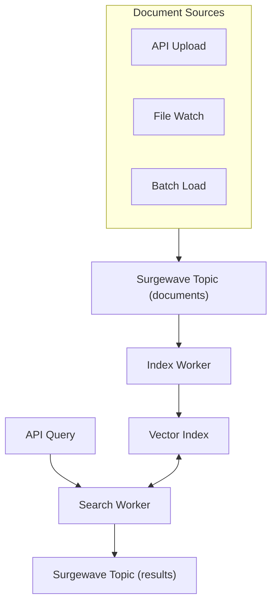

# Unit 22 Project: AI Document Search

Build a complete AI-powered document search application that combines everything learned in this unit into a production-ready system.

## Scenario

You're building a document search system for a company's knowledge base. The system needs to:

1. Index documents from various sources in real-time
2. Generate embeddings for semantic understanding
3. Store vectors for fast similarity search
4. Process search queries and return relevant results
5. Support both semantic and keyword search
6. Track usage metrics and performance

## Requirements

### Functional Requirements

- [ ] Real-time document indexing through Surgewave topics
- [ ] Embedding generation (simulated or via OpenAI/Ollama)
- [ ] Vector storage with metadata support
- [ ] Semantic search with relevance scoring
- [ ] Hybrid search combining semantic and keyword matching
- [ ] Category/metadata filtering
- [ ] Search result snippets with highlighting
- [ ] Query processing pipeline via Surgewave

### Technical Requirements

- [ ] Surgewave-based event-driven architecture
- [ ] Configurable embedding dimensions
- [ ] Thread-safe index operations
- [ ] Performance metrics tracking (latency percentiles)
- [ ] Graceful handling of edge cases (no results, low relevance)
- [ ] Clean separation of concerns

## Architecture



## Expected Output

```
=== AI Document Search Application ===

[Setup] Initializing Surgewave runtime...
[Setup] Surgewave broker started on port 12345
[Setup] Vector dimensions: 1536
[Setup] Embedding mode: Simulated

=== Phase 1: Document Indexing ===
[Index] Processing document stream...
[Index] Indexed: Introduction to Machine Learning (technology) - 2 chunks
[Index] Indexed: Cloud Computing Fundamentals (infrastructure) - 3 chunks
[Index] Indexed: Data Science Best Practices (data) - 2 chunks
[Index] Indexed: Natural Language Processing (technology) - 2 chunks
[Index] Indexed: Kubernetes Guide (infrastructure) - 3 chunks
[Index] Total: 5 documents, 12 chunks indexed

=== Phase 2: Search Demo ===

[Search] Query: "How do machines learn from data?"
[Search] Mode: Semantic
[Search] Results (3 found in 15ms):
  1. [0.9234] Introduction to Machine Learning
     "Machine learning enables computers to learn patterns..."
  2. [0.8456] Data Science Best Practices
     "Data scientists use machine learning algorithms..."
  3. [0.7123] Natural Language Processing
     "NLP models learn from text data..."

[Search] Query: "kubernetes deployment"
[Search] Mode: Hybrid (semantic + keyword)
[Search] Results (2 found in 12ms):
  1. [0.8901] Kubernetes Guide
     "Kubernetes automates container deployment..."
  2. [0.6543] Cloud Computing Fundamentals
     "Cloud platforms support container orchestration..."

[Search] Query: "quantum computing advances"
[Search] Mode: Semantic
[Search] Results (0 found in 8ms):
  No relevant documents found for this query.

=== Phase 3: Performance Report ===
[Metrics] Documents indexed: 5
[Metrics] Total chunks: 12
[Metrics] Search queries: 10
[Metrics] Average latency: 12ms
[Metrics] P50 latency: 10ms
[Metrics] P95 latency: 25ms
[Metrics] P99 latency: 45ms

=== Application Complete ===
```

## Getting Started

```bash
cd bootcamp/unit-22/project/start
dotnet run
```

## Implementation Guide

### Step 1: Set Up Core Types

Define your domain model for documents, chunks, and search.

### Step 2: Implement Document Chunking

Create a chunker that splits documents with overlap.

### Step 3: Build the Vector Index

Implement thread-safe storage and retrieval.

### Step 4: Create Surgewave Pipelines

Set up producers and consumers for document indexing and search.

### Step 5: Implement Hybrid Search

Combine semantic similarity with keyword matching.

### Step 6: Add Metrics Tracking

Record and report performance statistics.

### Step 7: Handle Edge Cases

Implement fallbacks for no results and low relevance.

## Hints

1. Use `SemaphoreSlim` or `lock` for thread safety
2. Chunk documents to 200-300 characters with 10-20% overlap
3. Set a minimum score threshold (0.3-0.5) to filter irrelevant results
4. Use Reciprocal Rank Fusion for hybrid search
5. Track percentile latencies, not just averages

## Evaluation Criteria

| Criteria | Points |
|----------|--------|
| Document indexing pipeline works | 15 |
| Chunking with overlap implemented | 10 |
| Semantic search functional | 20 |
| Hybrid search implemented | 15 |
| Category filtering works | 10 |
| Metrics tracking accurate | 10 |
| Edge cases handled | 10 |
| Code organization and clarity | 10 |

## Bonus Challenges

- Add query result caching with TTL
- Implement search result highlighting
- Add document deletion/update support
- Create a simple HTTP API wrapper
- Add relevance feedback loop

## Solution

Compare your implementation with [completed/](completed/README.md) when done.
