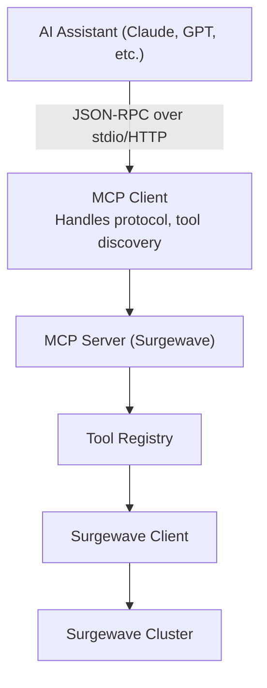

# Unit 19: MCP Server & AI Agents

Master the Model Context Protocol (MCP) and build intelligent AI agents that interact with Surgewave clusters. Learn how to expose Surgewave functionality to AI assistants like Claude and create custom agent frameworks for automated event-driven systems.

## Learning Objectives

By the end of this unit, you will be able to:

- Understand the Model Context Protocol (MCP) architecture and JSON-RPC communication
- Set up and configure Surgewave's MCP Server for AI integration
- Implement custom MCP tools for Surgewave operations (produce, consume, topic management)
- Integrate Surgewave with Claude Desktop and VS Code extensions
- Build custom AI agents using Surgewave's agent framework

## Lessons

| Lesson | Topic | Description |
|--------|-------|-------------|
| [23.1](lesson-1/README.md) | MCP Protocol Basics | JSON-RPC, tools, resources, prompts, transport mechanisms |
| [23.2](lesson-2/README.md) | Surgewave MCP Server Setup | Configure stdio and HTTP/SSE transports, server lifecycle |
| [23.3](lesson-3/README.md) | MCP Tools Implementation | Build tools for produce, consume, topic CRUD, metrics |
| [23.4](lesson-4/README.md) | AI Agent Integration | Connect Claude Desktop and VS Code to Surgewave |
| [23.5](lesson-5/README.md) | Building Custom AI Agents | Create autonomous agents with conversation state via Surgewave |

## Prerequisites

- Completed Unit 1: Surgewave Fundamentals
- Completed Unit 2: Producer & Consumer Basics
- Understanding of JSON and REST APIs
- Familiarity with async programming in C#

## Why MCP and AI Agents Matter

| | Traditional Approach | MCP-Powered Approach |
|---|---|---|
| Operations | Developers write code for each integration | Natural language: "Create a topic for orders" |
| Topic management | Operations team manages manually | AI agents monitor and respond autonomously |
| Monitoring | Requires dedicated dashboards | Conversational: "Why is consumer lag high?" |
| Troubleshooting | Needs deep system knowledge | Automated remediation based on patterns |

## MCP Architecture Overview



## MCP Core Concepts

| Concept | Description |
|---------|-------------|
| Tools | Functions the AI can invoke (e.g., "produce_message", "list_topics") |
| Resources | Data the AI can read (e.g., topic configurations, consumer groups) |
| Prompts | Pre-defined templates for common operations |
| Transport | Communication channel (stdio for local, HTTP/SSE for remote) |

## Example: AI-Powered Surgewave Interaction

```csharp
// User asks: "Send a test message to the orders topic"

// MCP Server receives tool invocation:
{
    "jsonrpc": "2.0",
    "method": "tools/call",
    "params": {
        "name": "surgewave_produce",
        "arguments": {
            "topic": "orders",
            "key": "test-key",
            "value": "{\"orderId\": \"ORD-001\", \"amount\": 99.99}"
        }
    }
}

// Surgewave MCP Server executes:
await producer.ProduceAsync("orders", "test-key", messageValue);

// Returns result to AI:
{
    "jsonrpc": "2.0",
    "result": {
        "content": [{ "type": "text", "text": "Message sent to 'orders' topic at partition 0, offset 42" }]
    }
}
```

## Use Cases for Surgewave + AI Agents

| Use Case | Description |
|----------|-------------|
| Natural Language Ops | "Show me all topics with high consumer lag" |
| Automated Monitoring | Agent consumes alerts topic, takes remediation actions |
| Data Exploration | "What's the schema of messages in the users topic?" |
| Workflow Automation | Agent orchestrates multi-step event-driven processes |
| Intelligent Routing | Agent reads messages, makes routing decisions |

## Best Practices

| Practice | Description |
|----------|-------------|
| Secure your MCP server | Use authentication for HTTP transport |
| Limit tool permissions | Don't expose destructive operations without safeguards |
| Log all tool invocations | Audit trail for AI-initiated actions |
| Rate limit operations | Prevent runaway AI from overwhelming Surgewave |
| Validate inputs | Sanitize all arguments from AI |

---

**Ready?** [Start Lesson 23.1: MCP Protocol Basics](lesson-1/README.md)
