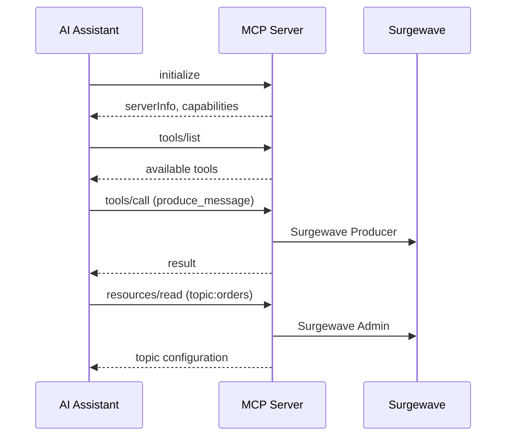

# Lesson 23.1: MCP Protocol Basics

## Overview

Learn the fundamentals of the Model Context Protocol (MCP), the open standard that enables AI assistants to interact with external systems. Understand JSON-RPC communication, the core primitives (tools, resources, prompts), and transport mechanisms.

## Learning Objectives

- Understand the MCP architecture and its role in AI integration
- Learn JSON-RPC 2.0 message format and request/response patterns
- Explore MCP primitives: tools, resources, and prompts
- Understand transport options: stdio vs HTTP/SSE
- Implement a basic MCP server structure

## What is MCP?

The Model Context Protocol (MCP) is an open standard developed by Anthropic that provides a universal interface between AI assistants and external systems. It allows:

- **AI Assistants** to discover and invoke capabilities (tools)
- **External Systems** to expose functionality in a standardized way
- **Bidirectional Communication** via JSON-RPC over various transports



## JSON-RPC 2.0 Fundamentals

MCP uses JSON-RPC 2.0 for all communication:

| Message Type | Key Fields | Description |
|-------------|------------|-------------|
| **Request** (Client → Server) | `jsonrpc`, `id`, `method`, `params` | e.g. `tools/call` with `name` and `arguments` |
| **Response** (Server → Client) | `jsonrpc`, `id`, `result` | Matches request `id`; result contains `content` array |
| **Error Response** | `jsonrpc`, `id`, `error` | `error` has `code`, `message`, and optional `data` |
| **Notification** (no response) | `jsonrpc`, `method` (no `id`) | e.g. `notifications/progress` with `params.progress` |

## MCP Primitives

### Tools

Functions that the AI can invoke to perform actions:

```csharp
// Tool definition
{
    "name": "surgewave_produce",
    "description": "Send a message to a Surgewave topic",
    "inputSchema": {
        "type": "object",
        "properties": {
            "topic": { "type": "string", "description": "Topic name" },
            "key": { "type": "string", "description": "Message key" },
            "value": { "type": "string", "description": "Message value" }
        },
        "required": ["topic", "value"]
    }
}
```

### Resources

Data that the AI can read (similar to REST GET endpoints):

```csharp
// Resource definition
{
    "uri": "surgewave://topics/orders",
    "name": "Orders Topic",
    "description": "Configuration and metadata for the orders topic",
    "mimeType": "application/json"
}
```

### Prompts

Pre-defined templates for common operations:

```csharp
// Prompt definition
{
    "name": "analyze_consumer_lag",
    "description": "Analyze consumer lag for a consumer group",
    "arguments": [
        { "name": "groupId", "description": "Consumer group ID", "required": true }
    ]
}
```

## Transport Mechanisms

| Transport | How | Best For | Pros | Cons |
|-----------|-----|----------|------|------|
| **STDIO** | stdin/stdout between processes | Local development, CLI tools | Simple, no network, no auth needed | Single client, local only |
| **HTTP/SSE** | HTTP POST requests + SSE events | Remote servers, multiple clients | Network accessible, supports auth, scalable | More complex setup, needs security |

## MCP Server Lifecycle

1. Client sends `initialize` with `protocolVersion`, `capabilities`, and `clientInfo`
2. Server responds with its `protocolVersion`, `capabilities` (tools, resources), and `serverInfo`
3. Client sends `notifications/initialized` (no response expected)
4. Server is ready to handle tool calls

## Exercise

In this exercise, you will:

1. Create a basic MCP message parser
2. Implement JSON-RPC request/response handling
3. Define a simple tool schema
4. Handle the MCP initialization handshake
5. Process a mock tool invocation

---

**Instructions:** [INSTRUCTIONS.md](INSTRUCTIONS.md)
