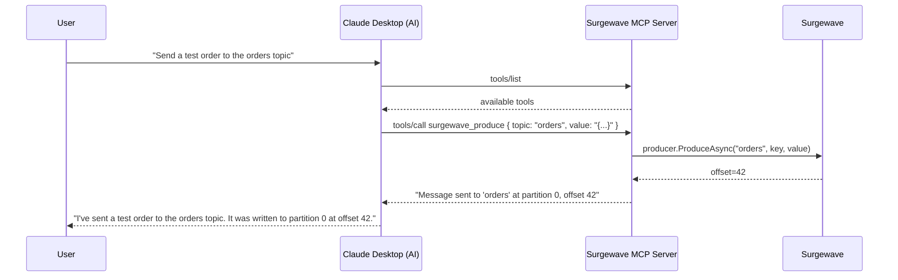

# Lesson 23.4: AI Agent Integration - Claude Desktop

## Overview

Learn how to integrate Surgewave's MCP Server with AI clients like Claude Desktop and VS Code extensions. Configure clients to discover and use Surgewave tools for natural language operations.

## Learning Objectives

- Configure Claude Desktop to connect to Surgewave MCP Server
- Set up VS Code with MCP extensions
- Use natural language to interact with Surgewave
- Handle authentication and security
- Debug MCP connections

## Claude Desktop Integration

```mermaid
graph TD
    App["Claude Desktop App"] -->|reads claude_desktop_config.json| Client["MCP Client\n(built into Claude Desktop)"]
    Client -->|launches subprocess\n(stdio transport)| Server["Surgewave MCP Server\n(your server)"]
    Server --> Cluster["Surgewave Cluster"]
```

## Configuration File Structure

### Claude Desktop (macOS/Windows)

```json
{
    "mcpServers": {
        "surgewave": {
            "command": "dotnet",
            "args": ["run", "--project", "/path/to/SurgewaveMcpServer"],
            "env": {
                "Surgewave_BOOTSTRAP_SERVERS": "localhost:9092"
            }
        }
    }
}
```

Config file locations:
- **macOS**: `~/Library/Application Support/Claude/claude_desktop_config.json`
- **Windows**: `%APPDATA%\Claude\claude_desktop_config.json`

### VS Code Extension

```json
{
    "mcp.servers": {
        "surgewave": {
            "command": "dotnet",
            "args": ["run", "--project", "${workspaceFolder}/tools/SurgewaveMcpServer"]
        }
    }
}
```

## Natural Language Workflow



## Example Conversations

| User Says | Claude Does |
|-----------|-------------|
| "What topics exist?" | Calls surgewave_list_topics |
| "Show me the last 5 orders" | Calls surgewave_consume with count=5 |
| "Create a topic called analytics" | Calls surgewave_create_topic |
| "Is the cluster healthy?" | Calls surgewave_cluster_info |
| "Send a user signup event" | Calls surgewave_produce |

## Security Considerations

| Area | Best Practices |
|------|---------------|
| **Authentication** | Use environment variables for credentials; never hardcode passwords in config files; support SASL/SSL for Surgewave connections |
| **Authorization** | Limit tools exposed to AI (no destructive operations); implement topic allowlists; log all tool invocations for audit |
| **Rate Limiting** | Limit messages per minute to prevent abuse; set max consume count per request; implement circuit breakers for Surgewave operations |

## Debugging MCP Connections

| Issue | Solution |
|-------|----------|
| "MCP server not found" | Check command path in config |
| "Tool not appearing" | Verify tools/list response |
| "Connection timeout" | Check Surgewave bootstrap servers |
| "Permission denied" | Check file permissions on server executable |

## Exercise

In this exercise, you will:

1. Create a complete Surgewave MCP Server application
2. Configure it for Claude Desktop
3. Implement a full set of Surgewave tools
4. Test natural language interactions
5. Add security measures

---

**Instructions:** [INSTRUCTIONS.md](INSTRUCTIONS.md)
