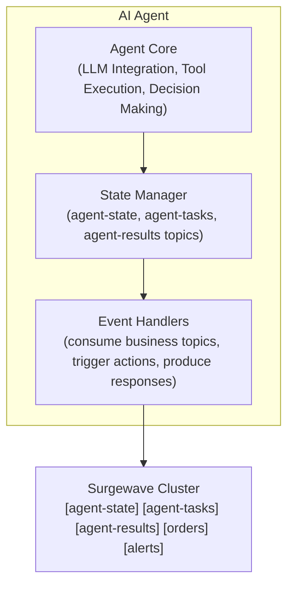
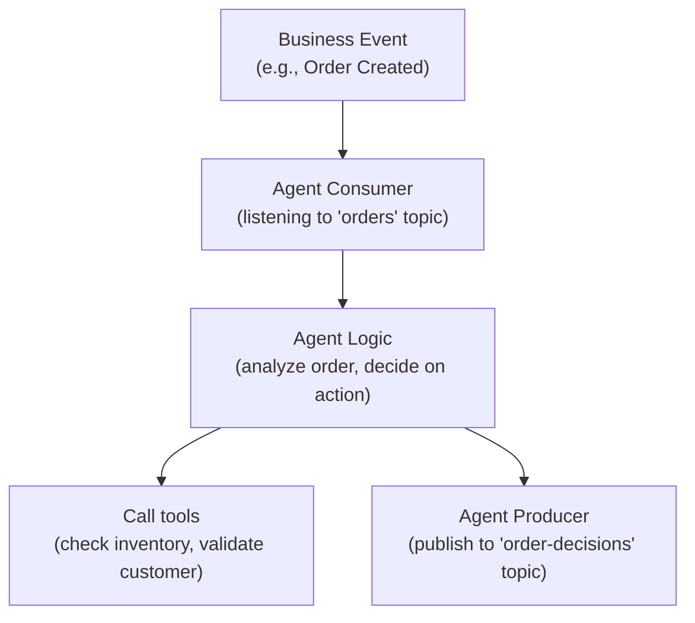
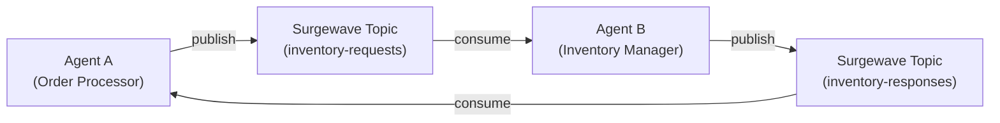

# Lesson 23.5: Building Custom AI Agents

## Overview

Learn how to build autonomous AI agents that use Surgewave for event-driven workflows. Create agents that maintain conversation state, respond to events, and coordinate multi-step tasks using Surgewave topics.

## Learning Objectives

- Design autonomous agent architectures with Surgewave
- Implement conversation state persistence via Surgewave topics
- Build event-driven agent workflows
- Create agents that monitor and respond to Surgewave events
- Implement agent coordination patterns

## AI Agent Architecture



## Agent Patterns

### Pattern 1: Conversation State via Surgewave

```mermaid
graph LR
    UserMsg["User Message"] --> Agent["Agent"]
    Agent <-->|save/load history\nKey: session-123\nValue: {history}| StateTopic["Agent State Topic"]
    Agent -->|with context from history| Response["Response to User"]
```

### Pattern 2: Event-Driven Agent



### Pattern 3: Multi-Agent Coordination



## Agent State Management

| State Type | Surgewave Topic | Key Strategy | Value |
|------------|-------------|--------------|-------|
| Conversation | agent-conversations | session-id | Message history JSON |
| Tasks | agent-tasks | task-id | Task definition and status |
| Results | agent-results | task-id | Execution results |
| Memory | agent-memory | entity-id | Long-term knowledge |

## Exercise

In this exercise, you will:

1. Build an autonomous order processing agent
2. Implement conversation state via Surgewave topics
3. Create event handlers for incoming orders
4. Add decision-making logic
5. Coordinate with other services via Surgewave

---

**Instructions:** [INSTRUCTIONS.md](INSTRUCTIONS.md)
