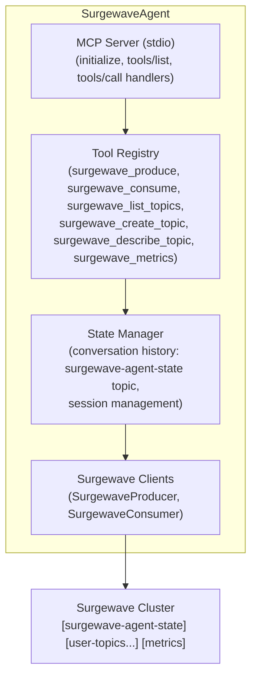

# Unit 23 Project: Surgewave Agent

Build a complete AI agent that connects to Surgewave via MCP, manages topics, produces/consumes messages, maintains conversation state, and provides cluster health insights.

## Scenario

You're building an intelligent Surgewave operations assistant that can:

1. Connect to a Surgewave cluster via MCP protocol
2. Manage topics (list, create, describe, delete)
3. Produce and consume messages with natural language commands
4. Maintain conversation context across sessions via Surgewave topics
5. Monitor cluster health and provide insights
6. Answer questions about Surgewave operations

## Requirements

### Functional Requirements

- [ ] Implement a complete MCP server with stdio transport
- [ ] Register tools for all Surgewave operations (produce, consume, topics, metrics)
- [ ] Persist conversation history to a `surgewave-agent-state` topic
- [ ] Implement cluster health monitoring with metrics
- [ ] Handle natural language commands gracefully
- [ ] Provide helpful error messages and suggestions

### Technical Requirements

- [ ] Support both interactive mode and MCP server mode
- [ ] Implement rate limiting (max 100 requests/minute)
- [ ] Add request logging for debugging
- [ ] Handle graceful shutdown with state persistence
- [ ] Support environment variable configuration

## Architecture



## Tool Specifications

### surgewave_produce
```json
{
    "name": "surgewave_produce",
    "description": "Send a message to a Surgewave topic",
    "inputSchema": {
        "type": "object",
        "properties": {
            "topic": { "type": "string" },
            "key": { "type": "string" },
            "value": { "type": "string" },
            "headers": { "type": "object" }
        },
        "required": ["topic", "value"]
    }
}
```

### surgewave_consume
```json
{
    "name": "surgewave_consume",
    "description": "Read messages from a Surgewave topic",
    "inputSchema": {
        "type": "object",
        "properties": {
            "topic": { "type": "string" },
            "count": { "type": "integer", "default": 1 },
            "timeout_ms": { "type": "integer", "default": 5000 },
            "from_beginning": { "type": "boolean", "default": false }
        },
        "required": ["topic"]
    }
}
```

### surgewave_list_topics
```json
{
    "name": "surgewave_list_topics",
    "description": "List all topics in the cluster",
    "inputSchema": {
        "type": "object",
        "properties": {
            "pattern": { "type": "string" }
        }
    }
}
```

### surgewave_cluster_health
```json
{
    "name": "surgewave_cluster_health",
    "description": "Get cluster health and metrics",
    "inputSchema": {
        "type": "object",
        "properties": {}
    }
}
```

## Expected Output

### Interactive Mode

```
=== Surgewave Agent ===

Surgewave cluster connected: localhost:9092
Agent ready. Type 'help' for commands.

> What topics exist?
[Calling surgewave_list_topics]
I found 5 topics in the cluster:
  - orders (3 partitions)
  - users (1 partition)
  - events (6 partitions)
  - surgewave-agent-state (1 partition)
  - notifications (2 partitions)

> Send a test order
[Calling surgewave_produce]
Done! I sent a test order to the 'orders' topic:
  - Key: auto-generated
  - Partition: 0
  - Offset: 42

> Is the cluster healthy?
[Calling surgewave_cluster_health]
The cluster looks healthy:
  - Brokers: 1 online
  - Topics: 5
  - Total partitions: 13
  - Consumer lag: minimal
  - Uptime: 2h 15m

> quit
Saving conversation state...
Goodbye!
```

### MCP Server Mode

```
$ dotnet run -- --mcp
(Running as MCP server, listening on stdio...)
```

## Configuration

### Environment Variables

| Variable | Description | Default |
|----------|-------------|---------|
| Surgewave_BOOTSTRAP_SERVERS | Surgewave cluster address | localhost:9092 |
| Surgewave_AGENT_ID | Unique agent identifier | surgewave-agent-{random} |
| Surgewave_LOG_LEVEL | Logging verbosity | info |
| Surgewave_RATE_LIMIT | Requests per minute | 100 |

### Claude Desktop Configuration

```json
{
    "mcpServers": {
        "surgewave-agent": {
            "command": "dotnet",
            "args": ["run", "--project", "/path/to/project/completed", "--", "--mcp"],
            "env": {
                "Surgewave_BOOTSTRAP_SERVERS": "localhost:9092"
            }
        }
    }
}
```

## Getting Started

```bash
cd bootcamp/unit-23/project/start
dotnet run
```

## Hints

1. Use the lessons from this unit as building blocks
2. Start with the MCP server skeleton from Lesson 4
3. Add state management from Lesson 5
4. Implement tools one by one, testing each
5. Add the interactive shell last

## Evaluation Criteria

| Criteria | Points |
|----------|--------|
| MCP protocol implementation (init, tools/list, tools/call) | 20 |
| All Surgewave tools working correctly | 25 |
| State persistence via Surgewave topic | 15 |
| Rate limiting and error handling | 15 |
| Interactive mode with help | 10 |
| Code quality and organization | 15 |

## Solution

Compare your implementation with [completed/](completed/README.md) when done.
