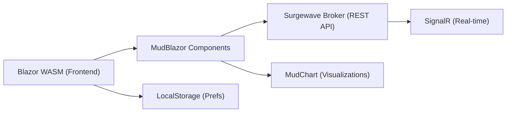

# Unit 2: Surgewave Control UI Mastery

Master the Surgewave Control UI, a Blazor MudBlazor dashboard at `localhost:5050`, to configure, monitor, and manage your entire Surgewave cluster through a rich graphical interface.

## Learning Objectives

By the end of this unit, you will be able to:

- Navigate the Surgewave Control dashboard and customize widget layouts
- Manage topics, messages, and consumer groups through the UI
- Build and monitor pipelines with visual editors and chat integration
- Configure alerting rules and notification channels
- Manage security policies, ACLs, and RBAC roles through the governance UI
- Create topics using natural language with Intent-Based Configuration

## Lessons

| Lesson | Topic | Description |
|--------|-------|-------------|
| [2.1](lesson-1/README.md) | Dashboard & Navigation | Home dashboard widgets, layout customization, theme toggle |
| [2.2](lesson-2/README.md) | Topic & Message Management | Topic CRUD, message browser, producer, bulk operations |
| [2.3](lesson-3/README.md) | Consumer Groups & Lag Monitoring | Group state, member assignment, lag charts, offset reset |
| [2.4](lesson-4/README.md) | Pipeline Management | Pipeline editor, chat integration, templates, versioning |
| [2.5](lesson-5/README.md) | Monitoring & Alerting | Metrics dashboards, alert rules, performance advisor |
| [2.6](lesson-6/README.md) | Security & Governance | ACLs, RBAC, quotas, data catalog, schema registry |
| [2.7](lesson-7/README.md) | Intent-Based Configuration | Natural language to broker config, 16 built-in rules, Intent Topic Creator |

## Prerequisites

- Completed Unit 1: Surgewave Fundamentals
- Completed Unit 1 & Unit 3: Fundamentals & Testing
- Completed Unit 16: Visual Pipeline UI (recommended for Lesson 2.4)
- Surgewave Broker running with Control UI enabled on port 5050

## Starting the Control UI

```bash
# Start the broker
dotnet run --project src/Kuestenlogik.Surgewave.Broker

# Start the Control UI on port 5050
dotnet run --project src/Kuestenlogik.Surgewave.Control --urls "http://localhost:5050"
```

## Dashboard Architecture



## Navigation Structure

| Section | Pages |
|---------|-------|
| Cluster | Dashboard (Home), Brokers, Cluster Info |
| Data | Topics, Messages, Consumer Groups |
| Integration | Connectors, Pipelines, Pipeline Chat |
| Governance | Schema Registry, Data Catalog, Dead Letter Queues |
| Security | ACLs, Roles (RBAC), Quotas |
| Monitoring | Metrics, Alerts, Performance Advisor, Audit Log |

---

## Lesson 2.1: Dashboard & Navigation

The home dashboard is the central hub of the Surgewave Control UI. It displays 14 configurable widgets that provide a real-time overview of your cluster health, performance, and activity.

### Dashboard Widgets

| Widget | Description |
|--------|-------------|
| Cluster Status | Overall health indicator (Healthy, Degraded, Critical) |
| Throughput | Messages per second across all topics |
| Latency P50 | Median end-to-end latency |
| Latency P90 | 90th percentile latency |
| Latency P99 | 99th percentile latency |
| Brokers | Active broker count and status |
| Topics | Total topic count |
| Consumer Groups | Active consumer group count |
| Partitions | Total partition count across topics |
| Errors | Recent error count with severity |
| Pipelines | Active pipeline count and status |
| Connectors | Running connector count and health |
| Cluster Info | Broker version, uptime, cluster ID |
| Topics Table | Sortable table of topics with message rates |
| Consumer Groups Table | Table of consumer groups with lag indicators |
| Recent Pipelines | Recently modified pipelines with quick actions |

### Widget Visibility Toggle

The settings menu (gear icon in the top-right) lets you show or hide individual widgets:

| Widget | Default | Widget | Default |
|--------|---------|--------|---------|
| Cluster Status | On | Throughput | On |
| Latency P50 | On | Latency P90 | On |
| Latency P99 | On | Brokers | On |
| Topics | On | Consumer Groups | On |
| Partitions | On | Errors | Off |
| Pipelines | On | Connectors | On |
| Cluster Info | Off | Topics Table | On |
| Consumer Groups Table | On | Recent Pipelines | On |

### Drag-and-Drop Widget Reordering

Widgets can be reordered by dragging them to new positions. The layout is persisted in the browser's LocalStorage, so your custom arrangement is remembered across sessions and browser restarts.

```csharp
// Layout persistence model
public record DashboardLayout
{
    public List<WidgetPosition> Widgets { get; init; } = [];
    public Dictionary<string, bool> WidgetVisibility { get; init; } = new();
    public string Theme { get; init; } = "system";
}

// Saved to LocalStorage under key "surgewave-dashboard-layout"
await LocalStorage.SetItemAsync("surgewave-dashboard-layout", layout);
```

### Theme Toggle

The Control UI supports Dark and Light themes with automatic system preference detection:

| Mode | Description |
|------|-------------|
| Light | White background, dark text, MudBlazor default palette |
| Dark | Dark background, light text, reduced eye strain |
| System | Follows OS-level dark/light preference via `prefers-color-scheme` |

Theme selection is persisted in LocalStorage alongside the dashboard layout.

---

### SQL Query Page

The Control UI includes a dedicated **SQL Query** page accessible from the Data section of the navigation. This page is powered by Surgewave's built-in SQL engine (not regex-based pattern matching), allowing you to run standard SQL queries against topic data:

```sql
SELECT key, value->>'customerId' AS customer, CAST(value->>'total' AS DECIMAL) AS total
FROM orders
WHERE CAST(value->>'total' AS DECIMAL) > 100
ORDER BY total DESC
LIMIT 50
```

The SQL engine supports `SELECT`, `WHERE`, `ORDER BY`, `GROUP BY`, `HAVING`, aggregate functions (`COUNT`, `SUM`, `AVG`, `MIN`, `MAX`), and JSON field extraction. Query results are displayed in a sortable, paginated table with CSV export.

### Continuous Queries

Beyond one-off queries, the SQL Query page lets you create **continuous queries** -- standing queries that run automatically as new messages arrive. Continuous queries are managed from a dedicated tab where you can create, pause, resume, and delete them. Each continuous query produces results into a destination topic, making it easy to build derived views or trigger alerts based on SQL conditions.

---

## Lesson 2.2: Topic & Message Management

The Topics section provides full CRUD operations for Surgewave topics along with a powerful message browser and producer.

### Topic List

The Topics list shows all topics with key metrics:

| Name | Partitions | Replication | Messages/s | Size |
|------|------------|-------------|------------|------|
| orders | 12 | 3 | 1,250 | 2.3 GB |
| user-events | 6 | 3 | 890 | 1.1 GB |
| notifications | 3 | 2 | 120 | 450 MB |
| analytics-raw | 24 | 3 | 5,600 | 12.8 GB |

Bulk actions available: **Delete Selected**, **Export Config**.

### Topic Detail View

Clicking a topic opens its detail page with three tabs:

- **Partitions**: Partition leader/replica assignments, ISR status, log sizes
- **Configuration**: All topic-level configs (retention, segment size, compression, etc.)
- **Messages**: Integrated message browser

### Message Browser

The message browser lets you consume messages from specific partitions and offsets. Filters: **Partition** (All or specific), **Offset** (Latest/Earliest/Custom), **Limit**.

| Offset | Partition | Key | Timestamp | Size |
|--------|-----------|-----|-----------|------|
| 10542 | 3 | order-9981 | 2026-03-14 09:12:03 | 284 B |
| 10541 | 7 | order-9980 | 2026-03-14 09:12:02 | 312 B |
| 10540 | 1 | order-9979 | 2026-03-14 09:12:01 | 298 B |

Clicking a row expands the **Message Detail** panel showing Key, Headers, and the full JSON Value.

### Message Producer

The built-in producer supports JSON and plain text messages with optional headers and partition selection. Fields:

| Field | Description |
|-------|-------------|
| Format | JSON or plain text |
| Partition | Auto or specific partition number |
| Key | Message key (e.g., `order-9982`) |
| Headers | Key-value pairs added as Kafka headers |
| Value | Message payload (JSON editor for JSON format) |

Actions: **Produce** (send once) or **Produce & Continue** (send and stay on the form).

### Bulk Operations

Select multiple topics using checkboxes to perform bulk actions:

- **Delete**: Remove multiple topics at once (with confirmation dialog)
- **Config Changes**: Apply configuration changes across selected topics (e.g., set retention policy)
- **Export**: Export topic configurations as JSON for backup or migration

---

## Lesson 2.3: Consumer Groups & Lag Monitoring

The Consumer Groups section provides visibility into consumer behavior, offset positions, and lag across all partitions.

### Consumer Group List

| Group ID | State | Members | Topics | Total Lag |
|----------|-------|---------|--------|-----------|
| order-processor | Stable | 3 | 2 | 12 |
| analytics-etl | Stable | 6 | 4 | 0 |
| notification-svc | Rebalancing | 2 | 1 | 1,542 |
| audit-logger | Empty | 0 | 1 | 89,204 |

### State Indicators

| State | Color | Description |
|-------|-------|-------------|
| Stable | Green | All members assigned, consuming normally |
| Rebalancing | Yellow | Partition reassignment in progress |
| PreparingRebalance | Orange | Rebalance triggered, waiting for members |
| Empty | Gray | No active members |
| Dead | Red | Group has been removed or expired |

### Consumer Group Detail

Clicking a group shows member assignments and per-partition offset positions.

**Member Assignments** (Consumer Group: order-processor — State: Stable, Protocol: range):

| Member ID | Host | Partitions |
|-----------|------|------------|
| member-1-abc | 10.0.1.10 | orders[0,1,2,3] |
| member-2-def | 10.0.1.11 | orders[4,5,6,7] |
| member-3-ghi | 10.0.1.12 | orders[8,9,10,11] |

**Offset Positions:**

| Topic | Partition | Current | End | Lag |
|-------|-----------|---------|-----|-----|
| orders | 0 | 10,530 | 10,542 | 12 |
| orders | 1 | 8,901 | 8,901 | 0 |
| orders | 2 | 7,220 | 7,220 | 0 |

### Consumer Lag Dashboard

The lag dashboard uses MudChart bar and line charts to visualize consumer lag over time. Charts shown:

- **Lag by Partition (Bar Chart)** — shows current lag per partition (P0–P11); in this example P0 has lag=12, all others are 0.
- **Lag Over Time (Line Chart)** — shows total lag over a rolling time window, revealing spikes and recovery patterns.

### Offset Reset

Reset consumer group offsets when you need to reprocess messages or skip ahead:

| Reset Strategy | Description |
|----------------|-------------|
| Earliest | Reset to beginning of topic |
| Latest | Reset to end of topic (skip all existing) |
| To Offset | Reset to a specific offset number |
| To Timestamp | Reset to the offset at a given timestamp |
| Shift By | Move offset forward or backward by N |

The UI requires the consumer group to be in `Empty` state (no active members) before allowing offset resets.

### Real-Time Lag Monitoring

Enable auto-refresh to monitor lag in real-time. The dashboard polls the broker at configurable intervals (default: 5 seconds) and updates the charts dynamically.

---

## Lesson 2.4: Pipeline Management

The Pipeline section integrates with the Visual Pipeline editor (covered in depth in Unit 16) and adds management features including chat integration, templates, and versioning.

### Pipeline List

| Name | Status | Nodes | Throughput | Last Modified |
|------|--------|-------|------------|---------------|
| order-enrichment | Running | 5 | 1,200/s | 2 hours ago |
| user-analytics | Running | 8 | 3,400/s | 1 day ago |
| doc-indexer | Stopped | 4 | 0/s | 3 days ago |
| rag-chatbot | Running | 6 | 45/s | 5 min ago |

### Chat Integration

When the broker detects a `ChatEndpoint` on a pipeline, a chat icon appears next to the pipeline. Surgewave provides two ways to interact with chat-enabled pipelines:

**Chat Drawer**: A slide-out panel accessible from the pipeline list or detail page. The left pane shows the Visual DAG Editor and the right pane shows the chat interface. The chat allows real-time Q&A against the pipeline's indexed documents.

**Dedicated Chat Page**: A full-page chat experience navigable from the Integration menu. Select a chat-enabled pipeline from the dropdown, then converse with the AI through a message history panel and text input field.

### Pipeline Templates

The Control UI ships with pre-built pipeline templates to accelerate common use cases:

| Template | Nodes | Description |
|----------|-------|-------------|
| RAG Chatbot | 6 | Source, Chunker, Embedding, VectorStore, Retriever, Chat |
| Document Indexer | 4 | Source, Parser, Embedding, VectorStore |
| Agent with Tools | 5 | Source, Agent, ToolExecutor, Memory, Chat |

Templates are available from the "Create New" pipeline dialog and can be customized after creation.

### AI Pipeline Seeder

For testing and development, the AI Pipeline Seeder can generate sample pipelines with mock data:

```csharp
// Seed a test pipeline via the API
POST /api/pipelines/seed
{
    "template": "rag-chatbot",
    "topicPrefix": "test-",
    "generateSampleData": true
}
```

### Pipeline Versioning

Every pipeline change creates a new version. The UI provides:

- **Version History**: List of all versions with timestamps and change summaries
- **Diff View**: Side-by-side comparison of any two versions showing added/removed/changed nodes
- **Restore**: Roll back to any previous version with a single click

---

## Lesson 2.5: Monitoring & Alerting

The Monitoring section provides real-time metrics dashboards, configurable alert rules, and a performance advisor.

### Metrics Dashboard

The Cluster Metrics dashboard auto-refreshes at a configurable interval (default: 5 seconds) and shows:

| Metric | Example Value |
|--------|---------------|
| Throughput | Line chart (Messages/s), range 0–12K |
| Latency P99 | 12ms |
| Latency P90 | 5ms |
| Latency P50 | 2ms |
| Active Producers | 24 |
| Active Consumers | 48 |
| Total Connections | 72 |

### Alert Rules

Surgewave supports 7 built-in alert rule types:

| Alert Type | Trigger | Example |
|------------|---------|---------|
| Consumer Lag | Lag exceeds threshold | Lag > 10,000 for 5 minutes |
| Throughput Drop | Messages/s drops below minimum | Throughput < 100/s |
| Latency Spike | P99 latency exceeds threshold | P99 > 500ms |
| Broker Down | Broker becomes unreachable | Broker-2 offline |
| Disk Usage | Storage exceeds percentage | Disk > 85% |
| Error Rate | Errors per minute exceed threshold | Errors > 50/min |
| Pipeline Failure | Pipeline enters error state | Pipeline stopped unexpectedly |

### Notification Channels

Configure where alerts are delivered:

| Channel | Configuration |
|---------|---------------|
| Email | SMTP server, recipients |
| Slack | Webhook URL, channel |
| Webhook | Custom HTTP endpoint |
| PagerDuty | Integration key |

### Performance Advisor

The performance advisor analyzes cluster behavior and provides actionable recommendations. Example findings:

| Severity | Finding | Recommendation |
|----------|---------|----------------|
| High | Partition imbalance on topic "orders" — Partition 3 handles 40% of traffic | Use a custom partitioner or increase partition count |
| Medium | Consumer group "analytics-etl" over-provisioned — 6 members for 4 partitions | Reduce to 4 members to save resources |
| Low | Topic "logs" retention could be reduced — Current: 7 days (18 GB), 95% of reads within 24h | Reduce retention to 2 days |

### Connector Health Dashboard

Monitor connector status with auto-restart capabilities:

| Column | Description |
|--------|-------------|
| Name | Connector instance name |
| Type | Source or Sink |
| State | Running, Paused, Failed, Restarting |
| Tasks | Active/Total task count |
| Throughput | Records per second |
| Errors | Recent error count |
| Auto-Restart | Enable/disable automatic restart on failure |

### Audit Log Viewer

All administrative actions are recorded in the audit log. Filterable by action type, user, and date range:

| Timestamp | User | Action | Resource |
|-----------|------|--------|----------|
| 2026-03-14 09:15:02 | admin | topic.create | orders-v2 |
| 2026-03-14 09:12:44 | admin | acl.update | orders (READ) |
| 2026-03-14 09:10:11 | ops-bot | pipeline.restart | order-enrichment |
| 2026-03-14 09:05:30 | admin | group.reset | analytics-etl |

---

## Lesson 2.6: Security & Governance

The Security and Governance sections provide UI-driven management for access control, quotas, schemas, and data governance.

### ACL Management

Create and manage Access Control Lists through the UI:

| Principal | Resource | Name | Operation | Permission |
|-----------|----------|------|-----------|------------|
| User:alice | Topic | orders | Read | Allow |
| User:alice | Topic | orders | Write | Allow |
| User:bob | Topic | * | Read | Allow |
| Group:devs | Topic | dev-* | All | Allow |
| User:* | Cluster | * | Describe | Allow |

### Role Management (RBAC)

Define roles with fine-grained permissions and assign them to users or groups:

| Built-in Role | Permissions |
|---------------|-------------|
| Admin | Full access to all resources |
| Operator | Manage topics, groups, connectors; read-only security |
| Developer | Read/write topics, manage own consumer groups |
| Viewer | Read-only access to all resources |
| Pipeline-Manager | Full pipeline CRUD, read topics |

Custom roles can be created by combining individual permissions.

### Quota Management

Set resource quotas to prevent any single user or client from monopolizing cluster resources:

| Quota Type | Description | Example |
|------------|-------------|---------|
| Producer Byte Rate | Max bytes/sec a producer can send | 10 MB/s per client |
| Consumer Byte Rate | Max bytes/sec a consumer can fetch | 20 MB/s per client |
| Request Rate | Max requests/sec per connection | 100 req/s |
| Connection Count | Max simultaneous connections | 50 per user |

### Data Catalog

The data catalog provides a searchable registry of all topics with metadata:

- **Topic descriptions**: Human-readable purpose and ownership
- **Schema association**: Link topics to schema registry entries
- **Data classification**: Tag topics with sensitivity levels (Public, Internal, Confidential, Restricted)
- **Lineage**: Visualize how data flows between topics through pipelines and connectors
- **Ownership**: Assign team/individual owners for accountability

### Dead Letter Queue Management

Manage DLQs for messages that fail processing:

| DLQ Topic | Messages | Oldest | Source Topic |
|-----------|----------|--------|--------------|
| orders.dlq | 42 | 2 hours ago | orders |
| analytics-raw.dlq | 1,203 | 3 days ago | analytics-raw |

Actions per DLQ: **Inspect**, **Replay Selected**, **Replay All**, **Purge**.

- **Inspect**: View individual failed messages with error details
- **Replay**: Re-send messages to the original topic for reprocessing
- **Purge**: Delete all messages from the DLQ after investigation

### Schema Registry Browser

Browse, compare, and manage schemas with a visual interface:

| Subject | Type | Version | Compatibility |
|---------|------|---------|---------------|
| orders-value | Avro | 3 | BACKWARD |
| user-events-value | JSON | 5 | FULL |
| metrics-value | Protobuf | 2 | FORWARD |

**Diff Viewer**: Compare any two schema versions side-by-side with added/removed/changed fields highlighted.

**Reference Graph**: Visualize schema dependencies showing which schemas reference or are referenced by others.

---

## Exercises

### Exercise 1: Configure a Custom Dashboard Layout

1. Open the Surgewave Control UI at `http://localhost:5050`
2. Open the settings menu and hide the "Cluster Info" and "Errors" widgets
3. Rearrange the remaining widgets: place throughput and latency widgets at the top
4. Switch to Dark theme
5. Close and reopen the browser -- verify your layout persists

### Exercise 2: Set Up Alert Rules for Consumer Lag

1. Navigate to Monitoring > Alerts
2. Create a new alert rule:
   - Type: Consumer Lag
   - Consumer Group: `order-processor`
   - Threshold: Lag > 1,000
   - Duration: 2 minutes
   - Notification: Webhook to `http://localhost:9999/alerts`
3. Produce messages faster than the consumer can process them
4. Verify the alert fires and the webhook receives the notification

### Exercise 3: Create and Test a Pipeline with Chat Integration

1. Navigate to Integration > Pipelines
2. Click "Create New" and select the "RAG Chatbot" template
3. Configure the source node to read from a `documents` topic
4. Start the pipeline
5. Produce sample documents to the `documents` topic
6. Open the chat drawer and ask questions about the ingested documents
7. Verify the chat responses reference the correct source documents

### Exercise 4: Configure RBAC Roles for Team Access

1. Navigate to Security > Roles
2. Create a custom role `data-engineer`:
   - Allow: Read/Write on topics matching `etl-*`
   - Allow: Manage consumer groups matching `etl-*`
   - Allow: Read-only on all pipeline definitions
   - Deny: Security and cluster management
3. Create a custom role `analyst`:
   - Allow: Read-only on topics matching `analytics-*`
   - Allow: Read-only on schema registry
   - Deny: All write operations
4. Assign the roles to test users and verify access is enforced

## Best Practices

| Practice | Description |
|----------|-------------|
| Customize your dashboard | Hide widgets you do not need to reduce noise |
| Set up alerts early | Configure lag and error alerts before issues occur |
| Use RBAC in production | Never run production clusters with open access |
| Review audit logs | Regularly check audit logs for unexpected changes |
| Use DLQ replay | Always inspect failed messages before replaying or purging |
| Version your pipelines | Use the diff view before restoring old versions |

---

**Ready?** [Start Lesson 2.1: Dashboard & Navigation](lesson-1/README.md)
