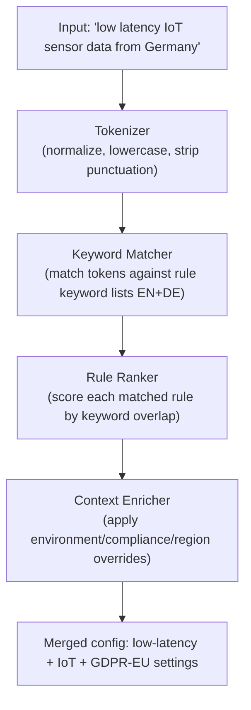

# Lesson 2.7: Intent-Based Configuration

> **Difficulty:** Beginner–Intermediate | **Duration:** 30 min | **Prerequisites:** Lesson 2.6

## Overview

Learn how Surgewave's Intent-Based Configuration feature lets you describe *what you want* in plain language — English or German — and have the broker translate that intent into concrete broker configuration. No need to remember exact setting names or look up documentation; just describe your goal and Surgewave does the rest.

## Learning Objectives

- Understand the intent-to-config translation model
- Use the Intent Topic Creator in the Control UI
- Call the Intent REST API to resolve and preview configurations
- Browse the 16 built-in intent rules and their coverage
- Add quick-intent chips for common scenarios
- Understand context fields (environment, compliance, region)
- Safely apply generated configurations to running topics

## What Is Intent-Based Configuration?

Traditional broker configuration requires knowing dozens of setting names, their valid ranges, and their interactions. Intent-Based Configuration lets you skip that:

| | Traditional | Intent-Based |
|-|-------------|--------------|
| **User action** | Must know exact setting names and values: `retention.ms = 604800000`, `min.insync.replicas = 2`, `replication.factor = 3`, `acks = all`, `enable.idempotence = true` | Types: `"I need high availability for financial transactions"` |
| **Result** | Manually entered config | Surgewave generates the same settings automatically |

## IntentConfigEngine

The `IntentConfigEngine` is the core component. It takes a natural language string and a context object, runs it through keyword matching against 16 built-in rules, and returns a ranked list of matching configurations with explanations:



### Keyword Matching (EN + DE)

Each rule carries an English and German keyword list. This lets German-speaking operators describe their intent in their native language:

| Intent | English Keywords | German Keywords |
|--------|-----------------|-----------------|
| High availability | `high availability, ha, resilient, fault tolerant, durable` | `hochverfügbar, ausfallsicher, redundanz` |
| Low latency | `low latency, fast, real-time, realtime, sub-millisecond` | `niedrige latenz, echtzeit, schnell` |
| GDPR / compliance | `gdpr, compliance, europe, eu, privacy, data protection` | `datenschutz, dsgvo, europa` |
| IoT | `iot, sensor, device, telemetry, edge` | `gerät, sensor, telemetrie` |
| Financial | `financial, trading, payment, transaction, fintech` | `finanz, zahlung, transaktion, handel` |

## The 16 Built-in Rules

| # | Rule Name | Applies | Key Settings Generated |
|---|-----------|---------|----------------------|
| 1 | `high-availability` | 3+ broker cluster | `min.insync.replicas=2`, `replication.factor=3`, `acks=all` |
| 2 | `low-latency` | Any | `linger.ms=0`, `compression.type=none`, `batch.size=1` |
| 3 | `high-throughput` | Any | `linger.ms=20`, `compression.type=lz4`, `batch.size=65536` |
| 4 | `gdpr-eu` | EU workloads | `retention.ms=2592000000` (30 days), `cleanup.policy=delete`, `encryption=aes256` |
| 5 | `iot-sensors` | IoT / telemetry | `retention.ms=86400000` (24 h), `compression.type=snappy`, `max.message.bytes=4096` |
| 6 | `financial-transactions` | Finance / trading | `acks=all`, `enable.idempotence=true`, `retention.ms=31536000000` (1 year) |
| 7 | `log-aggregation` | Logging pipelines | `cleanup.policy=delete`, `retention.ms=604800000` (7 days), `compression.type=gzip` |
| 8 | `event-sourcing` | Event store | `cleanup.policy=compact`, `min.cleanable.dirty.ratio=0.1` |
| 9 | `analytics` | OLAP / reporting | `retention.ms=-1` (infinite), `compression.type=lz4`, `segment.bytes=536870912` |
| 10 | `change-data-capture` | CDC pipelines | `cleanup.policy=compact,delete`, `delete.retention.ms=86400000` |
| 11 | `multi-tenant` | SaaS platforms | `quota.producer.byte.rate=10485760`, `quota.consumer.byte.rate=20971520` |
| 12 | `development` | Dev / test | `replication.factor=1`, `retention.ms=3600000` (1 h), `min.insync.replicas=1` |
| 13 | `ml-training` | ML feature stores | `retention.ms=-1`, `compression.type=lz4`, `max.message.bytes=10485760` |
| 14 | `video-streaming` | Media pipelines | `max.message.bytes=10485760`, `compression.type=none`, `linger.ms=5` |
| 15 | `audit-log` | Compliance / audit | `retention.ms=94608000000` (3 years), `cleanup.policy=delete`, `acks=all` |
| 16 | `edge-computing` | Edge / disconnected | `retention.ms=3600000`, `compression.type=snappy`, `max.message.bytes=65536` |

Rules are additive: if your intent matches both `high-availability` and `financial-transactions`, the settings from both rules are merged (with conflict resolution favouring the more restrictive value).

## Control UI: Intent Topic Creator

Navigate to **Topics > New Topic > Use Intent** in the Control UI (port 5050) to open the Intent Topic Creator:

The Intent Topic Creator form:

1. **Intent text box:** "I need a topic for high availability financial payment data in Germany with GDPR compliance"
2. **Quick-intent chips:** High Availability, Low Latency, IoT, GDPR, Financial, Log Aggregation, Event Sourcing, Analytics, Development
3. **Context fields:** Environment (Production), Region (eu-west-1), Compliance (GDPR)
4. Click **Resolve Intent** → matched rules appear: `high-availability`, `financial-transactions`, `gdpr-eu`
5. **Generated Configuration Preview:** `acks=all`, `min.insync.replicas=2`, `replication.factor=3`, `enable.idempotence=true`, `retention.ms=31536000000`, `encryption=aes256`, `cleanup.policy=delete`
6. Set Topic name and Partitions, then click **Create Topic**

### Quick-Intent Chips

Clicking a chip appends the corresponding keyword phrase to the intent text box. You can combine multiple chips:

| Chip | Appended Text |
|------|--------------|
| High Availability | `high availability` |
| Low Latency | `low latency real-time` |
| IoT | `iot sensor telemetry` |
| GDPR | `gdpr eu data protection compliance` |
| Financial | `financial transactions payment` |
| Development | `development test` |

### Context Fields

Context fields allow the engine to apply environment-specific overrides on top of the keyword-matched rules:

| Field | Effect |
|-------|--------|
| `Environment: Production` | Enforces `replication.factor >= 3`, `acks=all` |
| `Environment: Development` | Relaxes to `replication.factor=1`, shorter retention |
| `Region: eu-*` | Implies GDPR applicability, adds data-residency metadata |
| `Compliance: GDPR` | Adds GDPR rule regardless of text description |
| `Compliance: SOC2` | Enables audit-log rule + 1-year minimum retention |

## REST API Reference

| Method | Endpoint | Description |
|--------|----------|-------------|
| `POST` | `/api/intent/resolve` | Resolve an intent string to configuration |
| `POST` | `/api/intent/create` | Resolve + immediately create a topic |
| `GET` | `/api/intent/keywords` | List all keyword lists per rule (EN + DE) |
| `GET` | `/api/intent/rules` | List all 16 built-in rules with descriptions |

### Resolve an Intent

```bash
curl -X POST http://localhost:9092/api/intent/resolve \
     -H "Content-Type: application/json" \
     -d '{
           "intent": "low latency real-time IoT sensor data",
           "context": {
             "environment": "Production",
             "region": "us-east-1"
           }
         }'
```

```json
{
  "matchedRules": ["low-latency", "iot-sensors"],
  "config": {
    "linger.ms": "0",
    "compression.type": "snappy",
    "max.message.bytes": "4096",
    "retention.ms": "86400000",
    "batch.size": "1"
  },
  "explanations": [
    "low-latency: matched keywords [low latency, real-time]",
    "iot-sensors: matched keywords [iot, sensor]"
  ]
}
```

### Create a Topic Directly from Intent

```bash
curl -X POST http://localhost:9092/api/intent/create \
     -H "Content-Type: application/json" \
     -d '{
           "intent": "high availability financial transactions",
           "topicName": "payments",
           "partitions": 12,
           "context": { "environment": "Production", "compliance": "GDPR" }
         }'
```

```json
{
  "topic": "payments",
  "partitions": 12,
  "matchedRules": ["high-availability", "financial-transactions", "gdpr-eu"],
  "appliedConfig": {
    "acks": "all",
    "min.insync.replicas": "2",
    "replication.factor": "3",
    "enable.idempotence": "true",
    "retention.ms": "31536000000",
    "encryption": "aes256"
  },
  "status": "created"
}
```

### List All Rules

```bash
curl http://localhost:9092/api/intent/rules
```

```json
[
  {
    "name": "high-availability",
    "description": "Configures topics for maximum fault tolerance across broker failures",
    "keywordsEn": ["high availability", "ha", "resilient", "fault tolerant", "durable"],
    "keywordsDe": ["hochverfügbar", "ausfallsicher", "redundanz"],
    "settings": { "min.insync.replicas": "2", "replication.factor": "3", "acks": "all" }
  }
]
```

## Configuration

Intent-Based Configuration is enabled by default when the Control UI is running. You can customize behavior in `appsettings.json`:

```json
{
  "Surgewave": {
    "IntentConfig": {
      "Enabled": true,
      "MinKeywordMatchScore": 0.5,
      "MaxRulesPerResolution": 5,
      "AllowCustomRules": true,
      "CustomRulesPath": "config/intent-rules.json"
    }
  }
}
```

| Setting | Default | Description |
|---------|---------|-------------|
| `Enabled` | `true` | Enable the IntentConfigEngine |
| `MinKeywordMatchScore` | `0.5` | Minimum keyword overlap ratio for a rule to match |
| `MaxRulesPerResolution` | `5` | Maximum rules merged in a single resolution |
| `AllowCustomRules` | `false` | Load additional rules from `CustomRulesPath` |

### Writing a Custom Rule

```json
{
  "name": "real-time-gaming",
  "description": "Optimised for real-time gaming events with sub-5ms latency",
  "keywordsEn": ["gaming", "game", "real-time multiplayer", "leaderboard"],
  "keywordsDe": ["spiel", "gaming", "echtzeit"],
  "settings": {
    "linger.ms": "0",
    "compression.type": "none",
    "batch.size": "1",
    "retention.ms": "3600000"
  }
}
```

Drop this file into `config/intent-rules.json` and enable `AllowCustomRules`. The broker picks it up automatically.

## Exercise

In this exercise, you will:

1. Open the Control UI at `http://localhost:5050` and navigate to Topics > New Topic
2. Select "Use Intent" mode
3. Type `"I need a topic for IoT sensor data with low latency"` and click Resolve
4. Verify the matched rules are `iot-sensors` and `low-latency`
5. Click the `[GDPR]` chip and re-resolve — verify `gdpr-eu` is now also matched
6. Change the Environment context to `Production` and re-resolve — verify `replication.factor=3` appears
7. Create the topic with 6 partitions
8. Call `/api/intent/resolve` directly with a German intent string: `"niedrige Latenz Echtzeit Sensordaten"`
9. Verify the German keywords trigger the same rules as the English version

---

[Back to Unit 2](../README.md)
