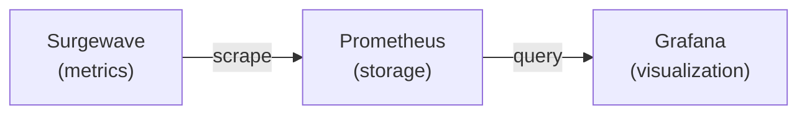
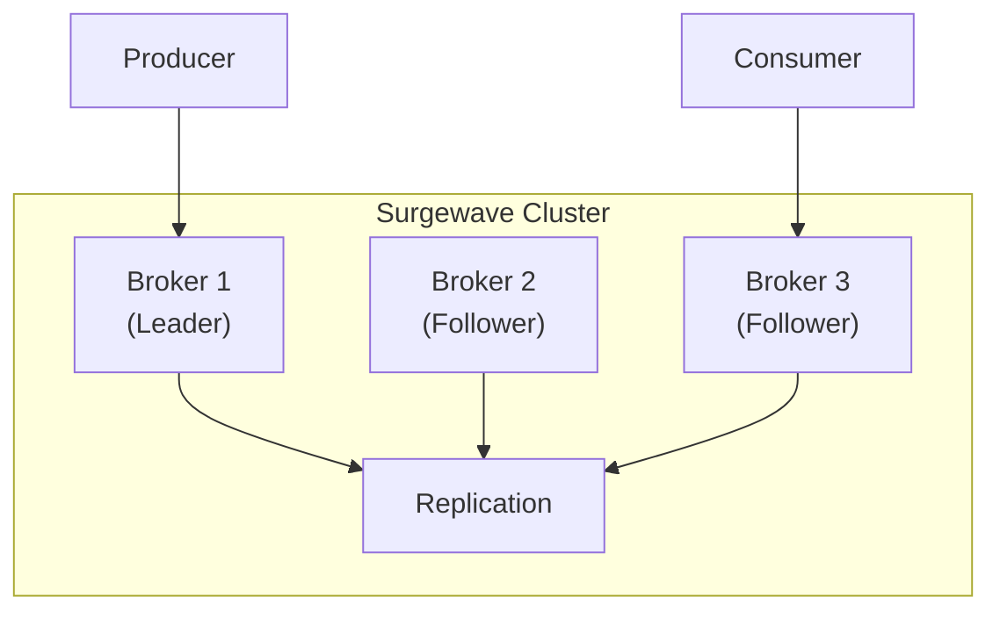

# Unit 21: Production Operations

Deploy and operate Surgewave in production environments.

## Learning Objectives

By the end of this unit, you will be able to:

- Set up multi-broker Surgewave clusters
- Configure replication for data durability
- Monitor Surgewave with metrics and dashboards
- Secure your cluster with TLS and authentication
- Tune performance for your workload
- Automatically rebalance partitions with Cruise Control

## Lessons

| Lesson | Topic | Description |
|--------|-------|-------------|
| [4.1](lesson-1/README.md) | Clustering | Multi-broker setup, leader election |
| [4.2](lesson-2/README.md) | Replication | Data durability, ISR, min.insync.replicas |
| [4.3](lesson-3/README.md) | Monitoring | Metrics, Prometheus, Grafana dashboards |
| [4.4](lesson-4/README.md) | Security | TLS encryption, SASL authentication, ACLs |
| [4.5](lesson-5/README.md) | Performance Tuning | Batching, compression, buffer tuning |
| [4.6](lesson-6/README.md) | Admin API | Programmatic cluster administration |
| [4.7](lesson-7/README.md) | Cruise Control & Auto-Balancing | Partition rebalancing, BalanceCalculator scores, SuggestOnly vs AutoRebalance |

## Prerequisites

- Completed Unit 1: Surgewave Fundamentals
- Basic understanding of networking concepts
- (Optional) Docker for multi-broker exercises

## Key Concepts

### Clustering

Surgewave clusters consist of multiple brokers for:
- **High availability**: Continue operating if a broker fails
- **Scalability**: Distribute load across brokers
- **Data locality**: Keep data close to consumers

### Replication

Topics can be replicated across brokers:
- **Replication factor**: Number of copies
- **In-Sync Replicas (ISR)**: Replicas caught up with leader
- **Min ISR**: Minimum replicas for writes to succeed

### Monitoring Stack

### Security Layers

| Layer | Technology | Purpose |
|-------|------------|---------|
| Transport | TLS | Encrypt data in transit |
| Authentication | SASL | Verify client identity |
| Authorization | ACLs | Control access to resources |

## Architecture Overview

---

**Ready?** [Start Lesson 4.1: Clustering](lesson-1/README.md)
