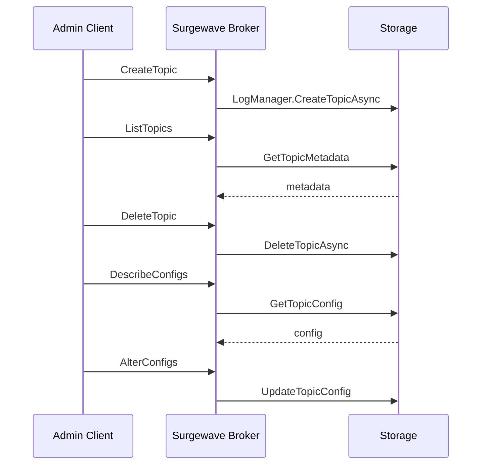

# Lesson 4.6: Admin API

> **Difficulty:** Intermediate | **Duration:** 30 min | **Prerequisites:** Lesson 4.5

## Overview

Learn how to programmatically administer your Surgewave cluster using the Admin API.

## Learning Objectives

- Create, list, and delete topics programmatically
- Manage topic configurations
- Work with Access Control Lists (ACLs)
- Configure producer/consumer quotas
- Inspect cluster metadata
- Understand partition reassignment

## Admin Operations Architecture

## Key Admin Operations

| Operation | Description | Use Case |
|-----------|-------------|----------|
| **CreateTopic** | Create new topic with partitions/replicas | Initial setup |
| **ListTopics** | List all topics with metadata | Discovery |
| **DeleteTopic** | Remove topic and all data | Cleanup |
| **DescribeTopic** | Get topic details (partitions, replicas) | Monitoring |
| **AlterConfigs** | Modify topic configuration | Tuning |
| **AddPartitions** | Increase partition count | Scaling |

## ACL Management

An ACL entry combines a principal, a resource, and a permission:

| Principal | Resource | Permission |
|-----------|----------|------------|
| User:alice | Topic:orders | ALLOW READ |
| User:bob | Topic:payments | ALLOW WRITE |
| User:* | Group:* | DENY DELETE |

Example ACL entry: `Principal=User:alice`, `Resource=Topic:orders`, `Operation=Read`, `Permission=Allow`

## Quota Management

| Quota Type | Limits |
|------------|--------|
| Producer Quota | Bytes/sec for producers |
| Consumer Quota | Bytes/sec for consumers |
| Request Quota | Request rate limiting |

Enforced via a token bucket: Rate 10 MB/s, Burst 100 MB, Throttle max 30 s.

## Topic Configuration Options

| Config Key | Description | Default |
|------------|-------------|---------|
| `retention.ms` | How long to retain messages | 7 days |
| `retention.bytes` | Max bytes per partition | -1 (unlimited) |
| `segment.bytes` | Log segment size | 1 GB |
| `cleanup.policy` | delete or compact | delete |
| `min.insync.replicas` | Min ISR for writes | 1 |

## Exercise

In this exercise, you'll:

1. Create topics programmatically with custom configurations
2. List and describe existing topics
3. Modify topic configurations
4. Delete topics
5. Explore ACL and quota management concepts

---

**Instructions:** -> [INSTRUCTIONS.md](INSTRUCTIONS.md)
