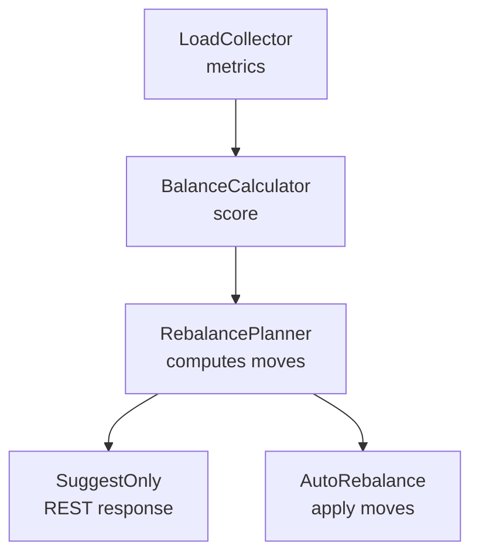
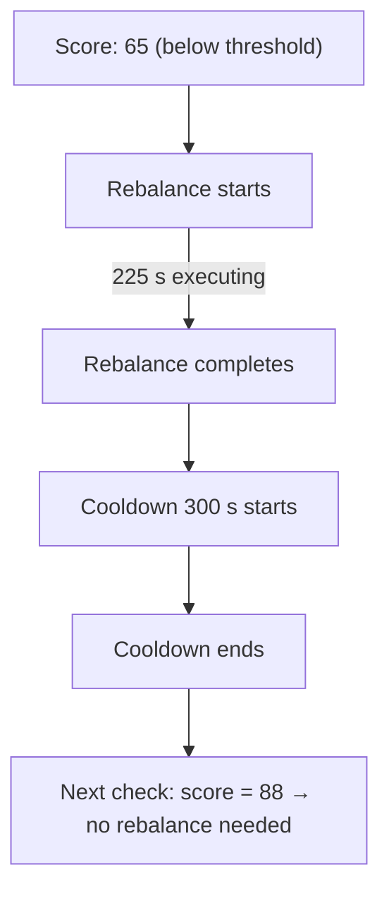

# Lesson 4.7: Cruise Control & Auto-Balancing

> **Difficulty:** Intermediate | **Duration:** 35 min | **Prerequisites:** Lesson 4.6

## Overview

Learn how Surgewave's Cruise Control feature continuously monitors partition distribution and automatically rebalances your cluster to eliminate hot spots, even out disk usage, and optimize leader placement — all without manual intervention.

## Learning Objectives

- Understand what partition imbalance is and why it matters
- Configure and enable Cruise Control for your cluster
- Interpret BalanceCalculator scores and LoadCollector metrics
- Choose between SuggestOnly and AutoRebalance modes
- Use the Cruise Control REST API to inspect and trigger rebalances
- Tune cooldown and threshold settings for your workload

## What Is Partition Imbalance?

In a multi-broker cluster, partitions are not always distributed evenly. Over time, certain brokers accumulate more leaders, receive more writes, or fill their disks faster than others:

| Broker | Partitions | Leaders | Disk | Network |
|--------|-----------|---------|------|---------|
| Broker 1 (Overloaded) | 42 | 30 | 87% | 850 MB/s |
| Broker 2 (Underutilized) | 18 | 8 | 31% | 210 MB/s |
| Broker 3 (Moderate) | 24 | 16 | 52% | 440 MB/s |

Result: Broker 1 is a hot spot. Latency and error rates are higher for topics whose leaders live on Broker 1.

Cruise Control solves this by continuously computing an optimal target state and either suggesting or applying the required partition moves.

## Architecture



## LoadCollector Metrics

The `LoadCollector` samples broker-level metrics on a configurable interval (default 60 s) and builds a rolling window of recent load data:

| Metric | Description | Unit |
|--------|-------------|------|
| `PartitionCount` | Number of partition replicas on this broker | count |
| `LeaderCount` | Number of partition leaders on this broker | count |
| `DiskUsageBytes` | Bytes used across all log directories | bytes |
| `BytesInPerSec` | Incoming bytes from producers and replication | bytes/s |
| `BytesOutPerSec` | Outgoing bytes to consumers and replication | bytes/s |
| `MessagesInPerSec` | Incoming message rate | msgs/s |
| `ReplicationBytesIn` | Cross-broker replication traffic in | bytes/s |
| `ReplicationBytesOut` | Cross-broker replication traffic out | bytes/s |

## BalanceCalculator Scoring

The `BalanceCalculator` computes a balance score (0–100) for the cluster. A score of 100 means perfectly even; lower scores indicate imbalance. Four sub-scores contribute to the overall score:

| Sub-Score | Weight | Description | Formula |
|-----------|--------|-------------|---------|
| Partition Score | 25% | How evenly partitions are distributed across brokers | `1 - (stddev(partitions) / mean(partitions))` |
| Leader Score | 25% | How evenly partition leaders are distributed; latency-critical since leaders handle all producer writes | same stddev/mean ratio |
| Disk Score | 25% | How evenly disk usage is distributed; prevents one broker filling up first | same stddev/mean ratio |
| Network Score | 25% | How evenly incoming + outgoing bytes are distributed; imbalance causes congestion | same stddev/mean ratio |

**Overall Score** = weighted average of the four sub-scores × 100

You can check the current score at any time via the REST API:

```bash
curl http://localhost:9092/api/cruisecontrol/score
```

```json
{
  "overallScore": 62.4,
  "partitionScore": 71.0,
  "leaderScore": 55.3,
  "diskScore": 68.8,
  "networkScore": 54.5,
  "needsRebalance": true
}
```

A score below the configured `MinBalanceScore` threshold (default 70) triggers a rebalance recommendation.

## SuggestOnly vs AutoRebalance Modes

Cruise Control operates in one of two modes:

| Mode | Behavior | When to Use |
|------|----------|-------------|
| `SuggestOnly` | Computes an optimal plan and exposes it via REST. No changes are applied unless you explicitly call the execute endpoint. | Production clusters where you want human approval before moving partitions. |
| `AutoRebalance` | Automatically applies the computed plan when the balance score drops below the threshold. | Development or staging environments, or production clusters where the ops team has validated the behavior. |

Switch modes at runtime without restarting the broker:

```bash
# Switch to AutoRebalance
curl -X POST http://localhost:9092/api/cruisecontrol/mode \
     -H "Content-Type: application/json" \
     -d '{"mode": "AutoRebalance"}'

# Switch back to SuggestOnly
curl -X POST http://localhost:9092/api/cruisecontrol/mode \
     -H "Content-Type: application/json" \
     -d '{"mode": "SuggestOnly"}'
```

## REST API Reference

Cruise Control exposes six endpoints:

| Method | Endpoint | Description |
|--------|----------|-------------|
| `GET` | `/api/cruisecontrol/score` | Current balance scores and rebalance recommendation |
| `GET` | `/api/cruisecontrol/metrics` | Raw LoadCollector metrics per broker |
| `GET` | `/api/cruisecontrol/plan` | Proposed partition move plan (read-only) |
| `POST` | `/api/cruisecontrol/execute` | Execute the current plan immediately |
| `POST` | `/api/cruisecontrol/mode` | Change operating mode (SuggestOnly/AutoRebalance) |
| `GET` | `/api/cruisecontrol/status` | Running status, last rebalance time, cooldown remaining |

### Example: Fetch the Rebalance Plan

```bash
curl http://localhost:9092/api/cruisecontrol/plan
```

```json
{
  "planId": "plan-2026-03-22T09:00:00",
  "moves": [
    {
      "topic": "orders",
      "partition": 3,
      "fromBroker": 1,
      "toBroker": 2,
      "estimatedDurationSeconds": 45,
      "reason": "LeaderImbalance"
    },
    {
      "topic": "analytics-raw",
      "partition": 11,
      "fromBroker": 1,
      "toBroker": 3,
      "estimatedDurationSeconds": 180,
      "reason": "DiskImbalance"
    }
  ],
  "estimatedTotalDurationSeconds": 225,
  "projectedScoreAfter": 91.2
}
```

### Example: Execute the Plan

```bash
curl -X POST http://localhost:9092/api/cruisecontrol/execute
```

```json
{
  "status": "executing",
  "planId": "plan-2026-03-22T09:00:00",
  "startedAt": "2026-03-22T09:01:00Z",
  "movesTotal": 2,
  "movesCompleted": 0
}
```

## Configuration

Enable Cruise Control in `appsettings.json`:

```json
{
  "Surgewave": {
    "CruiseControl": {
      "Enabled": true,
      "Mode": "SuggestOnly",
      "SampleIntervalSeconds": 60,
      "WindowSize": 10,
      "MinBalanceScore": 70.0,
      "CooldownSeconds": 300,
      "MaxConcurrentMoves": 2
    }
  }
}
```

| Setting | Default | Description |
|---------|---------|-------------|
| `Enabled` | `false` | Enable the Cruise Control subsystem |
| `Mode` | `SuggestOnly` | Starting mode: `SuggestOnly` or `AutoRebalance` |
| `SampleIntervalSeconds` | `60` | How often LoadCollector samples metrics |
| `WindowSize` | `10` | Number of samples in the rolling average window |
| `MinBalanceScore` | `70.0` | Score below which a rebalance is recommended |
| `CooldownSeconds` | `300` | Minimum seconds between consecutive rebalances |
| `MaxConcurrentMoves` | `2` | Max simultaneous partition moves to limit I/O impact |

### Cooldown Explained

After a rebalance completes, Cruise Control enters a cooldown period. During cooldown, no new rebalances are triggered even if the score drops below the threshold. This prevents thrashing — a state where every move triggers a new imbalance that immediately triggers another move.



## When to Enable Cruise Control

| Situation | Recommendation |
|-----------|---------------|
| Single-broker cluster | Not needed — no balancing possible |
| 2–3 brokers, stable workload | Enable with `SuggestOnly`, review weekly |
| 3+ brokers, dynamic topics | Enable with `AutoRebalance`, set cooldown >= 5 min |
| Topics created/deleted frequently | Enable — manual rebalancing cannot keep pace |
| After broker failure and recovery | Trigger a manual execute once the broker returns |
| Strict production SLAs | Use `SuggestOnly` to review plans before applying |

## Exercise

In this exercise, you will:

1. Start a 3-broker Surgewave cluster
2. Create several topics with intentionally uneven partition placement
3. Call the score endpoint and observe the imbalance
4. Enable Cruise Control in `SuggestOnly` mode
5. Fetch the generated rebalance plan
6. Execute the plan and watch the score improve
7. Switch to `AutoRebalance` and verify the cooldown setting works

---
