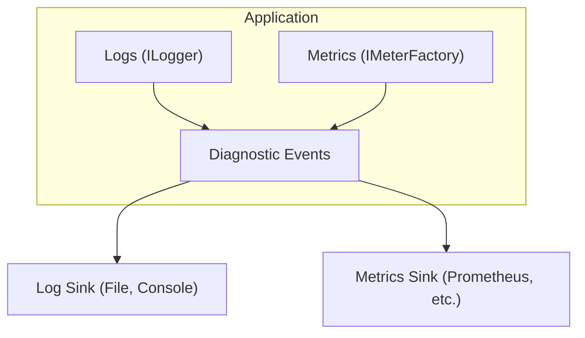

# Unit 22: Observability & Troubleshooting

Debug, monitor, and troubleshoot Surgewave applications effectively.

## Overview

Observability & Troubleshooting covers essential techniques for understanding what's happening in your Surgewave applications:
- Configuring logging and diagnostics for visibility
- Collecting and exposing metrics for monitoring
- Implementing distributed tracing across services
- Debugging common issues like consumer lag and rebalancing
- Profiling performance to identify bottlenecks

## Architecture

## Lessons

| Lesson | Topic | What You'll Build |
|--------|-------|-------------------|
| [9.1](lesson-1/README.md) | Logging & Diagnostics | Configure structured logging and diagnostic events |
| [9.2](lesson-2/README.md) | Metrics & Monitoring | Expose metrics for Prometheus-style monitoring |
| [9.3](lesson-3/README.md) | Distributed Tracing | Propagate correlation IDs across services |
| [9.4](lesson-4/README.md) | Common Issues | Debug consumer lag, rebalancing, and timeouts |
| [9.5](lesson-5/README.md) | Performance Profiling | Profile memory and identify bottlenecks |

## Prerequisites

- Completed Unit 1 (Fundamentals)
- Completed Unit 3 (Advanced Messaging)
- Basic understanding of logging frameworks

## Key Concepts

### Observability Pillars

| Pillar | Purpose | Surgewave Integration |
|--------|---------|-------------------|
| Logs | Record discrete events | ILogger, DiagnosticSource |
| Metrics | Measure numeric values over time | Meters, Counters, Histograms |
| Traces | Track requests across services | Activity, TraceId, SpanId |

### Common Issues

| Issue | Symptoms | Debug Approach |
|-------|----------|----------------|
| Consumer Lag | Messages piling up | Check offsets, processing time |
| Rebalancing | Connection drops | Monitor partition assignments |
| Timeouts | Operations failing | Check network, increase timeouts |
| Memory Issues | High memory usage | Profile allocations |

## Learning Objectives

By the end of this unit, you will be able to:

1. Configure structured logging for Surgewave applications
2. Expose application metrics for monitoring systems
3. Implement correlation IDs for distributed tracing
4. Debug common consumer and producer issues
5. Profile application performance and memory usage
