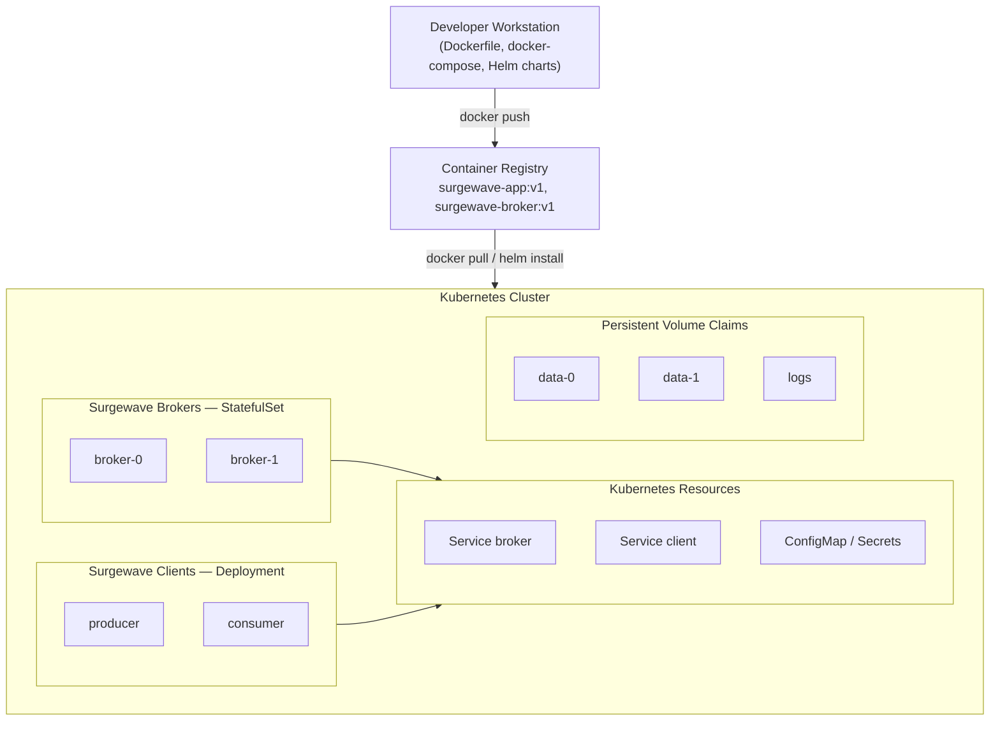

# Unit 23: Cloud & Kubernetes Deployment

Deploy Surgewave applications to cloud and container environments for production-grade scalability and reliability.

## Learning Objectives

By the end of this unit, you will be able to:

- Containerize Surgewave applications with Docker and multi-stage builds
- Orchestrate multi-broker Surgewave clusters with Docker Compose
- Deploy Surgewave to Kubernetes with Deployments, Services, and ConfigMaps
- Package Surgewave deployments as reusable Helm charts
- Understand cloud provider considerations for AWS, Azure, and GCP

## Lessons

| Lesson | Topic | Description |
|--------|-------|-------------|
| [14.1](lesson-1/README.md) | Docker Basics | Dockerfile for Surgewave apps, multi-stage builds, docker-compose.yml |
| [14.2](lesson-2/README.md) | Docker Compose | Multi-broker setup, networking, volumes, health checks |
| [14.3](lesson-3/README.md) | Kubernetes Fundamentals | Deployments, Services, ConfigMaps, Secrets for Surgewave |
| [14.4](lesson-4/README.md) | Helm Charts | Packaging Surgewave deployments, values.yaml, templating |
| [14.5](lesson-5/README.md) | Cloud Providers | AWS MSK/EKS, Azure Event Hubs/AKS, GCP Pub/Sub/GKE |

## Prerequisites

- Completed Unit 1: Surgewave Fundamentals
- Completed Unit 3: Advanced Messaging (recommended)
- Docker Desktop installed
- kubectl installed (for Kubernetes lessons)
- Helm installed (for Helm lessons)

## Deployment Architecture Overview



## Container Deployment Flow

| Stage | Tool | Topology | Notes |
|-------|------|----------|-------|
| Development | docker-compose (local testing) | Single broker, local volumes | Debug logging |
| Staging | Helm + K8s (test cluster) | 3-node cluster, shared storage | Test configs |
| Production | Helm + K8s (prod cluster) | Multi-region, HA + DR setup | Production TLS |

## Environment Configuration Pattern

Configuration sources in priority order (highest to lowest):

| Priority | Source | Example |
|----------|--------|---------|
| 1 (highest) | Command-line arguments | `--bootstrap-servers=broker:9092` |
| 2 | Environment variables | `Surgewave_BOOTSTRAP_SERVERS=broker:9092` |
| 3 | ConfigMap / Secrets | Kubernetes mounted configs |
| 4 | appsettings.json | `{ "Surgewave": { "BootstrapServers": "..." } }` |
| 5 (lowest) | Code defaults | `options.BootstrapServers = "localhost"` |

## Key Patterns

### Environment-Based Configuration

```csharp
await using var producer = new SurgewaveProducer<string, string>(options =>
{
    options.BootstrapServers = Environment.GetEnvironmentVariable("Surgewave_BOOTSTRAP_SERVERS")
        ?? "localhost:9092";
});
```

### Graceful Shutdown Handling

```csharp
var cts = new CancellationTokenSource();
Console.CancelKeyPress += (_, e) =>
{
    e.Cancel = true;
    cts.Cancel();
};

AppDomain.CurrentDomain.ProcessExit += (_, _) =>
{
    cts.Cancel();
};
```

### Health Probe Endpoints

```csharp
// Liveness probe - is the app running?
app.MapGet("/health/live", () => Results.Ok("alive"));

// Readiness probe - is the app ready to receive traffic?
app.MapGet("/health/ready", async (SurgewaveClient client) =>
{
    var isConnected = await client.IsConnectedAsync();
    return isConnected ? Results.Ok("ready") : Results.StatusCode(503);
});
```

## Docker Multi-Stage Build

```dockerfile
# Build stage
FROM mcr.microsoft.com/dotnet/sdk:10.0 AS build
WORKDIR /src
COPY . .
RUN dotnet publish -c Release -o /app

# Runtime stage
FROM mcr.microsoft.com/dotnet/runtime:10.0
WORKDIR /app
COPY --from=build /app .
ENTRYPOINT ["dotnet", "SurgewaveApp.dll"]
```

## Kubernetes Resources Overview

| Resource | Purpose | Surgewave Usage |
|----------|---------|-------------|
| Deployment | Stateless replicas | Producers, Consumers |
| StatefulSet | Stateful pods with identity | Brokers |
| Service | Network endpoint | Broker discovery |
| ConfigMap | Configuration data | Broker/client settings |
| Secret | Sensitive data | TLS certs, credentials |
| PersistentVolumeClaim | Storage | Broker data directories |
| Ingress | External access | Management API |

## Cloud Provider Considerations

| Provider | Managed Kafka Alternative | Kubernetes Service | Key Features |
|----------|---------------------------|-------------------|--------------|
| AWS | MSK (Managed Kafka) | EKS | IAM auth, PrivateLink |
| Azure | Event Hubs (Kafka API) | AKS | AAD integration, VNet |
| GCP | Pub/Sub, Managed Kafka | GKE | Workload Identity |

---

**Ready?** [Start Lesson 14.1: Docker Basics](lesson-1/README.md)
