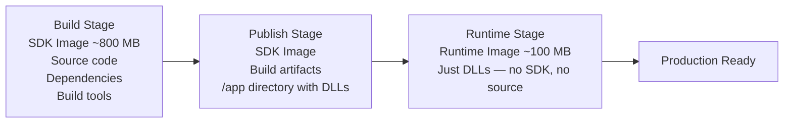
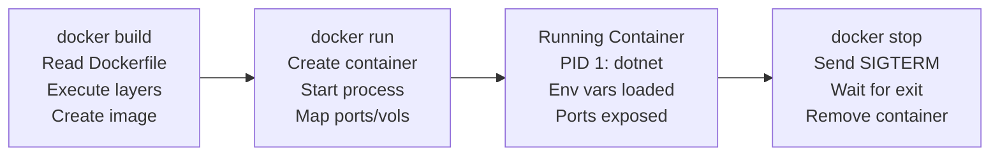

# Lesson 14.1: Docker Basics

> **Difficulty:** Advanced | **Duration:** 45 min | **Prerequisites:** Unit 13 completion

## Overview

Learn how to containerize Surgewave applications using Docker, including multi-stage builds and environment-based configuration.

## Learning Objectives

- Create Dockerfiles for Surgewave applications
- Use multi-stage builds for optimized images
- Configure Surgewave apps via environment variables
- Build and run containerized Surgewave clients

## Why Docker?

Docker provides consistent, reproducible environments for Surgewave applications:

| Benefit | Description |
|---------|-------------|
| Consistency | Same environment from dev to production |
| Isolation | Dependencies don't conflict |
| Portability | Run anywhere Docker runs |
| Scalability | Easy horizontal scaling |
| CI/CD | Automated build and deploy pipelines |

## Key Concepts

### Dockerfile Basics

```dockerfile
FROM mcr.microsoft.com/dotnet/sdk:10.0 AS build   # Base image for building

WORKDIR /src                                        # Set working directory

COPY *.csproj .
RUN dotnet restore                                  # Restore dependencies (cached layer)

COPY . .
RUN dotnet publish -c Release -o /app               # Build and publish application

FROM mcr.microsoft.com/dotnet/runtime:10.0
COPY --from=build /app .                            # Runtime image with only published output

ENTRYPOINT ["dotnet", "MyApp.dll"]                  # Command to run when container starts
```

### Multi-Stage Build Flow



### Environment Variable Configuration

Configuration is resolved via a fallback chain (highest to lowest priority):

1. **Environment variable** (`docker run -e Surgewave_BOOTSTRAP_SERVERS=broker:9092`) — read via `Environment.GetEnvironmentVariable(...)`
2. **`appsettings.json`** — baked into the image or mounted as a volume
3. **Code default** — `"localhost:9092"`

### Container Lifecycle



## Dockerfile Best Practices

| Practice | Why |
|----------|-----|
| Multi-stage builds | Smaller final images |
| Copy csproj first | Better layer caching |
| Use specific tags | Reproducible builds |
| Non-root user | Security |
| .dockerignore | Faster builds, smaller context |

## Exercise

In this exercise, you'll:

1. Configure a Surgewave producer to use environment variables
2. Understand Dockerfile structure for .NET apps
3. Handle graceful shutdown in containers
4. Test configuration with different environments

---

**Instructions:** [INSTRUCTIONS.md](INSTRUCTIONS.md)
