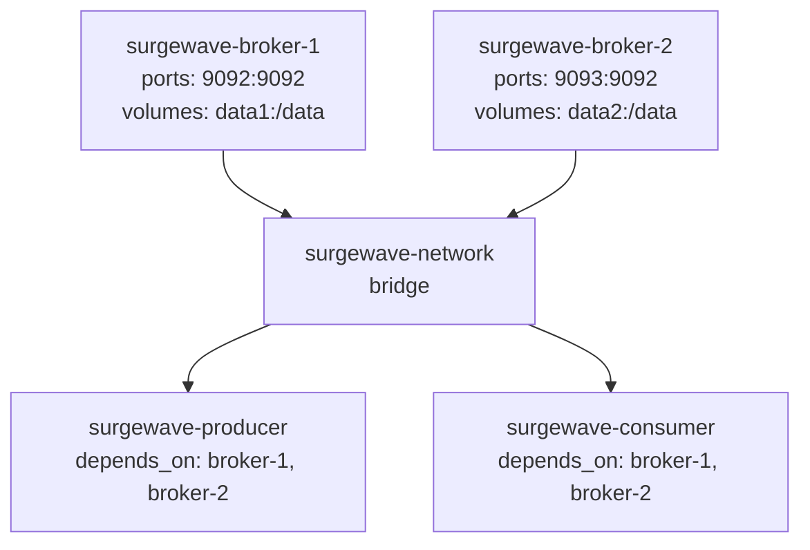
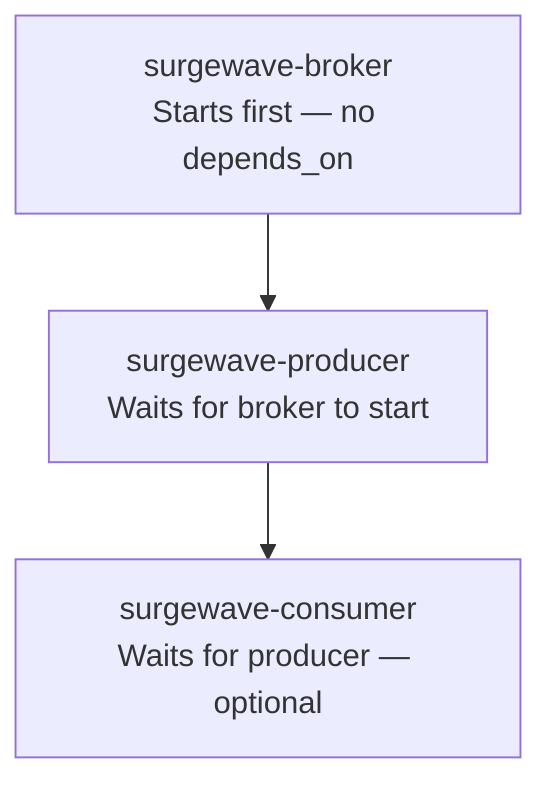
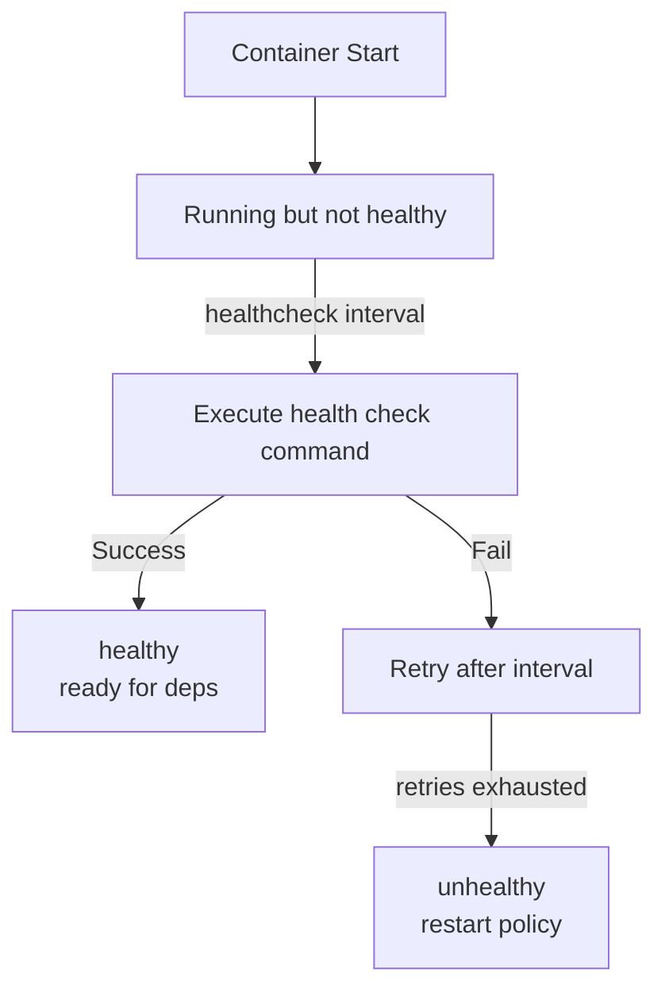

# Lesson 14.2: Docker Compose

> **Difficulty:** Advanced | **Duration:** 45 min | **Prerequisites:** Lesson 14.1

## Overview

Learn to orchestrate multi-container Surgewave deployments using Docker Compose, including multi-broker clusters, networking, volumes, and health checks.

## Learning Objectives

- Create docker-compose.yml for Surgewave clusters
- Configure networking between containers
- Set up persistent volumes for broker data
- Implement health checks for service readiness
- Scale services dynamically

## Why Docker Compose?

Docker Compose simplifies multi-container orchestration:

| Benefit | Description |
|---------|-------------|
| Single command | Start entire stack with `docker compose up` |
| Declarative | Define infrastructure as code |
| Networking | Automatic DNS between services |
| Volumes | Persistent storage configuration |
| Environment | Centralized environment management |

## Key Concepts

### Docker Compose Architecture



### Service Dependencies



### Health Check Flow



### Volume Persistence

| Volume Type | Syntax | Behaviour | Best For |
|-------------|--------|-----------|----------|
| Named Volume (recommended) | `- data:/app/data` | Docker manages location (`/var/lib/docker/volumes`); portable across hosts | Production |
| Bind Mount | `- ./data:/app/data` | Host directory mapped directly; immediately accessible on host | Development |

Data in named volumes persists across the container lifecycle: `Running` → `docker compose down` → `Stopped` → `docker compose up` → `Running` (data restored).

## docker-compose.yml Structure

```yaml
version: "3.8"

services:
  surgewave-broker:
    image: surgewave-broker:latest
    ports:
      - "9092:9092"
    environment:
      - Surgewave_BROKER_ID=1
      - Surgewave_DATA_DIR=/data
    volumes:
      - broker-data:/data
    healthcheck:
      test: ["CMD", "curl", "-f", "http://localhost:8080/health"]
      interval: 10s
      timeout: 5s
      retries: 3
      start_period: 30s
    networks:
      - surgewave-network

  surgewave-producer:
    image: surgewave-producer:latest
    environment:
      - Surgewave_BOOTSTRAP_SERVERS=surgewave-broker:9092
    depends_on:
      surgewave-broker:
        condition: service_healthy
    networks:
      - surgewave-network

volumes:
  broker-data:

networks:
  surgewave-network:
    driver: bridge
```

## Exercise

In this exercise, you'll:

1. Configure a Surgewave client for Docker Compose environments
2. Use service discovery via Docker DNS
3. Handle startup ordering with health checks
4. Test multi-container communication

---

**Instructions:** [INSTRUCTIONS.md](INSTRUCTIONS.md)
