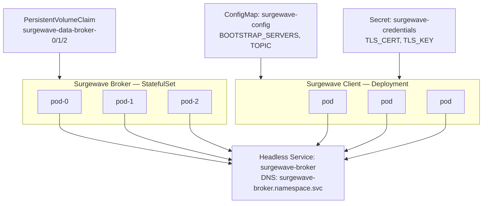
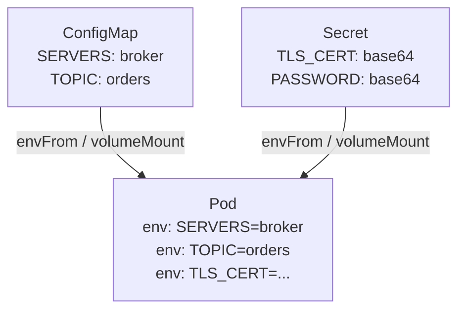

# Lesson 14.3: Kubernetes Fundamentals

> **Difficulty:** Advanced | **Duration:** 60 min | **Prerequisites:** Lesson 14.2

## Overview

Learn to deploy Surgewave applications on Kubernetes using Deployments, Services, ConfigMaps, and Secrets for production-grade orchestration.

## Learning Objectives

- Deploy Surgewave brokers as StatefulSets
- Deploy Surgewave clients as Deployments
- Expose services with Kubernetes Services
- Configure applications with ConfigMaps and Secrets
- Implement health probes for reliability

## Why Kubernetes?

Kubernetes provides enterprise-grade container orchestration:

| Feature | Description |
|---------|-------------|
| Self-healing | Automatic pod restarts on failure |
| Scaling | Horizontal pod autoscaling |
| Rolling updates | Zero-downtime deployments |
| Service discovery | Built-in DNS for services |
| Configuration | ConfigMaps and Secrets |
| Storage | Persistent volumes for data |

## Key Concepts

### Kubernetes Architecture for Surgewave

### Deployment vs StatefulSet

| Property | Deployment | StatefulSet |
|----------|-----------|-------------|
| **For** | Stateless applications | Stateful applications |
| **Pod names** | Random suffix (`myapp-7d9f8b6c4d-x2k4j`) | Ordered (`myapp-0`, `myapp-1`, `myapp-2`) |
| **Scaling** | Any order | Ordered (0 → 1 → 2) |
| **Storage** | Shared or none | Per-pod PVC |
| **Use for** | Producers, consumers, API servers | Brokers, databases, stateful services |

### Service Types

| Service Type | Access | Port Range | Best For |
|-------------|--------|-----------|----------|
| **ClusterIP** (default) | Internal only; pod-to-pod via `service:port` | — | Internal traffic |
| **NodePort** | Port on each node | 30000–32767 | Dev/testing, local access |
| **LoadBalancer** | Cloud LB with external IP | — | Production, external access |
| **Headless** (`clusterIP: None`) | Returns pod IPs directly; `surgewave-broker-0.surgewave-broker.ns.svc` | — | StatefulSets, direct pod addressing |

### Health Probes

| Probe | Question | Path | Failure Action |
|-------|----------|------|----------------|
| **Liveness** | Is the container alive? | `GET /healthz:8080` (`initialDelay: 10`, `period: 5`) | Restart pod |
| **Readiness** | Is it ready for traffic? | `GET /ready:8080` (`initialDelay: 5`, `period: 3`) | Remove from Service (no traffic until ready) |
| **Startup** | Has the app finished starting? | `GET /healthz` (`failureThreshold: 30`, `period: 10`) | Disables liveness/readiness until succeeds; good for apps that load data or warm caches |

### ConfigMap and Secret Flow

## Exercise

In this exercise, you'll:

1. Configure a Surgewave client for Kubernetes deployment
2. Read configuration from environment variables (from ConfigMaps)
3. Implement health endpoints for probes
4. Handle Kubernetes pod lifecycle events

---

**Instructions:** [INSTRUCTIONS.md](INSTRUCTIONS.md)
