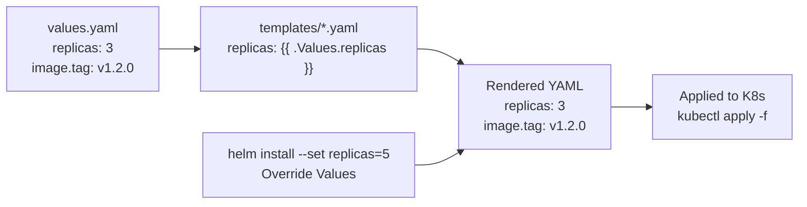
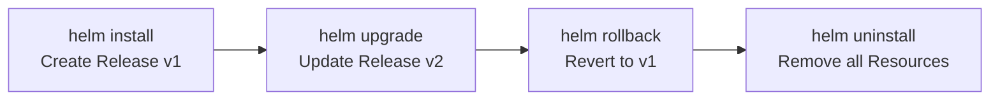

# Lesson 14.4: Helm Charts

> **Difficulty:** Advanced | **Duration:** 45 min | **Prerequisites:** Lesson 14.3

## Overview

Learn to package Surgewave deployments as reusable Helm charts with templating, values files, and release management.

## Learning Objectives

- Understand Helm chart structure
- Create templates for Surgewave deployments
- Use values.yaml for configuration
- Deploy and upgrade Surgewave with Helm
- Manage multiple environments

## Why Helm?

Helm simplifies Kubernetes application management:

| Benefit | Description |
|---------|-------------|
| Packaging | Bundle all K8s resources together |
| Templating | Dynamic configuration with Go templates |
| Versioning | Track and rollback releases |
| Reusability | Share charts via repositories |
| Dependencies | Manage chart dependencies |

## Key Concepts

### Helm Chart Structure

```
surgewave-chart/
├── Chart.yaml            # Chart metadata (name, version, etc.)
├── values.yaml           # Default configuration values
├── templates/            # Kubernetes manifest templates
│   ├── deployment.yaml   # {{ .Values.replicas }}
│   ├── service.yaml      # {{ .Values.service.port }}
│   ├── configmap.yaml    # {{ .Values.config.* }}
│   ├── secret.yaml       # {{ .Values.secrets.* }}
│   ├── statefulset.yaml  # {{ .Values.broker.* }}
│   ├── _helpers.tpl      # Reusable template functions
│   └── NOTES.txt         # Post-install instructions
└── charts/               # Chart dependencies
```

### Helm Templating Flow



### Values Hierarchy

Values are resolved highest to lowest priority:

1. `--set` flags — `helm install --set replicas=5`
2. `-f` values file — `helm install -f production.yaml`
3. Parent chart `values.yaml` (if this is a subchart)
4. Chart's own `values.yaml` — `surgewave-chart/values.yaml`

### Environment Management

| | `values.yaml` (defaults) | `values-dev.yaml` | `values-prod.yaml` |
|-|--------------------------|-------------------|--------------------|
| `replicas` | 1 | 1 | 5 |
| `resources.limits.memory` | 256Mi | 128Mi | 2Gi |
| `persistence.enabled` | false | false | true |
| **Command** | `helm install surgewave` | `helm install -f values-dev.yaml` | `helm install -f values-prod.yaml` |

### Helm Release Lifecycle



`helm history my-release`:

| Revision | Status | Description |
|----------|--------|-------------|
| 1 | superseded | Install complete |
| 2 | superseded | Upgrade complete |
| 3 | deployed | Rollback to 1 |

## Chart.yaml Structure

```yaml
apiVersion: v2
name: surgewave
description: A Helm chart for Surgewave message broker
type: application
version: 0.1.0          # Chart version
appVersion: "1.0.0"     # App version

dependencies:
  - name: redis
    version: "17.x.x"
    repository: "https://charts.bitnami.com/bitnami"
    condition: redis.enabled

maintainers:
  - name: Team Surgewave
    email: team@example.com
```

## Exercise

In this exercise, you'll:

1. Configure a Surgewave application for Helm deployment
2. Read configuration from Helm-managed ConfigMaps
3. Support multiple value overrides
4. Implement proper labeling for Helm releases

---

**Instructions:** [INSTRUCTIONS.md](INSTRUCTIONS.md)
