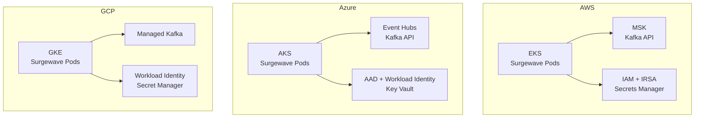

# Lesson 14.5: Cloud Providers

> **Difficulty:** Advanced | **Duration:** 45 min | **Prerequisites:** Lesson 14.4

## Overview

Learn cloud-specific deployment considerations for Surgewave on AWS, Azure, and GCP, including managed services, authentication, and networking.

## Learning Objectives

- Understand cloud provider-specific deployment patterns
- Configure Surgewave for AWS EKS and MSK
- Configure Surgewave for Azure AKS and Event Hubs
- Configure Surgewave for GCP GKE and Pub/Sub
- Handle cloud-native authentication and networking

## Cloud Provider Comparison

| Feature | AWS | Azure | GCP |
|---------|-----|-------|-----|
| Kubernetes | EKS | AKS | GKE |
| Managed Kafka | MSK | Event Hubs (Kafka API) | Managed Kafka |
| Auth | IAM/IRSA | AAD/Workload Identity | Workload Identity |
| Networking | VPC/PrivateLink | VNet/Private Endpoints | VPC/Private Service |
| Secrets | Secrets Manager | Key Vault | Secret Manager |

## Key Concepts

### Cloud Architecture Overview

### AWS Architecture

**AWS EKS + MSK:** Surgewave pods run in private subnets inside a VPC; outbound traffic routes through a NAT Gateway. Pods connect to the MSK Cluster over private networking. Secrets Manager stores connection strings and credentials. Authentication uses IAM Role for Service Account (IRSA) — `eks.amazonaws.com/...` grants MSK permissions and Secrets Manager access to the pods.

### Azure Architecture

**Azure AKS + Event Hubs:** AKS pods and Event Hubs Namespace live in separate subnets within a VNet, connected via a Private Endpoint. Key Vault stores connection strings and certificates. Pods use a User Assigned Managed Identity (UAMI) via Azure AD for Event Hubs Data Owner permissions and Key Vault access.

### GCP Architecture

**GCP GKE + Managed Kafka:** GKE and Kafka Subnets sit in the same VPC, connected via Private Service Connect. Secret Manager stores connection info and service credentials. Pods use Workload Identity (Kubernetes SA → GCP SA mapping) for Kafka client role and Secret Manager access.

### Configuration Strategy

**1. Bootstrap Servers**

| Cloud | Bootstrap Address |
|-------|------------------|
| AWS MSK | `b-1.cluster.xxx.kafka.us-east-1.amazonaws.com:9092` |
| Azure Event Hubs | `namespace.servicebus.windows.net:9093` |
| GCP Managed Kafka | `bootstrap.cluster.kafka.gcp.project.svc` |

**2. Authentication**

| Cloud | Mechanism | Settings |
|-------|-----------|---------|
| AWS | IAM Auth | `security.protocol=SASL_SSL`, `sasl.mechanism=AWS_MSK_IAM` |
| Azure | SASL/PLAIN (Connection String) | `security.protocol=SASL_SSL`, `sasl.mechanism=PLAIN` |
| GCP | SASL/PLAIN or mTLS | `security.protocol=SASL_SSL`, `sasl.mechanism=PLAIN` |

**3. Environment Detection**

Set `CLOUD_PROVIDER` to `aws`, `azure`, `gcp`, or `local`. Cloud-specific SDK detection: `AWS_REGION` / `AWS_EXECUTION_ENV`, `AZURE_CLIENT_ID` / `IDENTITY_ENDPOINT`, `GOOGLE_CLOUD_PROJECT` / `GCE_METADATA_HOST`.

## Exercise

In this exercise, you'll:

1. Configure a Surgewave client for cloud-agnostic deployment
2. Detect and adapt to different cloud environments
3. Handle cloud-specific authentication
4. Support multiple deployment targets

---

**Instructions:** [INSTRUCTIONS.md](INSTRUCTIONS.md)
