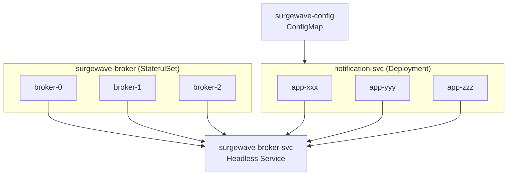

# Unit 14 Project: Kubernetes Deployment

Deploy a Surgewave application to Kubernetes with proper configurations for production readiness.

## Scenario

You're deploying a Surgewave-based notification service to Kubernetes. The deployment should include:
1. Surgewave broker as a StatefulSet
2. Notification service as a Deployment
3. ConfigMaps for configuration
4. Services for network access
5. Health probes for reliability

## Requirements

### Functional Requirements

- [ ] Deploy Surgewave broker with persistent storage
- [ ] Deploy notification service with multiple replicas
- [ ] Configure environment-based settings via ConfigMap
- [ ] Expose services within the cluster
- [ ] Add health check probes

### Technical Requirements

- [ ] Use Kubernetes best practices (labels, selectors, resource limits)
- [ ] Configure liveness and readiness probes
- [ ] Use ConfigMap for non-sensitive configuration
- [ ] Use proper service discovery
- [ ] Set resource requests and limits

## Architecture



## Files to Create

```
start/
  deployment.yaml     # Notification service deployment (with TODOs)
  service.yaml        # Service definitions (with TODOs)
  configmap.yaml      # Configuration (with TODOs)

completed/
  deployment.yaml     # Complete deployment
  service.yaml        # Complete services
  configmap.yaml      # Complete configuration
```

## Expected kubectl Output

```bash
$ kubectl apply -f .

configmap/surgewave-config created
service/surgewave-broker created
service/notification-svc created
statefulset.apps/surgewave-broker created
deployment.apps/notification-svc created

$ kubectl get pods

NAME                               READY   STATUS    RESTARTS   AGE
surgewave-broker-0                     1/1     Running   0          2m
surgewave-broker-1                     1/1     Running   0          1m
surgewave-broker-2                     1/1     Running   0          30s
notification-svc-xxx-yyy           1/1     Running   0          2m
notification-svc-xxx-zzz           1/1     Running   0          2m
notification-svc-xxx-abc           1/1     Running   0          2m

$ kubectl get svc

NAME               TYPE        CLUSTER-IP       PORT(S)    AGE
surgewave-broker       ClusterIP   None             9092/TCP   2m
notification-svc   ClusterIP   10.96.100.50     8080/TCP   2m

$ kubectl logs notification-svc-xxx-yyy

[Startup] Connecting to surgewave-broker:9092
[Startup] Connected to Surgewave cluster
[Consumer] Listening on notifications-email
[Consumer] Listening on notifications-sms
[API] Ready on port 8080
```

## Getting Started

```bash
cd bootcamp/unit-14/project/start

# Apply configuration
kubectl apply -f configmap.yaml

# Deploy services
kubectl apply -f service.yaml

# Deploy workloads
kubectl apply -f deployment.yaml

# Verify
kubectl get pods -w
```

## Hints

1. Use `envFrom` to inject ConfigMap as environment variables
2. Set `Surgewave_BOOTSTRAP_SERVERS` to `surgewave-broker:9092`
3. Use headless service for StatefulSet DNS discovery
4. Add both liveness (`/health/live`) and readiness (`/health/ready`) probes
5. Set reasonable resource limits (100m CPU, 256Mi memory)

## Kubernetes Resources

| Resource | Name | Purpose |
|----------|------|---------|
| ConfigMap | surgewave-config | Configuration values |
| Service | surgewave-broker | Headless service for broker discovery |
| Service | notification-svc | ClusterIP for notification API |
| StatefulSet | surgewave-broker | Surgewave broker cluster |
| Deployment | notification-svc | Notification service replicas |

## Evaluation Criteria

| Criteria | Points |
|----------|--------|
| ConfigMap correctly defined | 15 |
| Services properly configured | 20 |
| StatefulSet for broker | 25 |
| Deployment with probes | 25 |
| Resource limits set | 15 |

## Solution

Compare your implementation with [completed/](completed/README.md) when done.
