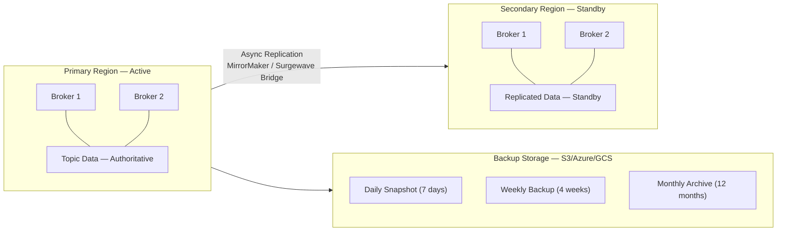
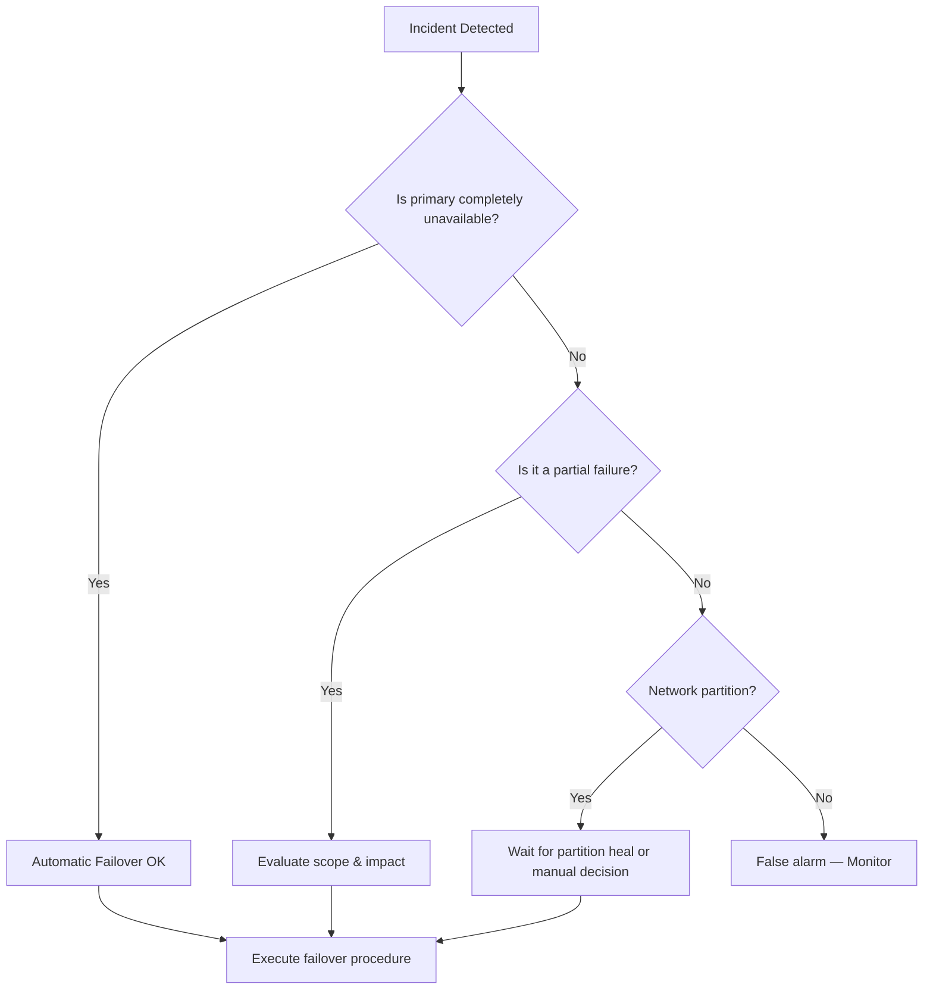

# Unit 24: Disaster Recovery

Build resilient Surgewave clusters with comprehensive disaster recovery strategies, cross-datacenter replication, and tested failover procedures.

## Learning Objectives

By the end of this unit, you will be able to:

- Design and implement topic backup strategies with retention policies
- Configure cross-datacenter replication using MirrorMaker patterns
- Execute manual and automatic failover procedures
- Restore data from backups with consistency verification
- Create and validate disaster recovery runbooks with chaos engineering

## Lessons

| Lesson | Topic | Description |
|--------|-------|-------------|
| [15.1](lesson-1/README.md) | Backup Strategies | Topic backup, snapshot creation, retention policies |
| [15.2](lesson-2/README.md) | Cross-Datacenter Replication | MirrorMaker concepts, async replication, lag monitoring |
| [15.3](lesson-3/README.md) | Failover Procedures | Detecting failures, manual vs automatic failover, DNS switching |
| [15.4](lesson-4/README.md) | Data Recovery | Restoring from backups, point-in-time recovery, consistency checks |
| [15.5](lesson-5/README.md) | DR Testing | Chaos engineering, failover drills, runbook creation |

## Prerequisites

- Completed Unit 1: Surgewave Fundamentals
- Completed Unit 4: Production Operations
- Completed Unit 14: Cloud & Kubernetes Deployment (recommended)
- Understanding of distributed systems concepts

## Disaster Recovery Architecture Overview



## Recovery Time Objectives (RTO) and Recovery Point Objectives (RPO)

| Strategy | RTO | RPO | Cost | Complexity |
|----------|-----|-----|------|------------|
| Cold Standby | Hours | Hours | Low | Low |
| Warm Standby | Minutes | Minutes | Medium | Medium |
| Hot Standby | Seconds | Seconds | High | High |
| Active-Active | Near-Zero | Near-Zero | Highest | Highest |

**RTO** = time from disaster occurring to service restored (Recovery Time Objective).
**RPO** = time from last good backup/replication to the disaster event (Recovery Point Objective).

## Backup Strategy Tiers

| Tier | Name | Description | RPO | Use Cases |
|------|------|-------------|-----|-----------|
| 1 | Continuous Replication (Hot) | Real-time async replication to secondary datacenter | Seconds to minutes | Immediate failover, high-value topics |
| 2 | Periodic Snapshots (Warm) | Scheduled snapshots to object storage (hourly/daily) | Hours | Quick restore, compliance retention |
| 3 | Archive Backups (Cold) | Long-term archives to cold storage (weekly/monthly) | Days to weeks | Disaster recovery, legal holds |

## Failover Decision Tree



## Key Patterns

### Backup Configuration

```csharp
// Configure backup service with retention policies
var backupConfig = new BackupConfiguration
{
    DestinationPath = "s3://surgewave-backups/production/",
    RetentionPolicy = new RetentionPolicy
    {
        DailyBackups = 7,      // Keep 7 daily backups
        WeeklyBackups = 4,     // Keep 4 weekly backups
        MonthlyBackups = 12    // Keep 12 monthly backups
    },
    Schedule = "0 2 * * *",    // Daily at 2 AM
    IncludeTopics = new[] { "orders", "payments", "users" },
    CompressionEnabled = true
};
```

### Replication Lag Monitoring

```csharp
// Monitor replication lag between datacenters
async Task MonitorReplicationLag(CancellationToken ct)
{
    while (!ct.IsCancellationRequested)
    {
        var lag = await GetReplicationLagAsync();

        if (lag > TimeSpan.FromMinutes(5))
        {
            await AlertAsync($"Replication lag critical: {lag}");
        }

        await Task.Delay(TimeSpan.FromSeconds(30), ct);
    }
}
```

### Failover Execution

```csharp
// Execute controlled failover to secondary region
async Task ExecuteFailoverAsync()
{
    // 1. Verify secondary is in sync
    await VerifyReplicationStatusAsync();

    // 2. Stop producers in primary
    await StopProducersAsync();

    // 3. Wait for replication to catch up
    await WaitForReplicationCatchupAsync();

    // 4. Switch DNS to secondary
    await UpdateDnsAsync("surgewave.example.com", secondaryEndpoint);

    // 5. Start consumers in secondary
    await StartConsumersAsync();

    // 6. Verify service health
    await VerifyServiceHealthAsync();
}
```

## DR Metrics

| Metric | Description | Target |
|--------|-------------|--------|
| RTO | Recovery Time Objective | < 15 minutes |
| RPO | Recovery Point Objective | < 5 minutes |
| Replication Lag | Time behind primary | < 1 minute |
| Backup Success Rate | Successful backups | > 99.9% |
| Failover Test Frequency | DR drill interval | Monthly |
| Mean Time to Detect | Failure detection time | < 1 minute |

---

**Ready?** [Start Lesson 15.1: Backup Strategies](lesson-1/README.md)
