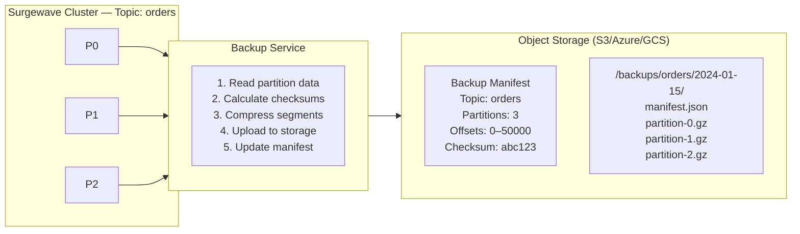
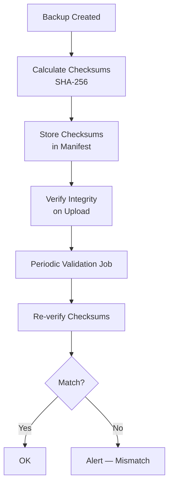

# Lesson 15.1: Backup Strategies

> **Difficulty:** Advanced | **Duration:** 45 min | **Prerequisites:** Unit 14 completion

## Overview

Learn how to implement comprehensive backup strategies for Surgewave topics, including snapshot creation, retention policies, and storage tier management.

## Learning Objectives

- Create topic snapshots and full backups
- Configure retention policies for different backup tiers
- Implement scheduled backup jobs
- Verify backup integrity with checksums
- Manage backup storage lifecycle

## Why Backups Matter

Backups provide the last line of defense against data loss:

| Scenario | Protection |
|----------|------------|
| Hardware failure | Restore from recent backup |
| Data corruption | Point-in-time recovery |
| Accidental deletion | Recover deleted topics |
| Ransomware | Clean restore from offline backup |
| Compliance | Audit trail and legal holds |

## Backup Architecture

## Backup Types

| Type | Data Captured | Storage | Speed | Best For |
|------|--------------|---------|-------|----------|
| **Full Backup** | Complete copy of all topic data | Large | Slow | Initial backup, periodic archive |
| **Incremental** | Only new data since last backup | Small | Fast | Frequent backups, low RPO |
| **Snapshot** | Point-in-time metadata + offset positions | Minimal | Very fast | Consistency checkpoints |

## Retention Policy Tiers

| Tier | Frequency | Retention | Storage Class | Use Case |
|------|-----------|-----------|---------------|----------|
| Hot | Hourly | 24 hours | Standard | Quick restore |
| Warm | Daily | 7 days | Infrequent | Recent recovery |
| Cold | Weekly | 4 weeks | Archive | DR scenarios |
| Glacier | Monthly | 12 months | Deep Archive | Compliance |

Timeline: Hot covers `Now–1d`, Warm `Now–7d`, Cold `Now–30d`, Glacier `Now–365d`.

## Backup Verification Flow

Verification steps: (1) download backup metadata, (2) verify file exists, (3) validate checksum, (4) optionally restore to a test cluster, (5) compare message counts.

## Best Practices

| Practice | Description |
|----------|-------------|
| 3-2-1 Rule | 3 copies, 2 different media, 1 offsite |
| Encryption | Encrypt backups at rest and in transit |
| Verification | Regularly test backup restoration |
| Monitoring | Alert on backup failures immediately |
| Documentation | Maintain runbooks for restore procedures |

## Exercise

In this exercise, you will:

1. Create a backup service that exports topic data
2. Implement retention policies with automatic cleanup
3. Calculate and verify checksums for backup integrity
4. Schedule periodic backups with different frequencies
5. List and manage existing backups

---

**Instructions:** [INSTRUCTIONS.md](INSTRUCTIONS.md)
