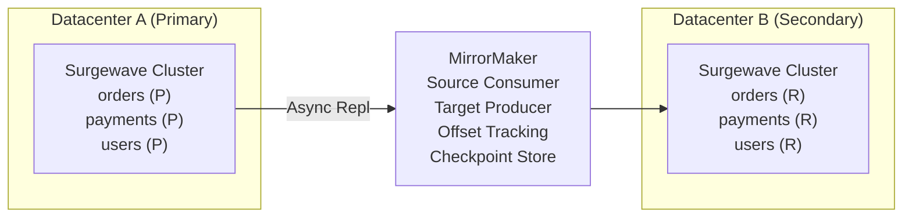

# Lesson 15.2: Cross-Datacenter Replication

> **Difficulty:** Advanced | **Duration:** 60 min | **Prerequisites:** Lesson 15.1

## Overview

Learn how to implement cross-datacenter replication for Surgewave clusters using MirrorMaker patterns, enabling geographic redundancy and disaster recovery capabilities.

## Learning Objectives

- Understand MirrorMaker concepts and architecture
- Configure asynchronous replication between datacenters
- Monitor replication lag and health
- Handle topic mapping and offset translation
- Implement bidirectional replication patterns

## Why Cross-Datacenter Replication?

Cross-datacenter replication provides critical capabilities:

| Capability | Description |
|------------|-------------|
| Geographic Redundancy | Survive regional outages |
| Disaster Recovery | Hot standby for failover |
| Data Locality | Reduce latency for regional consumers |
| Compliance | Data residency requirements |
| Migration | Zero-downtime cluster migration |

## Replication Architecture

## Replication Modes

| Mode | Pattern | Use |
|------|---------|-----|
| **Active-Passive** | Primary DC (Write) → MirrorMaker → Standby DC (Read/Idle) | Simple DR, lower cost |
| **Active-Active** | DC-A (Read/Write) ↔ MirrorMaker ↔ DC-B (Read/Write) | Multi-region writes, complex conflict handling |
| **Hub-and-Spoke** | Spoke 1 & Spoke 2 → Central Hub | Regional aggregation, global analytics |

## Lag Monitoring

**Time-based lag:** Source latest message is at `t-1s` (now); target has only replicated to `t-3s`. **Lag = 3 seconds.**

**Offset-based lag:** Source latest offset = 10; target latest offset = 7. **Offset lag = 3 messages.**

Alert when lag exceeds your RPO threshold.

## Topic Mapping Strategies

| Strategy | Example |
|----------|---------|
| **Identity** (same name) | `orders` → `orders` |
| **Prefixed** (cluster prefix) | `orders` → `dc-a.orders` |
| **Custom** (flexible rules) | `prod.orders` → `dr-orders`; `prod.*` → `backup-${topic}` |

## Best Practices

| Practice | Description |
|----------|-------------|
| Monitor Lag | Alert when lag exceeds RPO threshold |
| Offset Checkpointing | Enable automatic offset sync for failover |
| Topic Filtering | Only replicate critical topics |
| Compression | Enable compression for WAN efficiency |
| Heartbeats | Monitor replicator health |

## Exercise

In this exercise, you will:

1. Set up two Surgewave clusters simulating different datacenters
2. Configure a replication bridge between clusters
3. Implement lag monitoring with alerts
4. Handle topic mapping between clusters
5. Test failover scenarios

---

**Instructions:** [INSTRUCTIONS.md](INSTRUCTIONS.md)
