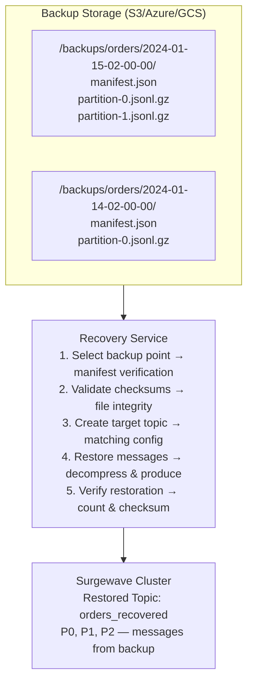
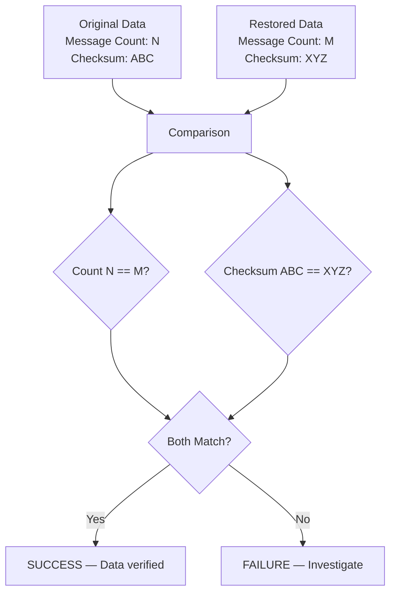

# Lesson 15.4: Data Recovery

> **Difficulty:** Advanced | **Duration:** 45 min | **Prerequisites:** Lesson 15.3

## Overview

Learn how to restore Surgewave topics from backups, perform point-in-time recovery, and verify data consistency after restoration.

## Learning Objectives

- Restore topics from backup files
- Perform point-in-time recovery
- Verify data consistency with checksums
- Handle partial recovery scenarios
- Implement recovery validation

## Why Data Recovery Matters

Effective data recovery ensures:

| Capability | Description |
|------------|-------------|
| Business Continuity | Resume operations after data loss |
| Compliance | Meet data retention requirements |
| Audit Trail | Restore historical data for analysis |
| Testing | Create production-like test environments |
| Migration | Move data between environments |

## Recovery Architecture

## Point-in-Time Recovery

Backups: B1 @ 12am, B2 @ 6am, B3 @ 12pm, B4 @ 6pm, B5 @ 12am (next day). Data loss event at 4pm.

| Option | Approach | RPO |
|--------|----------|-----|
| **1** | Restore from B3 (12pm) — lose 4 hours of data | 4 hours |
| **2** | Restore B3 + incremental replay from replication log | Minutes |
| **3** | Restore B3 + manual reconciliation of lost transactions | Zero (with effort) |

## Consistency Verification

## Recovery Strategies

| Strategy | RPO | RTO | Complexity | Use Case |
|----------|-----|-----|------------|----------|
| Full Restore | Hours | Hours | Low | Complete data loss |
| Incremental | Minutes | Minutes | Medium | Recent data loss |
| Point-in-Time | Variable | Hours | High | Specific timestamp |
| Partial | N/A | Minutes | Medium | Specific topics only |

## Best Practices

| Practice | Description |
|----------|-------------|
| Test Regularly | Perform recovery drills quarterly |
| Verify Backups | Validate backup integrity before relying on them |
| Document Process | Maintain detailed runbooks |
| Automate | Script common recovery scenarios |
| Retain Logs | Keep recovery logs for audit |

## Exercise

In this exercise, you will:

1. Create a recovery service
2. Restore topics from backups
3. Implement point-in-time recovery
4. Verify data consistency
5. Handle partial recovery scenarios

---

**Instructions:** [INSTRUCTIONS.md](INSTRUCTIONS.md)
