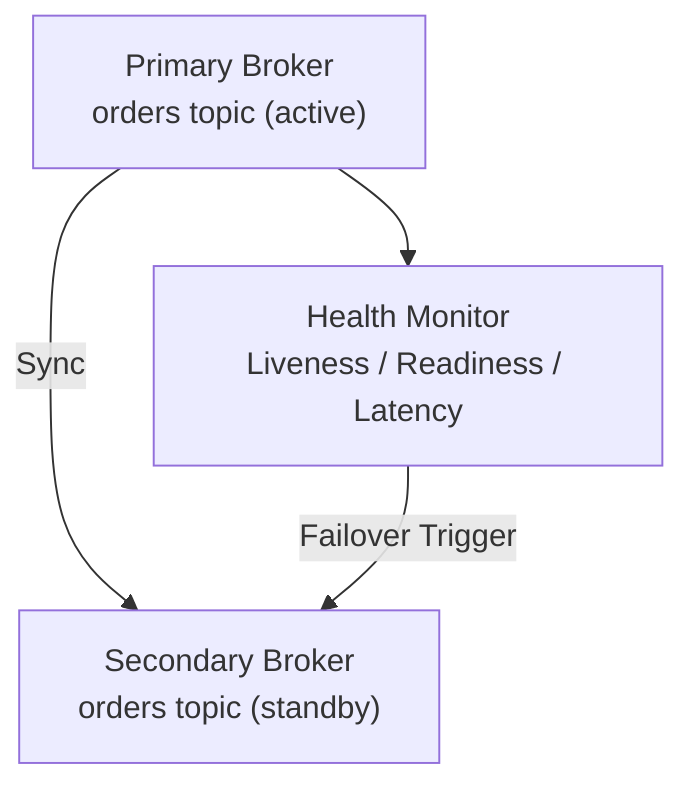

# Unit 15 Project: DR Simulation - Failover Test Suite

Build a comprehensive disaster recovery simulation that tests failover scenarios with health checks and automated recovery.

## Scenario

You're building a DR test suite for a critical messaging system. The system must:
1. Simulate primary/secondary broker topology
2. Monitor broker health with configurable health checks
3. Execute automatic failover when primary fails
4. Verify data integrity after failover
5. Generate DR test reports

## Requirements

### Functional Requirements

- [ ] Implement health check system with configurable intervals
- [ ] Simulate broker failure scenarios (network, crash, slow response)
- [ ] Execute automatic failover to secondary broker
- [ ] Verify message continuity after failover (no data loss)
- [ ] Generate failover test report with RTO/RPO metrics

### Technical Requirements

- [ ] Use async health monitoring with cancellation support
- [ ] Implement circuit breaker pattern for failure detection
- [ ] Track failover timing (RTO measurement)
- [ ] Calculate data loss metrics (RPO measurement)
- [ ] Handle graceful shutdown during failover

## Architecture



## Expected Output

```
=== DR Failover Test Suite ===

[Setup] Initializing primary and secondary brokers...
[Setup] Primary broker ready at localhost:9092
[Setup] Secondary broker ready at localhost:9093
[Setup] Initial sync completed: 100 messages replicated

[Health] Starting health monitoring (interval: 1s)
[Health] Primary: HEALTHY (latency: 5ms)
[Health] Primary: HEALTHY (latency: 4ms)

[Test 1] Simulating primary broker failure...
[Health] Primary: UNHEALTHY (connection refused)
[Health] Primary: UNHEALTHY (retry 1/3)
[Health] Primary: UNHEALTHY (retry 2/3)
[Health] Primary: UNHEALTHY (retry 3/3)
[Failover] Circuit breaker OPEN - initiating failover

[Failover] Switching to secondary broker...
[Failover] Verifying secondary readiness...
[Failover] Secondary promoted to primary
[Failover] Failover completed in 2.3 seconds (RTO: 2.3s)

[Verify] Checking message continuity...
[Verify] Messages before failure: 150
[Verify] Messages after recovery: 148
[Verify] Data loss: 2 messages (RPO: 2 messages)

[Report] DR Test Summary:
  - Test: Primary Broker Failure
  - Result: PASSED
  - RTO: 2.3 seconds (target: < 5s)
  - RPO: 2 messages (target: < 10 messages)
  - Failover trigger: Connection refused
  - Recovery action: Automatic promotion

=== DR Test Suite Complete ===
```

## Health Check Configuration

```csharp
public record HealthCheckConfig(
    TimeSpan Interval,          // Check frequency
    TimeSpan Timeout,           // Max wait per check
    int FailureThreshold,       // Failures before unhealthy
    int SuccessThreshold        // Successes before healthy
);

public enum BrokerHealth { Healthy, Degraded, Unhealthy, Unknown }
```

## Getting Started

```bash
cd bootcamp/unit-15/project/start
dotnet run
```

## Hints

1. Use `Task.Delay` with `CancellationToken` for health check intervals
2. Implement a simple state machine for circuit breaker (Closed -> Open -> HalfOpen)
3. Track timestamps for RTO calculation
4. Compare message counts before/after for RPO measurement
5. Use `Stopwatch` for accurate timing measurements

## Evaluation Criteria

| Criteria | Points |
|----------|--------|
| Health monitoring works correctly | 20 |
| Failure detection triggers failover | 25 |
| Failover executes successfully | 25 |
| RTO/RPO metrics calculated | 15 |
| Test report generated | 15 |

## Solution

Compare your implementation with [completed/](completed/README.md) when done.
