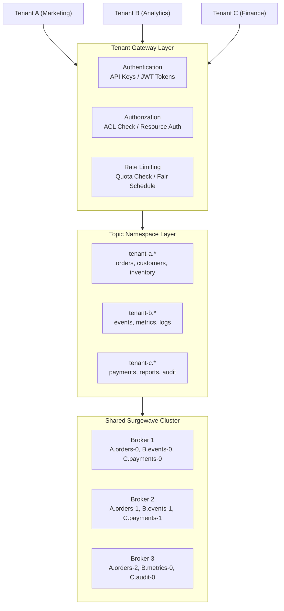

# Unit 25: Multi-Tenancy

Implement multi-tenant patterns for Surgewave clusters to support multiple isolated tenants sharing the same infrastructure.

## Learning Objectives

By the end of this unit, you will be able to:

- Understand multi-tenancy isolation levels and their trade-offs
- Implement topic namespacing strategies for tenant separation
- Configure quota management for fair resource allocation
- Set up per-tenant access control and authorization
- Monitor and manage resources across multiple tenants

## Lessons

| Lesson | Topic | Description |
|--------|-------|-------------|
| [16.1](lesson-1/README.md) | Tenant Isolation Concepts | Why multi-tenancy, isolation levels, shared vs dedicated |
| [16.2](lesson-2/README.md) | Topic Namespacing | Naming conventions, prefix strategies, tenant identification |
| [16.3](lesson-3/README.md) | Quota Management | Producer/consumer quotas, rate limiting, fair scheduling |
| [16.4](lesson-4/README.md) | Access Control | Per-tenant ACLs, resource authorization, audit logging |
| [16.5](lesson-5/README.md) | Resource Management | Partition allocation, storage limits, monitoring per tenant |

## Prerequisites

- Completed Unit 1: Surgewave Fundamentals
- Completed Unit 3: Advanced Messaging
- Understanding of distributed systems concepts

## Multi-Tenancy Architecture Overview



## Isolation Levels

| | Shared Everything | Namespace Isolation | Dedicated Cluster |
|---|---|---|---|
| **Isolation** | Low | Balanced | High |
| **Description** | All tenants, same topics, same partitions | Shared brokers, separate topics, quotas per tenant | Separate clusters, full isolation |
| **Cost** | $ | $$ | $$$ |
| **Complexity** | Low | Medium | High |
| **Isolation Level** | None | Logical | Physical |
| **Best For** | Dev/Test | Production SaaS | Enterprise |

## Key Patterns

### Tenant Context

```csharp
public record TenantContext(string TenantId, string TenantName)
{
    public string GetTopicName(string baseTopic) => $"{TenantId}.{baseTopic}";
    public string GetConsumerGroupId(string baseGroup) => $"{TenantId}-{baseGroup}";
}
```

### Tenant-Aware Producer

```csharp
public class TenantProducer<TKey, TValue>
{
    private readonly TenantContext _tenant;
    private readonly SurgewaveProducer<TKey, TValue> _producer;

    public async Task ProduceAsync(string baseTopic, TKey key, TValue value)
    {
        var tenantTopic = _tenant.GetTopicName(baseTopic);
        await _producer.ProduceAsync(tenantTopic, key, value);
    }
}
```

### Quota Configuration

```csharp
public record TenantQuota(
    long ProducerBytesPerSecond,
    long ConsumerBytesPerSecond,
    int MaxPartitions,
    long MaxStorageBytes);
```

## Resource Management Strategy

| Resource | Allocation Strategy | Enforcement |
|----------|---------------------|-------------|
| Topics | Namespace prefix | Naming conventions |
| Partitions | Per-tenant limits | Admin API |
| Throughput | Rate limiting | Token bucket |
| Storage | Quota per tenant | Monitoring + alerts |
| Connections | Connection limits | Connection manager |

## Monitoring Considerations

**Per-Tenant Metrics:**

| Tenant | Messages/sec | Bytes/sec | Partitions | Quota Utilization |
|--------|-------------|-----------|------------|-------------------|
| Tenant A | 1,200 | 12 MB | 24 | 45% |
| Tenant B | 800 | 8 MB | 16 | 75% (warning) |
| Tenant C | 2,100 | 21 MB | 32 | 95% (alert!) |

---

**Ready?** [Start Lesson 16.1: Tenant Isolation Concepts](lesson-1/README.md)
