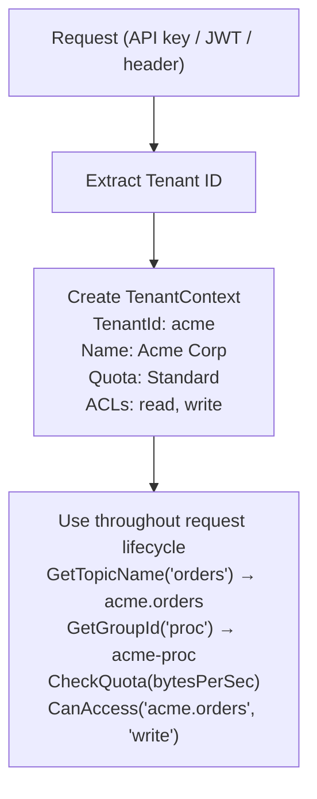

# Lesson 16.1: Tenant Isolation Concepts

> **Difficulty:** Advanced | **Duration:** 30 min | **Prerequisites:** Unit 15 completion

## Overview

Learn the fundamentals of multi-tenancy in messaging systems, including why organizations adopt multi-tenant architectures and the various isolation levels available.

## Learning Objectives

- Understand the business drivers for multi-tenancy
- Compare shared vs dedicated resource models
- Evaluate different isolation levels and their trade-offs
- Design tenant context patterns for Surgewave applications

## Why Multi-Tenancy?

Multi-tenancy allows a single Surgewave cluster to serve multiple customers, teams, or applications while maintaining logical separation.

| Driver | Description |
|--------|-------------|
| Cost Efficiency | Share infrastructure costs across tenants |
| Operational Simplicity | Single cluster to manage instead of many |
| Resource Utilization | Better use of available capacity |
| Scalability | Add tenants without new infrastructure |
| Time to Market | Faster onboarding for new tenants |

## Isolation Levels

| Level | Description | Pros | Cons |
|-------|-------------|------|------|
| **1 — Shared Topics** | All tenants share the same topic (e.g. `events`); messages from A, B, C are interleaved | Simple, efficient | No privacy, noisy neighbour |
| **2 — Topic-Level Isolation** | Each tenant gets their own topics (`tenant-a.events`, `tenant-b.events`); brokers shared | Data isolation, per-tenant quotas | Shared broker resources |
| **3 — Broker-Level Isolation** | Dedicated broker sets per tenant; complete physical separation | Full isolation | High cost, complexity |

## Shared vs Dedicated Models

| Property | Shared Model | Dedicated Model |
|----------|-------------|-----------------|
| **Infrastructure** | Single cluster for all tenants (A, B, C) | One cluster per tenant (Cluster A, B, C, D…) |
| **Cost** | $ | $$$$ |
| **Complexity** | Low | High |
| **Isolation** | Logical | Physical |
| **Best for** | SaaS, multi-team | Compliance, large enterprise customers |

## Tenant Context Pattern

A tenant context encapsulates all tenant-specific information needed for operations:

## Exercise

In this exercise, you'll:

1. Create a tenant context record with essential properties
2. Implement tenant identification from environment/configuration
3. Build a simple tenant registry for managing multiple tenants
4. Demonstrate tenant-scoped topic and group naming

---

**Instructions:** [INSTRUCTIONS.md](INSTRUCTIONS.md)
