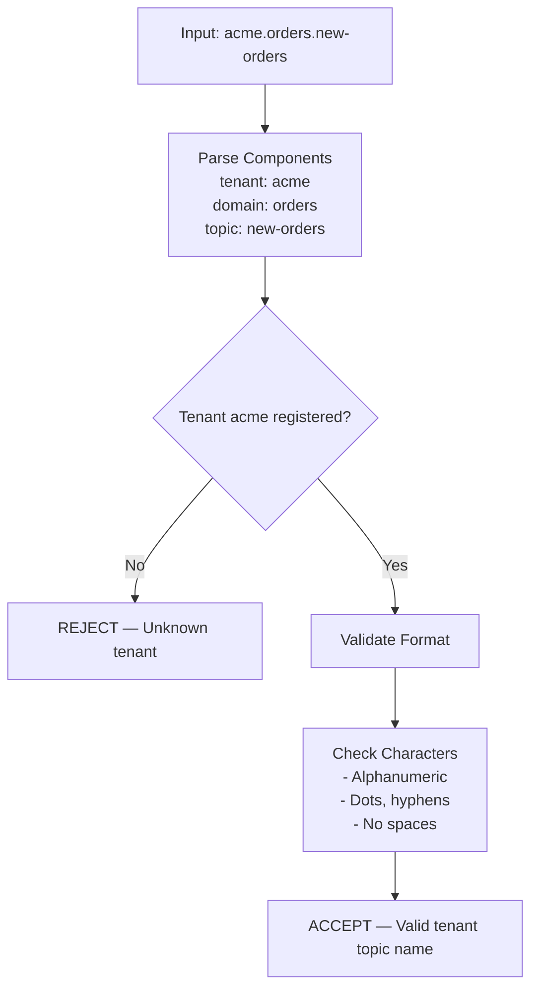
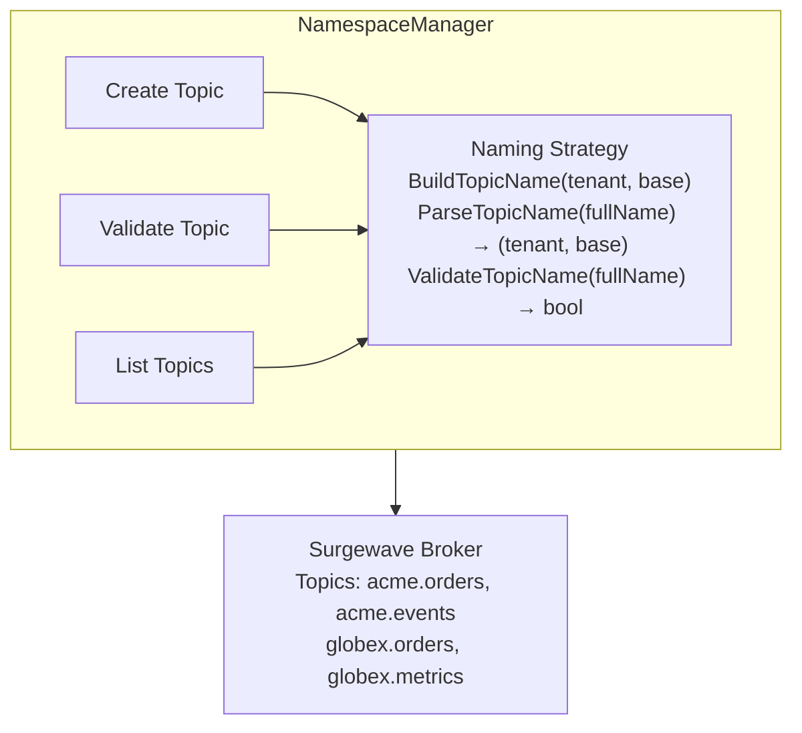

# Lesson 16.2: Topic Namespacing

> **Difficulty:** Advanced | **Duration:** 30 min | **Prerequisites:** Lesson 16.1

## Overview

Learn how to implement topic namespacing strategies that provide clean separation between tenants while maintaining consistency and discoverability.

## Learning Objectives

- Design effective topic naming conventions for multi-tenancy
- Implement prefix-based namespace strategies
- Create tenant-aware topic management utilities
- Handle namespace validation and enforcement

## Why Topic Namespacing?

Topic namespacing provides logical isolation between tenants at the messaging level.

| Benefit | Description |
|---------|-------------|
| Data Isolation | Each tenant's messages are physically separated |
| Access Control | Easy to apply ACLs based on topic prefix |
| Monitoring | Aggregate metrics by tenant namespace |
| Discovery | Predictable topic names for tooling |
| Cleanup | Simple to identify and remove all tenant resources |

## Naming Convention Patterns

| Strategy | Format | Examples | Pros | Cons |
|----------|--------|---------|------|------|
| **1. Simple Prefix** | `{tenant-id}.{topic-name}` | `acme.orders`, `acme.events`, `globex.orders` | Simple, clear ownership | Flat structure |
| **2. Hierarchical Namespace** | `{tenant-id}.{domain}.{topic-name}` | `acme.sales.orders`, `acme.inventory.stock-levels`, `globex.analytics.events` | Organised, supports sub-domains | More complex naming rules |
| **3. Environment-Aware** | `{env}.{tenant-id}.{topic-name}` | `prod.acme.orders`, `staging.acme.orders`, `dev.acme.orders` | Environment separation, safe testing | Requires env context everywhere |

## Namespace Validation Flow

## Namespace Manager Pattern

## Exercise

In this exercise, you'll:

1. Implement a topic naming strategy with validation
2. Create a namespace manager for tenant topics
3. Build utilities for listing and filtering tenant topics
4. Demonstrate namespace isolation with multiple tenants

---

**Instructions:** [INSTRUCTIONS.md](INSTRUCTIONS.md)
