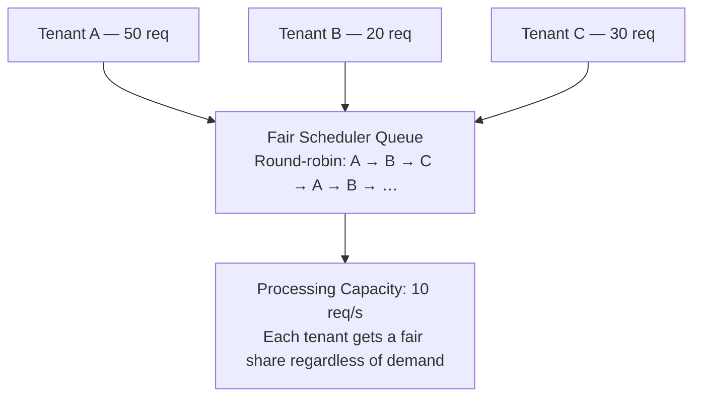
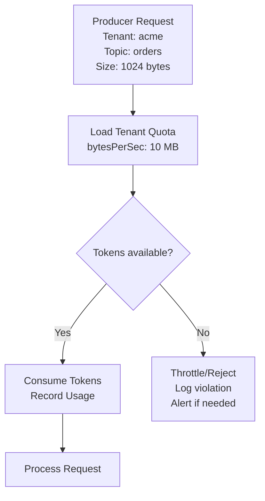

# Lesson 16.3: Quota Management

> **Difficulty:** Advanced | **Duration:** 45 min | **Prerequisites:** Lesson 16.2

## Overview

Learn how to implement quota management for multi-tenant Surgewave clusters, including rate limiting, fair scheduling, and resource allocation.

## Learning Objectives

- Define and enforce tenant quotas for producers and consumers
- Implement token bucket rate limiting algorithms
- Create fair scheduling policies for shared resources
- Monitor quota usage and handle violations

## Why Quota Management?

Quotas prevent any single tenant from monopolizing shared cluster resources.

| Challenge | Solution |
|-----------|----------|
| Noisy neighbors | Rate limiting per tenant |
| Resource exhaustion | Throughput quotas |
| Unfair distribution | Fair scheduling |
| Cost allocation | Usage tracking |
| SLA compliance | Guaranteed minimums |

## Quota Types

**Producer Quotas:**

| Metric | Limit | Burst |
|--------|-------|-------|
| Bytes/Second | 10 MB/s | 15 MB/s |
| Messages/Second | 10 K/s | 15 K/s |
| Request Rate | 100 req/s | 150 req/s |

**Consumer Quotas:** Fetch Bytes/Sec limit 50 MB/s; Partitions limit 100; Consumer Groups limit 10.

**Storage Quotas:** Total Storage limit 100 GB; Topics limit 50; Retention max 7 days.

## Token Bucket Algorithm

Capacity: 100 tokens; refill rate: 10 tokens/second.

| Time | Event | Tokens Remaining |
|------|-------|-----------------|
| 0 s | Full bucket | 100 |
| 0.1 s | Request 1 (30 tokens consumed) | 70 |
| 0.2 s | Request 2 (50 consumed + 1 refilled) | 21 |
| 0.3 s | Request 3 needs 30 — **BLOCKED** (only 21 available); wait or reject | 22 |
| 1.3 s | 10 tokens refilled; Request 3 can proceed | 32 |

## Fair Scheduling

## Quota Enforcement Flow

## Exercise

In this exercise, you'll:

1. Define tenant quota configurations
2. Implement a token bucket rate limiter
3. Create a quota manager that enforces limits
4. Demonstrate rate limiting with simulated traffic

---

**Instructions:** [INSTRUCTIONS.md](INSTRUCTIONS.md)
