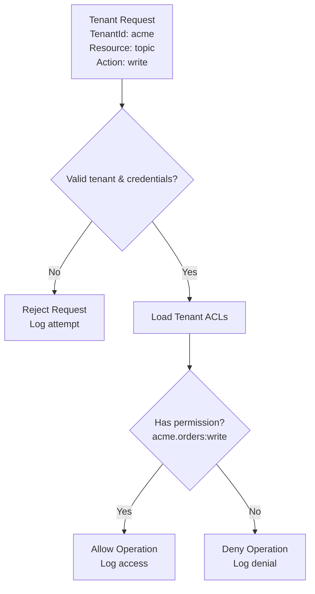

# Lesson 16.4: Access Control

> **Difficulty:** Advanced | **Duration:** 45 min | **Prerequisites:** Lesson 16.3

## Overview

Learn how to implement per-tenant access control lists (ACLs), resource authorization, and audit logging for multi-tenant Surgewave clusters.

## Learning Objectives

- Design and implement tenant-scoped ACL systems
- Create resource authorization policies
- Build audit logging for compliance and security
- Handle cross-tenant access scenarios securely

## Why Access Control?

Access control ensures tenants can only access their own resources while enabling controlled sharing when needed.

| Security Concern | Solution |
|-----------------|----------|
| Data leakage | Tenant-scoped permissions |
| Unauthorized access | ACL enforcement |
| Compliance | Audit logging |
| Privilege escalation | Least privilege principle |
| Cross-tenant attacks | Resource isolation |

## ACL Architecture



## Permission Model

| Resource Type | Allowed Operations |
|--------------|-------------------|
| **TOPIC** | Read, Write, Create, Delete, Describe, Alter |
| **GROUP** | Read, Delete, Describe |
| **CLUSTER** | Create, Alter, Describe, ClusterAction |
| **TRANSACT** | Read, Write, Describe |

ACL entry format: `Principal`, `ResourceType`, `ResourcePattern`, `Operation`, `Permission`. Example: `tenant:acme` / `Topic` / `acme.*` / `Write` / `Allow`.

## Resource Pattern Matching

| Pattern Type | Pattern | Matches |
|-------------|---------|---------|
| **Literal** | `acme.orders` | `acme.orders` only |
| **Prefix** | `acme.*` | `acme.orders`, `acme.events`, `acme.anything` — not `globex.orders` or `acme-orders` |
| **Wildcard** | `*` | All resources (use carefully) |

Example evaluation for tenant `acme` with ACLs `acme.*: Read, Write (Allow)` and `acme.audit: Read (Allow), Write (Deny)`:

| Check | Result | Reason |
|-------|--------|--------|
| `acme.orders:Write` | Allow | Matches `acme.*` |
| `acme.audit:Write` | Deny | Explicit deny wins |
| `acme.audit:Read` | Allow | Explicit allow |
| `globex.orders:Read` | Deny | No matching ACL |

## Audit Logging

Every access attempt generates an audit record:

```json
{
  "Timestamp": "2024-01-15T10:30:00Z",
  "TenantId": "acme",
  "Principal": "user:alice@acme.com",
  "Action": "Produce",
  "Resource": "acme.orders",
  "Result": "Allowed",
  "ClientIP": "192.168.1.100",
  "RequestId": "req-abc-123"
}
```

Audit log destinations: Local file (`audit.log`), Surgewave topic (`audit.events`), external SIEM (Splunk, etc.).

Typical queries: all denied requests for a tenant; access patterns for sensitive topics; cross-tenant access attempts (security alerts).

## Exercise

In this exercise, you'll:

1. Define ACL entries and permission types
2. Implement an ACL evaluator with pattern matching
3. Create an authorization service for tenant requests
4. Build audit logging for access attempts

---

**Instructions:** [INSTRUCTIONS.md](INSTRUCTIONS.md)
