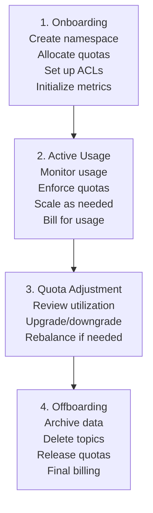

# Lesson 16.5: Resource Management

> **Difficulty:** Advanced | **Duration:** 45 min | **Prerequisites:** Lesson 16.4

## Overview

Learn how to manage and monitor resources across multiple tenants, including partition allocation, storage limits, and per-tenant monitoring.

## Learning Objectives

- Implement partition allocation strategies per tenant
- Set up storage limits and enforcement
- Build per-tenant monitoring dashboards
- Create resource utilization reports

## Why Resource Management?

Effective resource management ensures fair distribution and prevents resource exhaustion in multi-tenant environments.

| Challenge | Solution |
|-----------|----------|
| Resource starvation | Reserved minimums |
| Over-provisioning | Usage-based limits |
| Capacity planning | Utilization monitoring |
| Cost allocation | Per-tenant metrics |
| Performance isolation | Partition placement |

## Resource Allocation Model

Cluster capacity: 1000 partitions total — Reserved Pool: 200 (min guarantees), Shared Pool: 600 (on-demand), Buffer: 200 (headroom).

| Tenant | Tier | Reserved | Current | Limit |
|--------|------|---------|---------|-------|
| Tenant A | Premium | 100 | 150 | 300 |
| Tenant B | Standard | 50 | 45 | 100 |
| Tenant C | Basic | 20 | 18 | 50 |

## Storage Management

| Storage Tier | Data Age | Access Speed | Cost |
|-------------|---------|--------------|------|
| Hot (SSD) | < 7 days | Fast | $$$ |
| Warm | 7–30 days | Medium | $$ |
| Cold | > 30 days (archived) | Slow | $ |

Example — Tenant `acme` quota 100 GB, used 75 GB (75% — Warning):

| Topic | Storage Used |
|-------|-------------|
| `acme.orders` | 30 GB |
| `acme.events` | 25 GB |
| `acme.logs` | 15 GB |
| `acme.metrics` | 5 GB |

Status: Warning (> 70% used). Action: consider cleanup or quota increase.

## Monitoring Dashboard

**Cluster overview:** Active Tenants: 25, Total Topics: 450, Total Partitions: 850, Messages/s: 125 K, Bytes/s: 1.2 GB, Avg Latency: 2.5 ms.

Top tenants by throughput: globex 45 000 msg/s, acme 32 000, initech 22 000, umbrella 15 000, others 11 000.

| Tenant | Partitions | Storage | Producer | Consumer |
|--------|-----------|---------|----------|---------|
| globex | 150/200 (75%) | 80/100 GB | 8/10 MB/s | 40/50 MB/s |
| acme | 85/100 (85%) | 45/50 GB | 4/5 MB/s | 20/25 MB/s |
| initech | 40/50 (80%) | 18/20 GB | 1.8/2 MB/s | 8/10 MB/s |

Alerts: `[WARN] acme: Partition usage at 85% of quota` | `[INFO] globex: Producer quota trending 95%`.

## Resource Lifecycle

## Exercise

In this exercise, you'll:

1. Create a resource allocation tracker per tenant
2. Implement storage usage monitoring
3. Build a multi-tenant metrics aggregator
4. Create utilization reports and alerts

---

**Instructions:** [INSTRUCTIONS.md](INSTRUCTIONS.md)
