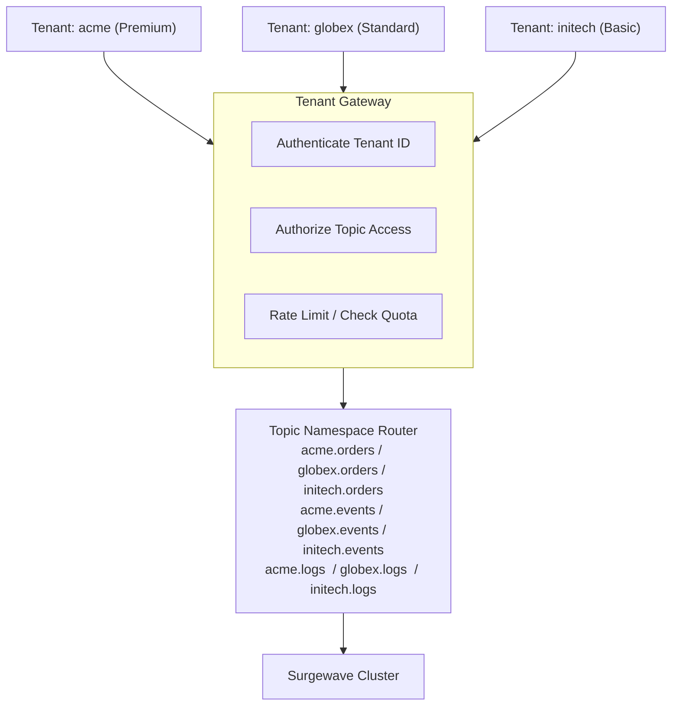

# Unit 16 Project: SaaS Platform - Multi-Tenant Message Routing

Build a multi-tenant SaaS messaging platform with tenant isolation, namespace routing, and quota management.

## Scenario

You're building a SaaS platform where multiple tenants share the same Surgewave infrastructure. Each tenant must:
1. Have isolated topic namespaces (no cross-tenant access)
2. Respect individual quota limits
3. Use tenant-aware producers and consumers
4. Track per-tenant metrics
5. Enforce access control

## Requirements

### Functional Requirements

- [ ] Register and manage multiple tenants with unique IDs
- [ ] Route messages to tenant-specific topics automatically
- [ ] Enforce per-tenant message rate limits
- [ ] Track usage metrics per tenant (messages, bytes)
- [ ] Prevent cross-tenant message access

### Technical Requirements

- [ ] Implement TenantContext for request scoping
- [ ] Use topic namespacing with tenant prefixes
- [ ] Apply rate limiting with token bucket algorithm
- [ ] Thread-safe tenant metrics collection
- [ ] Clean tenant isolation verification

## Architecture



## Expected Output

```
=== Multi-Tenant SaaS Platform ===

[Setup] Registering tenants...
[Tenant] Registered: acme (Premium tier, 1000 msg/s limit)
[Tenant] Registered: globex (Standard tier, 500 msg/s limit)
[Tenant] Registered: initech (Basic tier, 100 msg/s limit)

[Namespace] Created topic: acme.orders (3 partitions)
[Namespace] Created topic: globex.orders (2 partitions)
[Namespace] Created topic: initech.orders (1 partition)

[Producer] Tenant acme: Producing order messages...
[Producer] acme.orders <- Order ORD-001 (customer: C-100)
[Producer] acme.orders <- Order ORD-002 (customer: C-101)
[Quota] Tenant acme: 2/1000 messages (0.2% of limit)

[Producer] Tenant globex: Producing order messages...
[Producer] globex.orders <- Order ORD-001 (customer: G-200)
[Quota] Tenant globex: 1/500 messages (0.2% of limit)

[Producer] Tenant initech: Testing rate limit...
[Quota] Tenant initech: Rate limit exceeded! (100/100)
[Quota] Throttling tenant initech for 1000ms

[Consumer] Tenant acme: Consuming from acme.orders...
[Consumer] Received: Order ORD-001 for customer C-100
[Consumer] Received: Order ORD-002 for customer C-101

[Isolation] Testing cross-tenant access...
[Isolation] BLOCKED: Tenant globex cannot access acme.orders
[Isolation] Tenant isolation verified!

[Metrics] Per-Tenant Usage Report:
  acme:    5 messages, 2.5 KB (Premium)
  globex:  3 messages, 1.2 KB (Standard)
  initech: 100 messages, 45 KB (Basic) [THROTTLED]

=== Multi-Tenant Platform Complete ===
```

## Tenant Configuration

```csharp
public record TenantConfig(
    string TenantId,
    string TenantName,
    TenantTier Tier,
    int RateLimitPerSecond,
    int MaxPartitionsPerTopic,
    long MaxStorageBytes
);

public enum TenantTier { Basic, Standard, Premium, Enterprise }

public record TenantContext(string TenantId)
{
    public string GetTopicName(string baseTopic) => $"{TenantId}.{baseTopic}";
    public string GetConsumerGroup(string baseGroup) => $"{TenantId}-{baseGroup}";
}
```

## Getting Started

```bash
cd bootcamp/unit-16/project/start
dotnet run
```

## Hints

1. Use a `ConcurrentDictionary<string, TenantConfig>` for tenant registry
2. Implement rate limiting with `SemaphoreSlim` or token bucket
3. Prefix all topic names with tenant ID for namespace isolation
4. Track metrics in a thread-safe manner using `Interlocked`
5. Verify isolation by attempting cross-tenant access (should fail)

## Evaluation Criteria

| Criteria | Points |
|----------|--------|
| Tenant registration works | 15 |
| Topic namespacing correct | 20 |
| Rate limiting enforced | 25 |
| Cross-tenant isolation verified | 25 |
| Metrics tracked accurately | 15 |

## Solution

Compare your implementation with [completed/](completed/README.md) when done.
