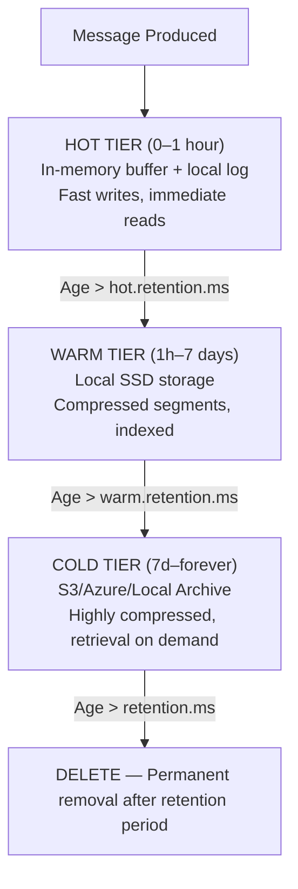

# Unit 26: Tiered Storage

Master tiered storage strategies in Surgewave to optimize cost and performance by automatically moving data between hot, warm, and cold storage tiers based on access patterns and retention policies.

## Learning Objectives

By the end of this unit, you will be able to:

- Understand hot/warm/cold storage tiers and their cost-performance tradeoffs
- Configure local file system as a cold storage tier
- Integrate S3/MinIO for scalable cloud storage
- Set up Azure Blob Storage for enterprise cloud scenarios
- Implement retention policies and lifecycle management for cost optimization

## Lessons

| Lesson | Topic | Description |
|--------|-------|-------------|
| [24.1](lesson-1/README.md) | Tiered Storage Concepts | Hot/warm/cold tiers, data movement triggers, cost optimization |
| [24.2](lesson-2/README.md) | Local File System Tier | Configuring local disk as cold storage, compaction strategies |
| [24.3](lesson-3/README.md) | S3/MinIO Integration | Cloud object storage, MinIO for local development |
| [24.4](lesson-4/README.md) | Azure Blob Storage | Azure integration, access tiers, lifecycle management |
| [24.5](lesson-5/README.md) | Retention and Lifecycle Policies | Automated data movement, TTL configuration, cost analysis |

## Prerequisites

- Completed Unit 1: Surgewave Fundamentals
- Completed Unit 2: Producer & Consumer Basics
- Understanding of storage concepts and data retention
- Basic familiarity with cloud storage (AWS S3 or Azure Blob)

## Why Tiered Storage Matters

| Tier | Storage | Cost/GB/month | Latency | Examples |
|------|---------|--------------|---------|----------|
| Hot (Recent, Frequently Accessed) | Memory or fast NVMe SSDs | $0.10–0.50 | Sub-millisecond | Last 1 hour of events, active sessions |
| Warm (Recent, Occasionally Accessed) | Local SSDs or standard cloud storage | $0.02–0.10 | Milliseconds | Last 7 days, recent audit logs |
| Cold (Historical, Rarely Accessed) | Cheap HDDs or archive cloud storage | $0.004–0.02 | Seconds to minutes | Compliance data, historical analytics |

## Tiered Storage Architecture



## Cost Optimization Examples

| Scenario | Without Tiering | With Tiering | Savings |
|----------|----------------|--------------|---------|
| 1TB/day, 90-day retention | $2,700/month | $540/month | 80% |
| 100GB/day, 1-year retention | $3,600/month | $720/month | 80% |
| 10TB, compliance (7 years) | $420,000 total | $84,000 total | 80% |

## Key Configuration Options

```csharp
// Example tiered storage configuration
await using var runtime = await SurgewaveRuntime.CreateBuilder()
    .WithPort(9092)
    .WithStorageMode(StorageMode.Tiered)
    .WithHotTierRetention(TimeSpan.FromHours(1))
    .WithWarmTierRetention(TimeSpan.FromDays(7))
    .WithColdTierStorage(new S3StorageConfig
    {
        Endpoint = "s3.amazonaws.com",
        Bucket = "my-surgewave-archive",
        Region = "us-east-1"
    })
    .Build()
    .StartAsync();
```

## Best Practices

| Practice | Description |
|----------|-------------|
| Start with warm tier | Don't over-optimize; add cold tier when needed |
| Monitor access patterns | Use metrics to tune tier transitions |
| Test retrieval times | Ensure cold tier latency meets SLAs |
| Use compression | Reduce storage costs across all tiers |
| Set up lifecycle rules | Automate data movement and deletion |
| Consider compliance | Some data must be retained for specific periods |

---

**Ready?** [Start Lesson 24.1: Tiered Storage Concepts](lesson-1/README.md)
