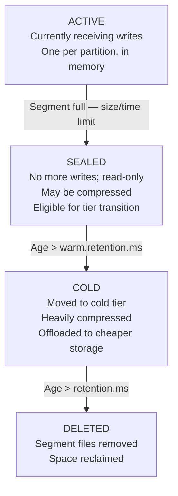

# Lesson 24.2: Local File System Tier

> **Difficulty:** Advanced | **Duration:** 40 min | **Prerequisites:** Lesson 24.1 completion

## Overview

Learn how to configure and use the local file system as a cold storage tier in Surgewave. Understand segment file management, compaction strategies, and how to optimize disk-based storage for cost-effective data retention.

## Learning Objectives

- Configure local file system as a cold tier
- Understand log segment file structure
- Implement segment compaction and cleanup
- Monitor disk usage and I/O performance
- Handle segment retrieval and caching

## Local File System Architecture

```
/data/surgewave/cold/
└── topics/
    ├── orders-events/
    │   ├── partition-0/
    │   │   ├── 00000000000000000000.log        (base offset: 0)
    │   │   ├── 00000000000000000000.index      (offset index)
    │   │   ├── 00000000000000000000.timeindex  (time index)
    │   │   ├── 00000000000001048576.log        (base offset: 1048576)
    │   │   ├── 00000000000001048576.index
    │   │   └── 00000000000001048576.timeindex
    │   └── partition-1/
    │       └── ...
    └── user-activity/
        └── ...
```

## Segment File Types

| File | Purpose | Format |
|------|---------|--------|
| `.log` | Actual message data in append-only format; typically 1 GB per segment | `[offset][size][crc][magic][attributes][timestamp][key]…` |
| `.index` | Maps offset → physical position in `.log`; sparse (every 4 KB of data) | `[relative_offset:4 B][position:4 B]` |
| `.timeindex` | Maps timestamp → offset for time-based queries (e.g. "fetch last hour") | `[timestamp:8 B][relative_offset:4 B]` |
| `.snapshot` (optional) | Compacted state for log-compacted topics; latest value per key | — |

## Segment Lifecycle



## Compression Strategies

| Algorithm | Ratio | Compress Speed | Decompress Speed | CPU | Recommended For |
|-----------|-------|---------------|-----------------|-----|-----------------|
| None | 1.0x | N/A | N/A | None | Hot tier |
| LZ4 | 2.5x | 780 MB/s | 4 500 MB/s | Low | Hot or warm tier |
| Snappy | 2.3x | 500 MB/s | 1 500 MB/s | Low | General purpose |
| Zstd (fast) | 3.0x | 400 MB/s | 1 200 MB/s | Medium | Warm tier |
| Zstd (best) | 4.5x | 50 MB/s | 1 200 MB/s | High | Cold tier |
| Gzip | 3.5x | 50 MB/s | 400 MB/s | High | Cold tier (legacy) |

## Configuration Options

```csharp
var coldTierConfig = new LocalFileSystemTierConfig
{
    // Base path for cold tier storage
    BasePath = "/data/surgewave/cold",

    // Segment settings
    SegmentBytes = 1L * 1024 * 1024 * 1024,  // 1 GB per segment
    SegmentMs = TimeSpan.FromHours(24),       // Or roll after 24 hours

    // Compression
    Compression = CompressionType.Zstd,
    CompressionLevel = 19,  // Max compression for cold tier

    // Index settings
    IndexIntervalBytes = 4096,  // Index entry every 4KB

    // Cleanup
    RetentionMs = TimeSpan.FromDays(90),
    RetentionBytes = null,  // No size-based retention
    CleanupPolicy = CleanupPolicy.Delete,  // or Compact

    // Performance
    FlushMessages = 10000,  // Flush to disk every 10k messages
    FlushMs = TimeSpan.FromSeconds(1),  // Or every second
};
```

## Best Practices

| Practice | Description |
|----------|-------------|
| Use dedicated disks | Separate cold tier storage from OS and hot tier |
| Enable compression | Always compress cold tier data (50-75% savings) |
| Monitor disk space | Alert when disk usage exceeds 80% |
| Use SSDs for index files | Keep .index files on SSD for fast lookups |
| Regular compaction | Schedule compaction during off-peak hours |
| Backup cold tier | Cold tier often contains compliance data |

## Exercise

In this exercise, you will:

1. Configure local file system cold tier storage
2. Write segments to disk with compression
3. Implement segment cleanup based on retention
4. Read data from cold tier segments
5. Monitor disk usage and segment statistics

---

**Instructions:** [INSTRUCTIONS.md](INSTRUCTIONS.md)
