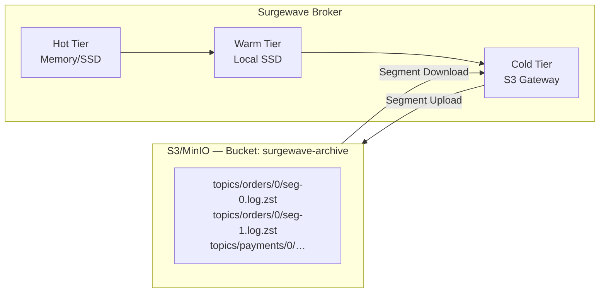

# Lesson 24.3: S3/MinIO Integration

> **Difficulty:** Advanced | **Duration:** 45 min | **Prerequisites:** Lesson 24.2 completion

## Overview

Learn how to integrate Amazon S3 or MinIO as a cold storage tier in Surgewave. Understand object storage concepts, configure S3-compatible storage, and implement efficient data upload and retrieval patterns.

## Learning Objectives

- Understand object storage concepts for cold tier
- Configure S3/MinIO as a storage backend
- Implement multipart uploads for large segments
- Handle retrieval with range requests
- Optimize costs with S3 storage classes

## Object Storage Architecture



## S3 Key Structure

Pattern: `{prefix}/{topic}/{partition}/{segment-name}`

Examples:
```
surgewave/topics/orders-events/0/00000000000000000000.log.zst
surgewave/topics/orders-events/0/00000000000001048576.log.zst
surgewave/topics/orders-events/1/00000000000000000000.log.zst
surgewave/topics/user-activity/0/00000000000000000000.log.zst
```

Metadata stored as object tags: `x-amz-meta-topic`, `x-amz-meta-partition`, `x-amz-meta-base-offset`, `x-amz-meta-end-offset`, `x-amz-meta-message-count`, `x-amz-meta-compressed-size`, `x-amz-meta-uncompressed-size`.

## S3 Storage Classes

| Class | Cost/GB/mo | Retrieval | Min Duration | Use Case |
|-------|-----------|-----------|-------------|----------|
| STANDARD | $0.023 | Instant | None | Hot data |
| STANDARD_IA | $0.0125 | Instant | 30 days | Warm (7–30 d) |
| INTELLIGENT_TIERING* | $0.023 | Instant | None | Variable access |
| GLACIER_IR | $0.004 | ms | 90 days | Cold (30 d–1 y) |
| GLACIER_FLEXIBLE | $0.0036 | mins–hrs | 90 days | Archive |
| GLACIER_DEEP | $0.00099 | 12–48 hrs | 180 days | Compliance (1 y+) |

*Intelligent-Tiering has a monitoring fee of $0.0025/1 000 objects.

## MinIO for Local Development

```yaml
# docker-compose.yml
services:
  minio:
    image: minio/minio:latest
    command: server /data --console-address ":9001"
    ports:
      - "9000:9000"   # S3 API
      - "9001:9001"   # Web Console
    environment:
      MINIO_ROOT_USER: minioadmin
      MINIO_ROOT_PASSWORD: minioadmin
    volumes:
      - minio-data:/data
volumes:
  minio-data:
```

```csharp
var s3Config = new S3StorageConfig
{
    Endpoint = "http://localhost:9000",
    AccessKey = "minioadmin",
    SecretKey = "minioadmin",
    Bucket = "surgewave-archive",
    UsePathStyle = true  // Required for MinIO
};
```

## Multipart Upload Strategy

For segments > 5 MB, use multipart upload:

1. **Initiate** — `POST /{bucket}/{key}?uploads` → returns `UploadId`
2. **Upload parts in parallel** — `PUT /{bucket}/{key}?partNumber=N&uploadId=X`; part size 5 MB–5 GB (recommended 100 MB); max 10 000 parts
3. **Complete** — `POST /{bucket}/{key}?uploadId=X` with `<CompleteMultipartUpload>` body

A 1 GB segment splits into ~10 × 100 MB parts uploaded in parallel (5 concurrent). Benefits: parallel throughput, per-part retry, no size limit (up to 5 TB per object).

## Configuration Options

```csharp
var s3Config = new S3StorageConfig
{
    // Connection
    Endpoint = "s3.amazonaws.com",       // Or MinIO endpoint
    Region = "us-east-1",
    AccessKey = Environment.GetEnvironmentVariable("AWS_ACCESS_KEY_ID"),
    SecretKey = Environment.GetEnvironmentVariable("AWS_SECRET_ACCESS_KEY"),

    // Bucket settings
    Bucket = "surgewave-archive",
    KeyPrefix = "surgewave/topics",

    // Storage class
    StorageClass = S3StorageClass.GlacierInstantRetrieval,

    // Upload settings
    MultipartThreshold = 5 * 1024 * 1024,  // 5 MB
    PartSize = 100 * 1024 * 1024,          // 100 MB parts
    MaxConcurrentParts = 5,

    // Compression (before upload)
    Compression = CompressionType.Zstd,
    CompressionLevel = 19,

    // Lifecycle
    ExpirationDays = 365,                   // Auto-delete after 1 year
    TransitionToGlacierDays = 30,           // Move to Glacier after 30 days
};
```

## Best Practices

| Practice | Description |
|----------|-------------|
| Use multipart upload | For segments > 5MB, always use multipart |
| Enable S3 Transfer Acceleration | For cross-region uploads |
| Set appropriate storage class | Match access patterns to storage class |
| Use lifecycle policies | Automate transitions and expiration |
| Compress before upload | Reduces transfer costs and storage |
| Use S3 Inventory | Track objects for compliance reporting |

## Exercise

In this exercise, you will:

1. Configure S3-compatible storage (simulated)
2. Implement segment upload with compression
3. Create object key naming scheme
4. Simulate multipart upload for large segments
5. Retrieve segments and measure latency

---

**Instructions:** [INSTRUCTIONS.md](INSTRUCTIONS.md)
