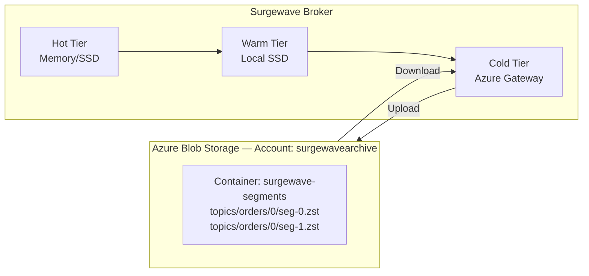

# Lesson 24.4: Azure Blob Storage

> **Difficulty:** Advanced | **Duration:** 45 min | **Prerequisites:** Lesson 24.3 completion

## Overview

Learn how to integrate Azure Blob Storage as a cold tier for Surgewave. Understand Azure storage concepts, access tiers, lifecycle management, and best practices for enterprise cloud deployments.

## Learning Objectives

- Configure Azure Blob Storage as a cold tier backend
- Understand Azure access tiers (Hot, Cool, Cold, Archive)
- Implement lifecycle management policies
- Use Azure-specific features like immutable storage
- Optimize costs with reserved capacity and access tier selection

## Azure Blob Storage Architecture



## Azure Access Tiers

| Tier | Storage $/GB/mo | Read $/10k | Write $/10k | Retrieval | Min Duration | Surgewave Use |
|------|----------------|-----------|-----------|-----------|-------------|-----------|
| Hot | $0.0184 | $0.0044 | $0.0055 | Instant | None | Messages < 7 d |
| Cool | $0.01 | $0.01 | $0.10 | Instant | 30 days | — |
| Cold | $0.0036 | $0.10 | $0.18 | Instant | 90 days | Messages 7–90 d |
| Archive | $0.00099 | $5.50 | $0.11 | Hours (rehydrate) | 180 days | > 90 d with lifecycle management |

> Early deletion penalty applies if a blob is deleted before its minimum storage duration.

## Azure vs AWS S3 Comparison

| Feature | Azure Blob | AWS S3 |
|---------|-----------|--------|
| Hot Storage | Hot ($0.0184/GB) | Standard ($0.023/GB) |
| Cool Storage | Cool ($0.01/GB) | Standard-IA ($0.0125/GB) |
| Cold Storage | Cold ($0.0036/GB) | Glacier IR ($0.004/GB) |
| Archive | Archive ($0.00099/GB) | Deep Archive ($0.00099/GB) |
| Retrieval | Hot/Cool/Cold: instant; Archive: 1–15 h | All except Deep Archive: ms; Deep Archive: 12–48 h |
| Immutability | Legal Hold, WORM | Object Lock, Governance |
| Lifecycle Rules | Yes, blob-level | Yes, prefix-based |
| Reserved Capacity | Yes (1 or 3 years) | No (use Savings Plans) |

## Blob Naming Convention

Pattern: `{prefix}/{topic}/{partition}/{segment-name}` in container `surgewave-segments`:
```
topics/orders-events/0/00000000000000000000.log.zst
topics/orders-events/0/00000000000001048576.log.zst
topics/orders-events/1/00000000000000000000.log.zst
topics/user-activity/0/00000000000000000000.log.zst
```

Custom blob metadata: `topic`, `partition`, `baseOffset`, `endOffset`, `messageCount`, `compressedSize`, `uncompressedSize`, `compressionType`.

## Lifecycle Management Policy

```json
{
  "rules": [
    {
      "name": "surgewave-tiering-policy",
      "type": "Lifecycle",
      "definition": {
        "filters": {
          "prefixMatch": ["topics/"],
          "blobTypes": ["blockBlob"]
        },
        "actions": {
          "baseBlob": {
            "tierToCool": {
              "daysAfterModificationGreaterThan": 7
            },
            "tierToCold": {
              "daysAfterModificationGreaterThan": 30
            },
            "tierToArchive": {
              "daysAfterModificationGreaterThan": 90
            },
            "delete": {
              "daysAfterModificationGreaterThan": 365
            }
          }
        }
      }
    }
  ]
}
```

## Configuration Options

```csharp
var azureConfig = new AzureBlobStorageConfig
{
    // Connection
    ConnectionString = Environment.GetEnvironmentVariable("AZURE_STORAGE_CONNECTION_STRING"),
    // Or use managed identity
    AccountName = "surgewavearchive",
    UseManagedIdentity = true,

    // Container settings
    ContainerName = "surgewave-segments",
    BlobPrefix = "topics",

    // Access tier
    AccessTier = AzureAccessTier.Cold,

    // Upload settings
    MaxBlockSize = 100 * 1024 * 1024,  // 100 MB blocks
    MaxConcurrency = 8,

    // Compression (before upload)
    Compression = CompressionType.Zstd,
    CompressionLevel = 19,

    // Immutability (for compliance)
    EnableImmutableStorage = false,
    ImmutabilityPeriodDays = 365,

    // Lifecycle
    EnableLifecycleManagement = true,
    TierToCoolDays = 7,
    TierToColdDays = 30,
    TierToArchiveDays = 90,
    DeleteAfterDays = 365
};
```

## Archive Tier Rehydration

| Priority | Time | Cost/GB | Use Case |
|---------|------|---------|---------|
| Standard | Up to 15 h | $0.02 | Planned retrieval |
| High | < 1 h | $0.10 | Urgent retrieval |

Rehydration process: (1) initiate with `Set-BlobTier` or copy to new blob; (2) status becomes `rehydrate-pending-to-hot` or `…-to-cool`; (3) poll blob properties until complete; (4) access normally; (5) blob stays at target tier until policy moves it back.

> Best practice: copy the archive blob to a new hot/cool blob; delete the copy after processing; keep the original in archive.

## Best Practices

| Practice | Description |
|----------|-------------|
| Use managed identity | Avoid storing connection strings in config |
| Enable soft delete | Protect against accidental deletion |
| Set access tier at upload | Avoid transition costs from Hot |
| Use lifecycle rules | Automate tier transitions and deletion |
| Enable blob versioning | For audit and recovery scenarios |
| Use reserved capacity | Save 20-40% with 1-3 year reservations |

## Exercise

In this exercise, you will:

1. Configure Azure Blob Storage (simulated)
2. Implement segment upload with access tier setting
3. Create lifecycle management rules
4. Simulate archive tier rehydration
5. Compare costs across access tiers

---

**Instructions:** [INSTRUCTIONS.md](INSTRUCTIONS.md)
