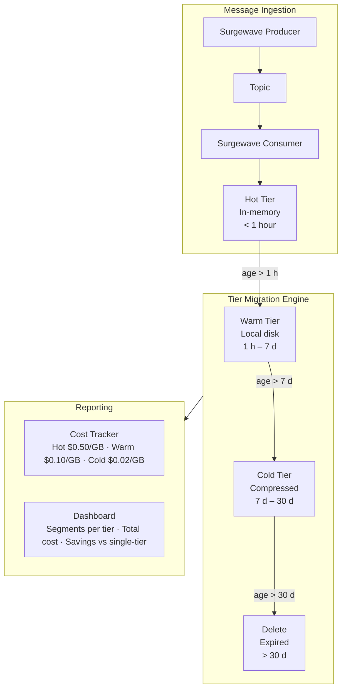

# Unit 24 Project: Tiered Storage Simulator

Build a tiered storage simulator that demonstrates hot, warm, and cold data movement with retention policies, cost tracking, and automatic tier migration.

## Scenario

You're building a tiered storage management system for a Surgewave cluster that handles high-volume order events. The system must:

1. Accept incoming messages into the hot tier (in-memory)
2. Automatically migrate aging data through warm and cold tiers
3. Apply retention policies to delete expired data
4. Track storage costs across all tiers
5. Provide a dashboard showing tier distribution and cost savings

## Requirements

### Functional Requirements

- [ ] Implement a three-tier storage simulator (Hot, Warm, Cold)
- [ ] Create a tier migration engine that moves data based on age
- [ ] Implement retention policies with TTL-based expiration
- [ ] Track and report storage costs per tier
- [ ] Support simulated time advancement to demonstrate data lifecycle
- [ ] Calculate cost savings compared to single-tier storage

### Technical Requirements

- [ ] Use Surgewave producer/consumer for message ingestion
- [ ] Implement segment-based storage (group messages into segments)
- [ ] Support compression during tier migration
- [ ] Handle concurrent access to storage tiers
- [ ] Provide summary statistics and cost reports

## Architecture



## Expected Output

```
=== Tiered Storage Simulator ===

[Setup] Surgewave broker started on port 12345
[Setup] Retention policy: Hot(1h) -> Warm(7d) -> Cold(30d) -> Delete

--- Phase 1: Ingesting Messages ---
[Ingest] Produced 1000 messages to 'orders' topic
[Ingest] Created segment seg-0000 (1000 messages, 48 KB) in Hot tier

--- Phase 2: Simulating Time Passage ---

[T+1 hour] Running tier migration...
  [Migrate] seg-0000: Hot -> Warm (age: 1.0h, compressed: 48 KB -> 12 KB)
  Tier distribution: Hot=0, Warm=1, Cold=0

[T+7 days] Running tier migration...
  [Migrate] seg-0000: Warm -> Cold (age: 7.0d, compressed: 12 KB -> 10 KB)
  Tier distribution: Hot=0, Warm=0, Cold=1

[T+30 days] Running tier migration...
  [Delete] seg-0000: Expired (age: 30.0d, retention: 30d)
  Tier distribution: Hot=0, Warm=0, Cold=0

--- Phase 3: Multi-Segment Lifecycle ---
[Ingest] Created 10 segments spanning 0-45 days

  Tier Distribution:
    Hot:  1 segments (48 KB)   - $0.02/month
    Warm: 2 segments (24 KB)   - $0.00/month
    Cold: 4 segments (40 KB)   - $0.00/month
    Expired: 3 segments (deleted)

--- Cost Report ---
  Single-tier cost (all Hot):  $0.23/month
  Tiered storage cost:         $0.05/month
  Savings:                     78.3%

=== Simulation Complete ===
```

## Getting Started

```bash
cd bootcamp/unit-24/project/start
dotnet run
```

## Hints

1. Use a dictionary to store segments per tier
2. Simulate time advancement by offsetting DateTime.UtcNow
3. Use GZipStream for compression simulation
4. Track original and compressed sizes for cost calculation
5. Group messages into segments of fixed size (e.g., 1000 messages)

## Evaluation Criteria

| Criteria | Points |
|----------|--------|
| Three-tier storage implementation | 20 |
| Tier migration engine working correctly | 25 |
| Retention policy enforcement | 20 |
| Cost tracking and reporting | 20 |
| Code quality and documentation | 15 |

## Solution

Compare your implementation with [completed/](completed/README.md) when done.
