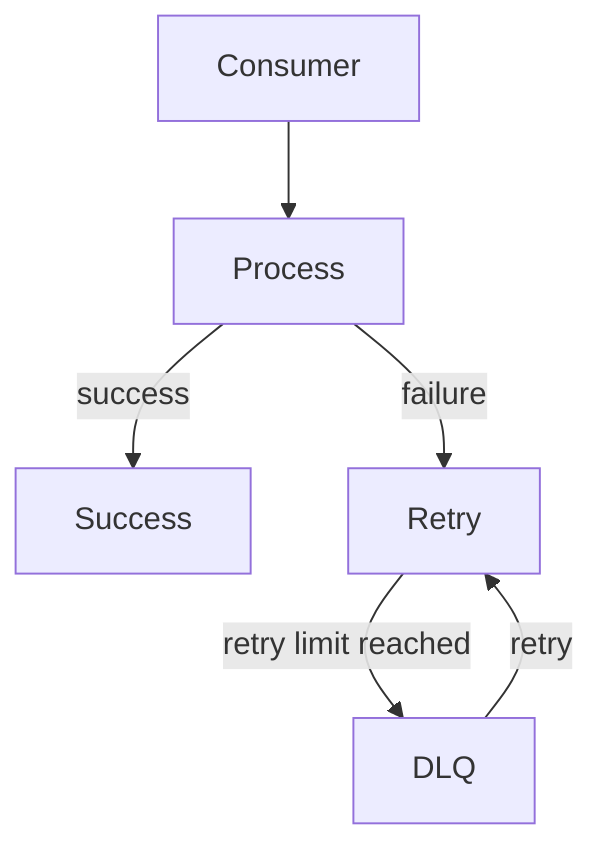
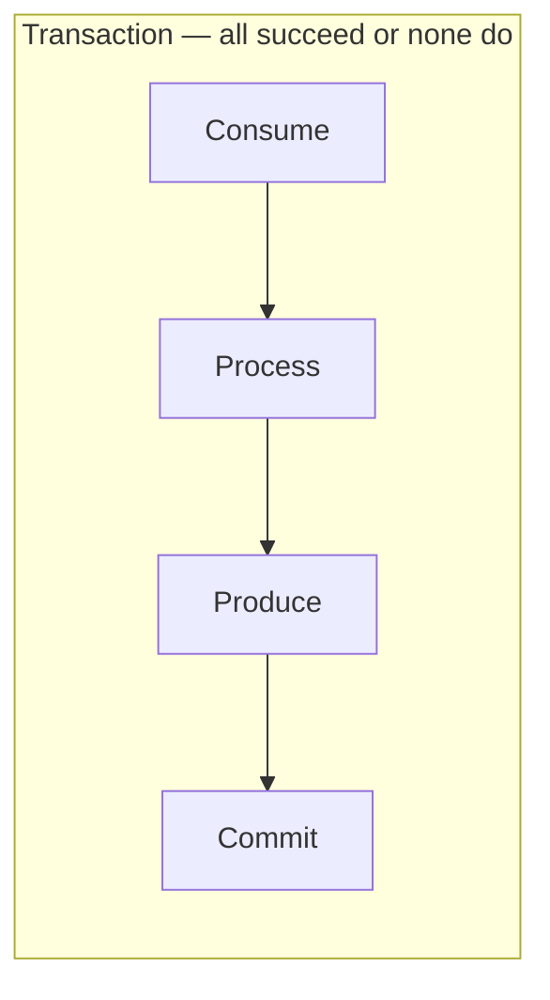

# Unit 28: Advanced Messaging

Build sophisticated applications with advanced message patterns.

## Learning Objectives

By the end of this unit, you will be able to:

- Implement custom serializers for complex data types
- Use message headers for correlation and tracing
- Build robust error handling with retries and dead letter queues
- Use transactions for atomic multi-message operations
- Implement exactly-once semantics
- Understand log compaction and use tombstones for key deletion
- Use ephemeral topics for real-time event distribution without persistence

## Lessons

| Lesson | Topic | Description |
|--------|-------|-------------|
| [3.1](lesson-1/README.md) | Custom Serialization | JSON, Protobuf, and custom serializers |
| [3.2](lesson-2/README.md) | Headers & Metadata | Correlation IDs and distributed tracing |
| [3.3](lesson-3/README.md) | Error Handling | Retries, dead letter queues, circuit breakers |
| [3.4](lesson-4/README.md) | Transactions | Atomic multi-message operations |
| [3.5](lesson-5/README.md) | Exactly-Once Semantics | Idempotent producers and transactional consumers |
| [3.6](lesson-6/README.md) | Compacted Topics | Log compaction and key-based retention |
| [3.7](lesson-7/README.md) | Ephemeral Topics | Ephemeral mode, ring-buffer, real-time distribution |

## Prerequisites

- Completed Unit 1: Surgewave Fundamentals
- Completed Unit 2: Testing Surgewave (recommended)

## Key Concepts

### Serialization
Convert complex objects to/from byte arrays for transmission:
- **JSON**: Human-readable, flexible schema
- **Protobuf**: Binary, strongly-typed, efficient
- **Custom**: Application-specific formats

### Message Headers
Metadata attached to messages without affecting the payload:
- Correlation IDs for request tracking
- Trace context for distributed tracing
- Custom application metadata

### Per-Message TTL

Surgewave supports per-message time-to-live via the `surgewave-ttl-ms` header. When a message's TTL expires, the broker automatically skips it during consumption. This is useful for time-sensitive data such as price quotes, session tokens, or cache invalidation signals where stale messages should not be processed:

```csharp
var headers = new Headers { { "surgewave-ttl-ms", "30000" } }; // 30 seconds
await producer.ProduceAsync("quotes", key, value, headers);
```

Per-message TTL works alongside topic-level retention -- whichever expires first takes effect.

### Error Handling Patterns
Handle failures gracefully in distributed systems:
- **Retry**: Attempt failed operations multiple times
- **Dead Letter Queue (DLQ)**: Store unprocessable messages
- **Circuit Breaker**: Prevent cascading failures

### Native Dead Letter Queue (Nack API)

In addition to application-level DLQ patterns (covered in Lesson 3.3), Surgewave provides a **native Nack API** at the broker level. When a consumer calls `Nack(message)`, the broker automatically routes the message to the topic's configured dead letter queue without requiring the application to produce to a separate topic manually:

```csharp
try
{
    await ProcessMessage(message);
    consumer.Ack(message);
}
catch (Exception)
{
    // Broker routes the message to "orders.dlq" automatically
    consumer.Nack(message);
}
```

Configure the DLQ topic per-topic via `dead.letter.queue.topic` in the topic configuration. The broker attaches error metadata headers (`x-dlq-reason`, `x-dlq-timestamp`, `x-original-topic`) to nacked messages. The Control UI provides a DLQ management page for inspecting, replaying, and purging failed messages (see Unit 28).

### Transactions
Ensure atomicity across multiple operations:
- Produce to multiple topics atomically
- Consume-transform-produce patterns
- Exactly-once processing guarantees

### Log Compaction
Key-based retention that keeps only the latest value per key:
- **Changelog Topics**: Store state for stream processors
- **Config Topics**: Latest configuration per service
- **Tombstones**: Null values signal key deletion

### Ephemeral Topics
Ring-buffer mode for real-time event distribution without persistence:
- **Live Dashboards**: Only current data matters
- **Sensor Telemetry**: High-frequency, recent-only reads
- **Cache Invalidation**: Signals without replay

## Architecture Patterns





---

**Ready?** → [Start Lesson 3.1: Custom Serialization](lesson-1/README.md)
