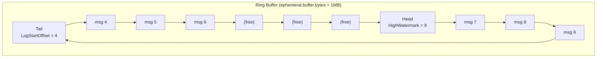

# Lesson 3.7: Ephemeral Topics

> **Difficulty:** Intermediate | **Duration:** 45 min | **Prerequisites:** Lesson 3.6

## Overview

Learn how ephemeral topics provide real-time event distribution without persistence, using a ring-buffer architecture similar to Redis Pub/Sub or NATS Core semantics.

## Learning Objectives

- Understand ephemeral topic mode and its ring-buffer architecture
- Compare Delete, Compact, and Ephemeral cleanup policies
- Create ephemeral topics with configurable buffer sizes
- Observe ring-buffer wrap-around and message eviction behavior
- Identify appropriate use cases for ephemeral vs persistent topics

## Cleanup Policy Comparison

| Feature | Delete | Compact | Ephemeral |
|---------|--------|---------|-----------|
| **Persistence** | Yes (time/size-based) | Yes (key-based) | No (ring-buffer only) |
| **Retention** | Configurable TTL | Latest per key | Active buffer window |
| **Data loss on restart** | No | No | Yes - all data lost |
| **Consumer catch-up** | Full replay | Latest state replay | Only buffered data |
| **Use case** | Event logs, audit trails | State stores, configs | Live dashboards, telemetry |

## Ring-Buffer Architecture

Ephemeral topics use a fixed-size ring buffer that wraps around when full:



Messages 0–3 have been overwritten (evicted). New writes go to Head; old data at Tail is evicted when the buffer is full.

### How It Works

1. **Producer writes** to the Head position
2. **Buffer fills up** as messages accumulate
3. **Wrap-around occurs** when buffer is full - oldest messages are evicted
4. **LogStartOffset advances** as old data is overwritten
5. **Consumers** can only read from LogStartOffset to HighWatermark

## When to Use Ephemeral Topics

### Good Use Cases

| Scenario | Why Ephemeral? |
|----------|---------------|
| **Live dashboards** | Only current data matters, historical data is stale |
| **Sensor telemetry** | High-frequency data, only recent readings relevant |
| **Chat/notifications** | Real-time delivery, missed messages acceptable |
| **Cache invalidation** | Signals to invalidate, replay not needed |
| **Heartbeats/health** | Only latest status matters |

### When NOT to Use

| Scenario | Why Not? |
|----------|----------|
| **Audit logs** | Must retain all events for compliance |
| **Order processing** | Cannot lose orders, needs durability |
| **Financial transactions** | Requires guaranteed delivery |
| **Event sourcing** | Needs complete event history |
| **Data replication** | Must replay all changes |

## Configuration

| Setting | Config Key | Default | Description |
|---------|-----------|---------|-------------|
| **Cleanup Policy** | `cleanup.policy` | `delete` | Set to `ephemeral` for ring-buffer mode |
| **Buffer Size** | `ephemeral.buffer.bytes` | 64 MB | Ring buffer size (supports KB, MB, GB units) |

```csharp
// Create ephemeral topic with 1MB buffer
await nativeClient.Topics.Create("sensor-data")
    .WithPartitions(1)
    .WithConfig("cleanup.policy", "ephemeral")
    .WithConfig("ephemeral.buffer.bytes", "1048576")
    .ExecuteAsync();
```

## Exercise

In this exercise, you'll:

1. Create an ephemeral topic and a persistent topic for comparison
2. Observe real-time message delivery to active consumers
3. Demonstrate that messages without an active consumer are lost
4. Trigger buffer wrap-around and observe LogStartOffset advancing
5. Compare ephemeral vs persistent topic behavior

---

**Instructions:** -> [INSTRUCTIONS.md](INSTRUCTIONS.md)
