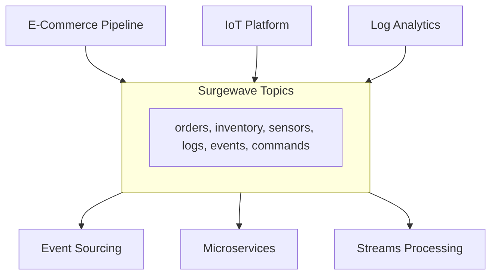

# Unit 29: Real-World Patterns (Capstone)

Combine multiple Surgewave concepts into comprehensive real-world scenarios.

## Overview

This capstone unit brings together everything you've learned across the bootcamp into complete, production-ready patterns. Each lesson presents a real-world use case that demonstrates how Surgewave powers modern event-driven architectures.

## Architecture

## Lessons

| Lesson | Topic | What You'll Build |
|--------|-------|-------------------|
| [11.1](lesson-1/README.md) | E-Commerce Pipeline | Order processing, inventory updates, notifications |
| [11.2](lesson-2/README.md) | IoT Data Platform | Sensor ingestion, aggregation, alerting |
| [11.3](lesson-3/README.md) | Log Analytics | Centralized logging, search, dashboards |
| [11.4](lesson-4/README.md) | Event Sourcing | Event store, projections, replay |
| [11.5](lesson-5/README.md) | Microservices Communication | Service mesh, saga pattern |

## Prerequisites

- Completed Unit 1 (Fundamentals)
- Completed Unit 3 (Advanced Messaging)
- Completed Unit 7 (Stream Processing)
- Completed Unit 8 (Data Integration)
- Understanding of distributed systems concepts

## Key Concepts

### Pattern Integration

| Pattern | Units Combined | Real-World Use |
|---------|----------------|----------------|
| E-Commerce | Messaging + Streams | Retail platforms |
| IoT | Messaging + Aggregation | Smart devices |
| Log Analytics | Integration + Streams | Observability |
| Event Sourcing | Storage + Replay | Financial systems |
| Microservices | Messaging + Patterns | Service architecture |

### Architecture Principles

| Principle | Description | Applied In |
|-----------|-------------|------------|
| Event-Driven | React to events, not poll | All lessons |
| Loose Coupling | Services communicate via topics | 11.5 |
| Event Sourcing | Events as source of truth | 11.4 |
| CQRS | Separate read/write models | 11.4 |
| Saga Pattern | Distributed transactions | 11.5 |

## Learning Objectives

By the end of this unit, you will be able to:

1. Design complete event-driven architectures with Surgewave
2. Build e-commerce pipelines with order processing and inventory management
3. Create IoT platforms for sensor data ingestion and real-time alerting
4. Implement centralized logging with search and analytics
5. Apply event sourcing patterns with projections and replay
6. Orchestrate microservices using saga patterns and service mesh concepts

## Tips for Success

1. **Start Simple**: Each lesson builds incrementally - understand the basics first
2. **Run and Experiment**: Modify the examples to see how changes affect behavior
3. **Think Events**: Model your domain as events, not just data
4. **Consider Failure**: Real systems fail - think about retry and compensation
5. **Scale Thinking**: Design for horizontal scaling from the start
