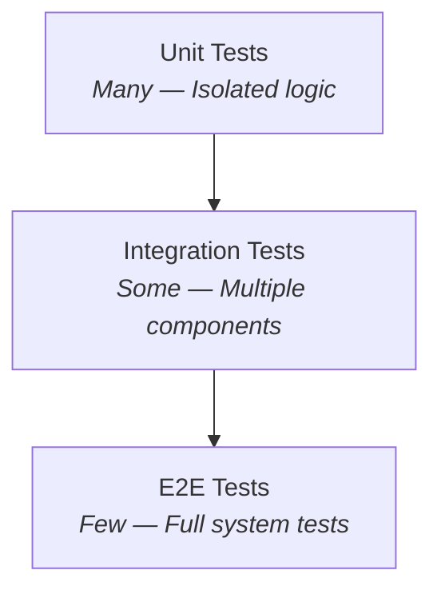

# Unit 3: Testing Surgewave

Welcome to Unit 3! In this unit, you'll learn how to test Surgewave applications effectively - from unit tests to integration tests, from mocking to benchmarking.

## Learning Objectives

By the end of this unit, you will be able to:

- Write unit tests for producers and consumers using embedded broker
- Mock Surgewave interfaces for isolated testing
- Create integration tests with shared fixtures
- Use Testcontainers for realistic test environments
- Benchmark your Surgewave applications with BenchmarkDotNet

## Lessons

| Lesson | Topic | Duration | Description |
|--------|-------|----------|-------------|
| [2.1](lesson-1/README.md) | Unit Testing Basics | 30 min | xUnit setup, testing with embedded broker |
| [2.2](lesson-2/README.md) | Mocking & Isolation | 30 min | Mock interfaces, testing without broker |
| [2.3](lesson-3/README.md) | Integration Testing | 35 min | End-to-end tests, test fixtures |
| [2.4](lesson-4/README.md) | Testcontainers | 40 min | Docker-based testing, CI/CD |
| [2.5](lesson-5/README.md) | Benchmarking | 35 min | Performance testing with BenchmarkDotNet |

## Prerequisites

- Completed Unit 1: Surgewave Fundamentals
- Basic understanding of xUnit testing
- Docker installed (for Lesson 2.4)

## Key Concepts You'll Learn

### Testing Pyramid for Messaging



### Embedded Broker Testing

The fastest way to test Surgewave is with an embedded broker:

```csharp
[Fact]
public async Task Producer_SendsMessage_Successfully()
{
    // Arrange - Start embedded broker
    await using var runtime = await SurgewaveRuntime.CreateBuilder()
        .WithPort(0)
        .WithStorageEngine(StorageEngines.Memory)
        .Build()
        .StartAsync();

    await using var producer = new SurgewaveProducer<string, string>(opt =>
    {
        opt.BootstrapServers = $"localhost:{runtime.Port}";
    });

    // Act
    var result = await producer.ProduceAsync("test-topic", "key", "value");

    // Assert
    Assert.Equal(0, result.Offset);
}
```

### Mocking for Unit Tests

For pure unit tests without any broker:

```csharp
[Fact]
public async Task OrderProcessor_ProcessesOrder_Successfully()
{
    // Arrange - Mock the producer
    var mockProducer = new Mock<IProducer<string, Order>>();
    mockProducer
        .Setup(p => p.ProduceAsync(It.IsAny<string>(), It.IsAny<string>(), It.IsAny<Order>(), default))
        .ReturnsAsync(new ProduceResult { Offset = 1 });

    var processor = new OrderProcessor(mockProducer.Object);

    // Act
    await processor.ProcessAsync(new Order { Id = "123" });

    // Assert
    mockProducer.Verify(p => p.ProduceAsync("orders", "123", It.IsAny<Order>(), default), Times.Once);
}
```

### Integration Test Fixtures

Share broker instances across tests for efficiency:

```csharp
public class SurgewaveFixture : IAsyncLifetime
{
    public ISurgewaveRuntime Runtime { get; private set; } = null!;
    public int Port => Runtime.Port;

    public async Task InitializeAsync()
    {
        Runtime = await SurgewaveRuntime.CreateBuilder()
            .WithPort(0)
            .WithStorageEngine(StorageEngines.Memory)
            .Build()
            .StartAsync();
    }

    public async Task DisposeAsync() => await Runtime.DisposeAsync();
}
```

### Benchmarking

Measure performance with BenchmarkDotNet:

```csharp
[MemoryDiagnoser]
public class ProducerBenchmarks
{
    [Benchmark]
    public async Task Produce_SingleMessage()
    {
        await _producer.ProduceAsync("bench-topic", "key", "value");
    }

    [Benchmark]
    public async Task Produce_BatchOf100()
    {
        for (int i = 0; i < 100; i++)
            await _producer.ProduceAsync("bench-topic", $"key-{i}", $"value-{i}");
        await _producer.FlushAsync();
    }
}
```

## Getting Started

Start with Lesson 2.1 to learn the basics of testing Surgewave:

```bash
cd bootcamp/unit-2/lesson-1
cat README.md
```

---

**Ready?** → [Start Lesson 2.1: Unit Testing Basics](lesson-1/README.md)
