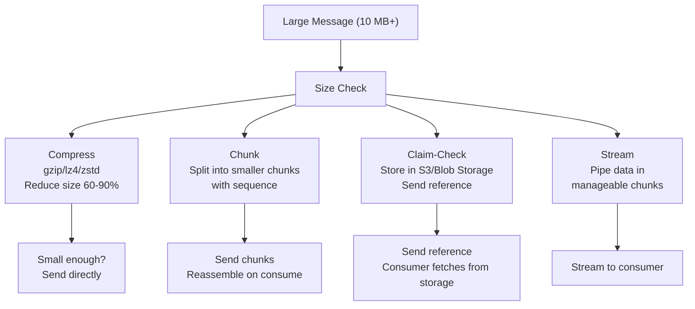
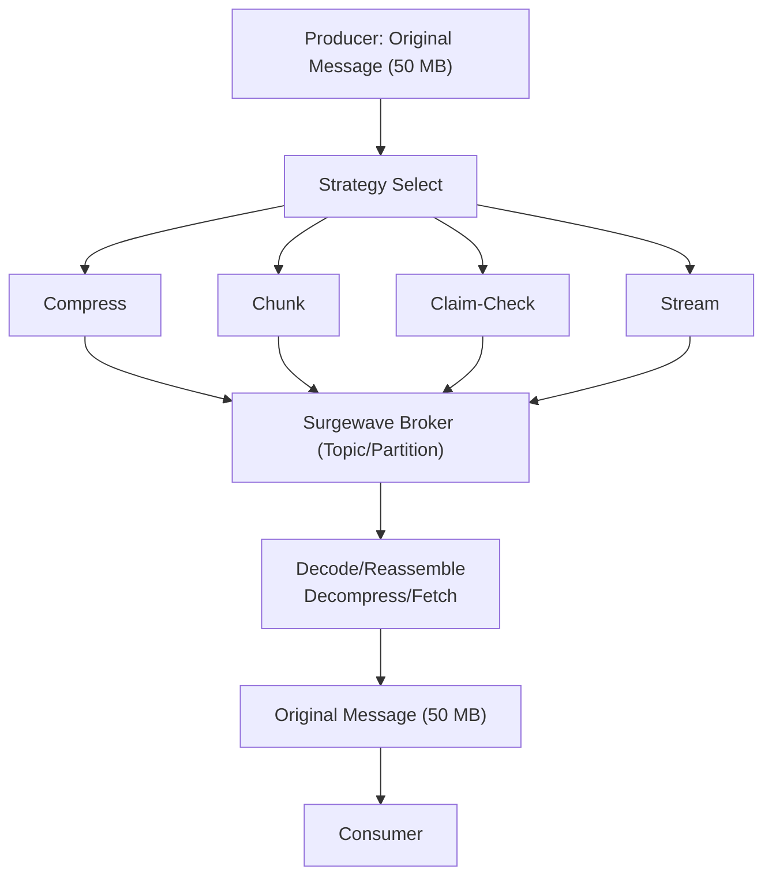
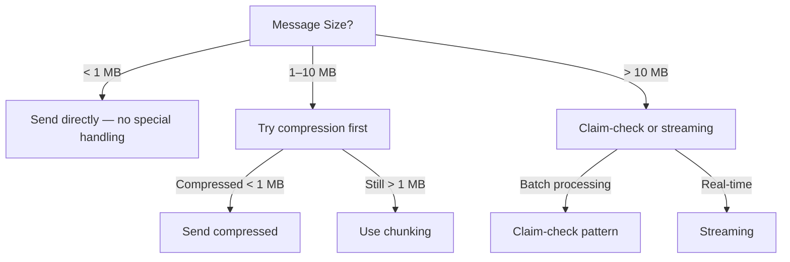

# Unit 30: Large Message Handling

Learn patterns and strategies for handling large messages in Surgewave, from configuration to advanced streaming techniques.

## Learning Objectives

By the end of this unit, you will be able to:

- Configure message size limits and understand their implications
- Apply compression to reduce message size and improve throughput
- Implement message chunking for oversized payloads
- Use the claim-check pattern with external storage
- Stream large data efficiently with backpressure handling

## Lessons

| Lesson | Topic | Description |
|--------|-------|-------------|
| [17.1](lesson-1/README.md) | Message Size Limits | Understanding limits, why they exist, configuration options |
| [17.2](lesson-2/README.md) | Compression | Compression codecs (gzip, snappy, lz4, zstd), trade-offs, configuration |
| [17.3](lesson-3/README.md) | Chunking | Splitting large messages, reassembly, ordering guarantees |
| [17.4](lesson-4/README.md) | Claim-Check Pattern | External storage (S3, Azure Blob), reference messages, cleanup |
| [17.5](lesson-5/README.md) | Streaming Large Data | Streaming uploads/downloads, backpressure, memory efficiency |

## Prerequisites

- Completed Unit 1: Surgewave Fundamentals
- Understanding of Surgewave producers and consumers
- Basic knowledge of compression algorithms

## Architecture Overview



## Message Size Flow



## Key Concepts

### Why Message Size Limits Exist

| Reason | Description |
|--------|-------------|
| Memory Pressure | Large messages consume significant broker memory |
| Network Latency | Large messages increase end-to-end latency |
| Replication Lag | Large messages slow down replica synchronization |
| Consumer Impact | Single large message can block consumer processing |

### Strategy Selection Guide



### Compression Trade-offs

| Codec | Speed | Ratio | CPU | Best For |
|-------|-------|-------|-----|----------|
| None | Fastest | 1:1 | None | Already compressed data |
| LZ4 | Very Fast | ~2:1 | Low | Low latency requirements |
| Snappy | Fast | ~2:1 | Low | General purpose |
| GZIP | Medium | ~4:1 | Medium | Bandwidth constrained |
| ZSTD | Medium | ~5:1 | Medium | Best balance |

## Common Patterns

### Chunked Message Header

```csharp
public record ChunkHeader
{
    public Guid MessageId { get; init; }      // Links chunks together
    public int ChunkIndex { get; init; }      // Order of this chunk
    public int TotalChunks { get; init; }     // Total chunks in message
    public int TotalSize { get; init; }       // Original message size
    public string Checksum { get; init; }     // For integrity verification
}
```

### Claim-Check Reference

```csharp
public record ClaimCheckReference
{
    public string StorageType { get; init; }  // "s3", "azure-blob", "local"
    public string Location { get; init; }     // URI to the stored data
    public long Size { get; init; }           // Size of stored data
    public string ContentType { get; init; }  // MIME type
    public DateTime ExpiresAt { get; init; }  // When the reference expires
}
```

## Getting Started

Start with Lesson 17.1 to understand message size limits and configuration:

```bash
cd bootcamp/unit-17/lesson-1
cat README.md
```

---

**Ready?** -> [Start Lesson 17.1: Message Size Limits](lesson-1/README.md)
