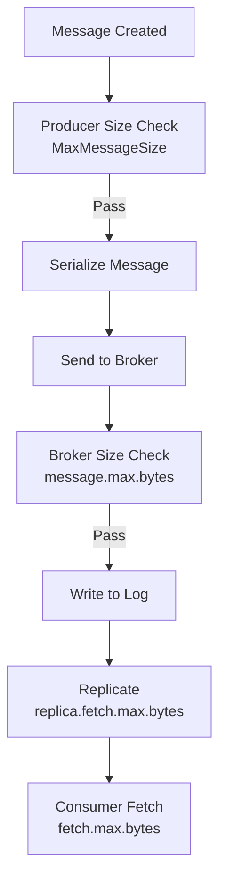

# Lesson 17.1: Message Size Limits

> **Difficulty:** Advanced | **Duration:** 25 min | **Prerequisites:** Unit 16 completion

Learn about message size limits in Surgewave, why they exist, and how to configure them appropriately.

## Learning Objectives

After completing this lesson, you will be able to:

- [ ] Understand why message size limits exist
- [ ] Configure producer and broker message size limits
- [ ] Handle message size validation errors gracefully
- [ ] Implement size checking before sending messages

## Prerequisites

- .NET 10 SDK installed
- Understanding of Surgewave producers and consumers
- Completed Unit 1: Surgewave Fundamentals

## Duration

~25 minutes

## What You'll Build

A message producer that:
1. Validates message sizes before sending
2. Handles size limit errors gracefully
3. Demonstrates size limit configuration options

## Key Concepts

### Why Size Limits Exist

**Memory Pressure:**

| Component | Impact |
|-----------|--------|
| Broker Memory | 100 MB msg x 3 replicas = 300 MB |
| Producer Buffers | Serializer buffers = 100 MB |
| Consumer Heap | Deserialize + process = 200 MB+ |

**Network Impact:**

| Factor | Impact |
|--------|--------|
| Latency | 100 MB @ 1 Gbps = ~800ms |
| Bandwidth | Saturates network for other messages |
| Timeouts | Processing delays can trigger timeouts |

### Default Size Limits

| Level | Setting | Default | Behavior |
|-------|---------|---------|----------|
| **Producer** | `MaxMessageSize` | 1 MB | Enforced before send, throws `MessageSizeException` |
| **Broker** | `message.max.bytes` | 1 MB | Enforced on receive, rejects message |
| **Topic** | `max.message.bytes` | Inherits from broker | Can be set per topic, overrides broker default |

### Size Limit Configuration Flow



### Size Components

**Total Message Size = Headers + Key + Value + Overhead**

| Component | Size |
|-----------|------|
| Record Header | ~12 bytes (fixed) |
| Key Length | 4 bytes |
| Key Data | Variable (your key) |
| Value Length | 4 bytes |
| Value Data | Variable (your payload) |
| Headers[] | Variable (custom headers) |
| CRC/Checksum | 4 bytes |

> **Example:** Key: "user-123" (8 bytes) + Value: 1 MB + Headers: 100 bytes = ~1,000,128 bytes (may exceed 1 MB limit!)

## Exercise

### Step 1: Navigate to the Start Folder

```bash
cd bootcamp/unit-17/lesson-1/start
```

### Step 2: Open the Project

Open `Program.cs` in your editor. You'll see placeholder code with `// TODO` comments.

### Step 3: Follow the Instructions

Open [INSTRUCTIONS.md](INSTRUCTIONS.md) for detailed step-by-step guidance.

### Step 4: Run Your Solution

```bash
dotnet run
```

### Expected Output

```
Message Size Limits Demo
========================

Broker started on port 54321
Producer configured with MaxMessageSize: 1048576 bytes (1 MB)

Test 1: Small message (100 bytes)
  Size: 100 bytes - Within limit
  Status: Sent successfully

Test 2: Medium message (500 KB)
  Size: 512000 bytes - Within limit
  Status: Sent successfully

Test 3: Large message (2 MB)
  Size: 2097152 bytes - EXCEEDS limit of 1048576 bytes
  Status: Blocked by size validation

Test 4: Configuring larger limit (5 MB)
  New limit: 5242880 bytes
  Retrying 2 MB message...
  Status: Sent successfully with increased limit

Consumed 3 messages successfully
Demo completed!
```

## Checkpoints

Verify your solution:

- [ ] Small messages send successfully
- [ ] Large messages are blocked with clear error
- [ ] Size limit can be configured
- [ ] Error handling is graceful
- [ ] Size validation happens before network send

## Troubleshooting

### "Message size validation not working"

Make sure you're checking the serialized size, not just the string length:

```csharp
var serializedSize = Encoding.UTF8.GetByteCount(message);
if (serializedSize > maxSize)
{
    throw new MessageSizeException($"Message size {serializedSize} exceeds limit {maxSize}");
}
```

### "Broker rejecting messages even with producer limit increased"

Both producer AND broker limits must accommodate the message:

```csharp
// Producer side
options.MaxMessageSize = 5 * 1024 * 1024;

// Broker side
builder.WithMaxMessageSize(5 * 1024 * 1024);
```

### "Size calculation is slightly off"

Remember to account for key size and headers:

```csharp
var totalSize = keySize + valueSize + headerOverhead + recordOverhead;
```

## Summary

In this lesson, you learned:

- Why message size limits exist (memory, network, latency)
- How to configure size limits at producer and broker level
- How to validate message sizes before sending
- How to handle size limit errors gracefully

## Next Steps

Continue to [Lesson 17.2: Compression](../lesson-2/README.md) to learn how compression can help fit more data within size limits.

---

**Stuck?** Check the [completed/](completed/README.md) solution for reference.
