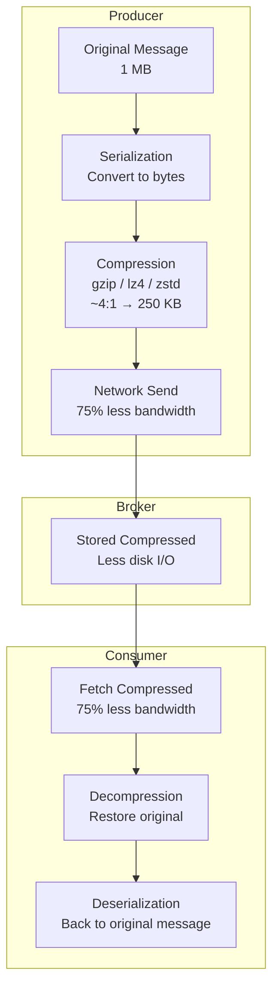

# Lesson 17.2: Compression

> **Difficulty:** Advanced | **Duration:** 30 min | **Prerequisites:** Lesson 17.1

Learn how to use compression to reduce message sizes and improve throughput in Surgewave.

## Learning Objectives

After completing this lesson, you will be able to:

- [ ] Understand different compression codecs (gzip, lz4, zstd)
- [ ] Configure compression at producer level
- [ ] Measure compression ratios and performance trade-offs
- [ ] Decompress messages on the consumer side

## Prerequisites

- .NET 10 SDK installed
- Completed Lesson 17.1: Message Size Limits
- Basic understanding of compression concepts

## Duration

~30 minutes

## What You'll Build

A demonstration that:
1. Compresses messages with different codecs
2. Compares compression ratios
3. Measures compression/decompression performance
4. Shows transparent decompression on consume

## Key Concepts

### Compression Overview



### Compression Codecs Comparison

**Codec Comparison (1 MB JSON payload):**

| Codec | Speed (compress) | Compression Ratio | CPU Usage |
|-------|-----------------|-------------------|-----------|
| LZ4 | 650 MB/s (fastest) | 2:1 | Low |
| Snappy | 500 MB/s | 2.5:1 | Low |
| ZSTD | 400 MB/s | 5:1 (best) | Medium |
| GZIP | 200 MB/s | 4.5:1 | High |

### When to Use Each Codec

| Codec | Use When |
|-------|----------|
| **LZ4** | Low latency is critical; high throughput required; CPU resources are limited; compression ratio is secondary |
| **Snappy** | General purpose streaming; balanced speed/ratio needed; wide compatibility required |
| **ZSTD** | Best compression ratio needed; CPU is available; storage/bandwidth constrained; modern clients only |
| **GZIP** | Maximum compatibility required; archival/long-term storage; latency is not critical |
| **None** | Data is already compressed (images, video); messages are very small (< 100 bytes); maximum throughput, CPU-bound system |

### Compression Level Trade-offs

```
Level    Speed        Ratio     Use Case
-----    -----        -----     --------
  1      Fastest      ~2:1      Real-time streaming
  3      Fast         ~3:1      General purpose (default)
  6      Medium       ~4:1      Balanced
  9      Slow         ~5:1      Maximum compression
```

## Exercise

### Step 1: Navigate to the Start Folder

```bash
cd bootcamp/unit-17/lesson-2/start
```

### Step 2: Open the Project

Open `Program.cs` in your editor. You'll see placeholder code with `// TODO` comments.

### Step 3: Follow the Instructions

Open [INSTRUCTIONS.md](INSTRUCTIONS.md) for detailed step-by-step guidance.

### Step 4: Run Your Solution

```bash
dotnet run
```

### Expected Output

```
Compression Demo
================

Broker started on port 54321
Test payload: 100,000 bytes of JSON data

Compression Results:
+----------+-------------+--------+--------------+--------------+
| Codec    | Compressed  | Ratio  | Compress ms  | Decompress ms|
+----------+-------------+--------+--------------+--------------+
| None     | 100,000     | 1.0x   | 0.0          | 0.0          |
| GZip     | 2,847       | 35.1x  | 2.3          | 0.4          |
| LZ4      | 8,234       | 12.1x  | 0.3          | 0.1          |
| Zstd     | 2,156       | 46.4x  | 0.8          | 0.2          |
+----------+-------------+--------+--------------+--------------+

Best compression ratio: Zstd (46.4x)
Fastest compression: LZ4 (0.3ms)
Fastest decompression: LZ4 (0.1ms)

Sending compressed messages to Surgewave...
All messages sent and consumed successfully!
Decompressed payloads match originals: True

Demo completed!
```

## Checkpoints

Verify your solution:

- [ ] Compression ratios are calculated correctly
- [ ] Performance metrics show expected patterns
- [ ] Messages round-trip successfully
- [ ] Decompressed data matches original
- [ ] Different codecs show different characteristics

## Troubleshooting

### "Compression ratio seems wrong"

Ensure you're comparing raw bytes, not string length:

```csharp
var originalSize = Encoding.UTF8.GetByteCount(original);
var compressedSize = compressed.Length;
var ratio = (double)originalSize / compressedSize;
```

### "Zstd not available"

ZSTD requires a NuGet package. Make sure it's referenced:

```xml
<PackageReference Include="ZstdSharp.Port" Version="0.7.1" />
```

### "Decompression fails"

Ensure you're using the same codec for decompression:

```csharp
// Store codec type with message
var header = new { Codec = "gzip", OriginalSize = original.Length };
```

## Summary

In this lesson, you learned:

- How different compression codecs compare (gzip, lz4, zstd)
- When to use each codec based on requirements
- How to compress messages before sending
- How to decompress messages after consuming
- Trade-offs between compression ratio, speed, and CPU usage

## Next Steps

Continue to [Lesson 17.3: Chunking](../lesson-3/README.md) to learn how to split large messages into smaller pieces.

---

**Stuck?** Check the [completed/](completed/README.md) solution for reference.
