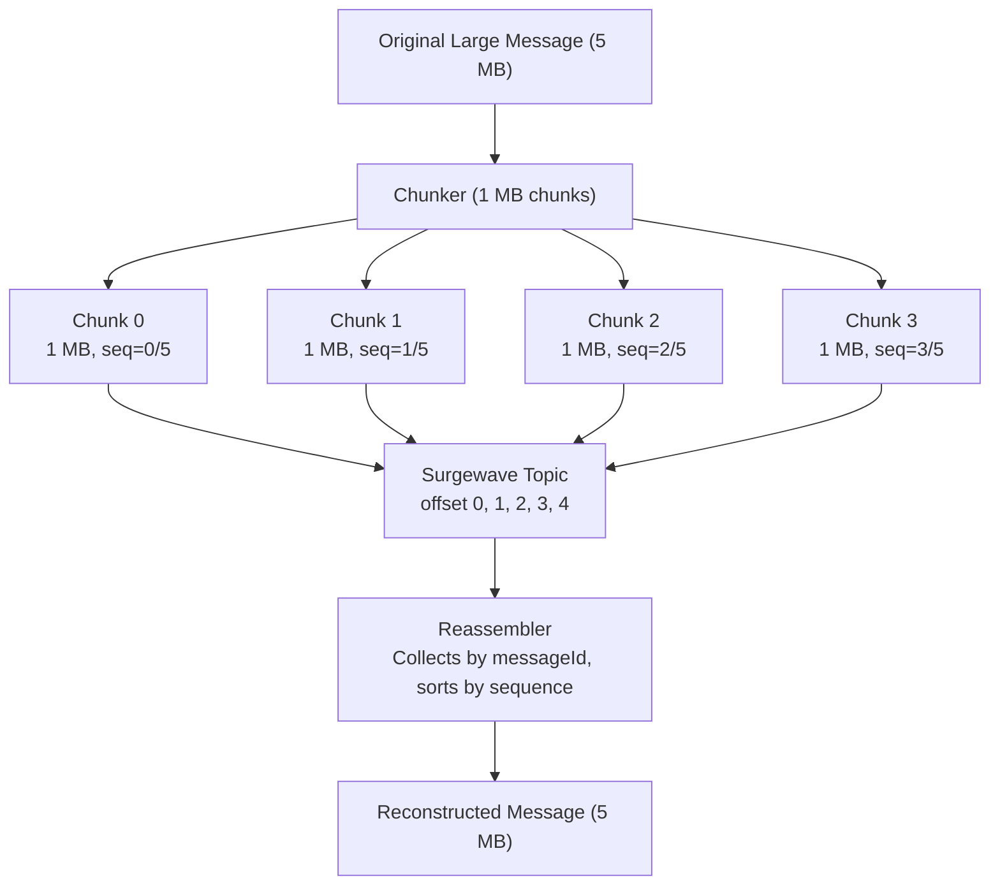
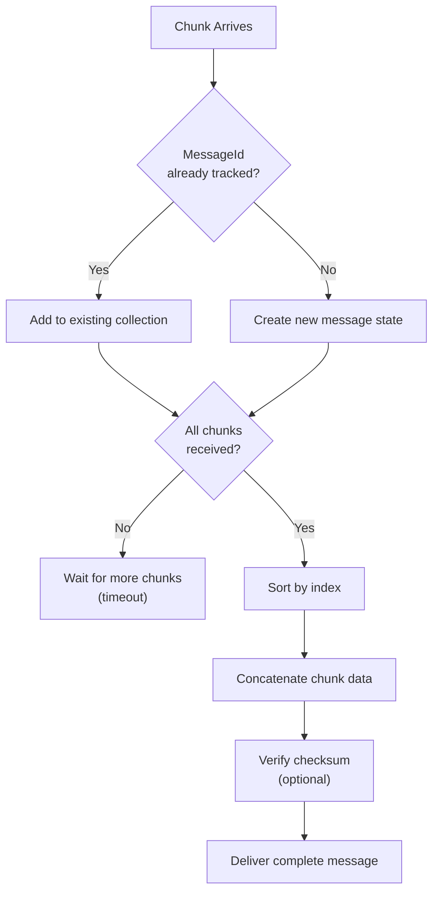

# Lesson 17.3: Chunking

> **Difficulty:** Advanced | **Duration:** 35 min | **Prerequisites:** Lesson 17.2

Learn how to split large messages into smaller chunks and reassemble them on the consumer side.

## Learning Objectives

After completing this lesson, you will be able to:

- [ ] Implement message chunking for large payloads
- [ ] Design chunk headers with sequence and metadata
- [ ] Reassemble chunks in order on the consumer side
- [ ] Handle missing chunks and out-of-order delivery

## Prerequisites

- .NET 10 SDK installed
- Completed Lesson 17.2: Compression
- Understanding of message ordering concepts

## Duration

~35 minutes

## What You'll Build

A chunking system that:
1. Splits large messages into configurable chunk sizes
2. Adds headers for reassembly (message ID, sequence, total)
3. Reassembles chunks on the consumer side
4. Handles out-of-order chunk arrival

## Key Concepts

### Chunking Overview



### Chunk Header Structure

**Chunk Header** (metadata for reassembly):

| Field | Type | Description |
|-------|------|-------------|
| MessageId | Guid | Unique ID for the original message |
| ChunkIndex | int | 0-based index of this chunk |
| TotalChunks | int | Total number of chunks |
| TotalSize | long | Size of original message |
| ChunkSize | int | Size of this chunk's data |
| Checksum | string | Optional hash for integrity |
| Timestamp | DateTime | When the message was chunked |

**Chunk Data**: `byte[]` — portion of the original message.

### Reassembly State Machine



### Ordering Considerations

| Strategy | Key | Chunk Arrival Order | Reassembly |
|----------|-----|---------------------|-----------|
| **Same Partition** | `"msg-abc"` (fixed) | Guaranteed: chunk0 → chunk1 → chunk2 | Simple |
| **Different Partitions** | varies / round-robin | May arrive out of order: chunk2 → chunk0 → chunk1 | Must buffer and sort |
| **Recommendation** | MessageId as message key | All chunks for same message go to same partition | Ordered delivery, simpler reassembly |

## Exercise

### Step 1: Navigate to the Start Folder

```bash
cd bootcamp/unit-17/lesson-3/start
```

### Step 2: Open the Project

Open `Program.cs` in your editor. You'll see placeholder code with `// TODO` comments.

### Step 3: Follow the Instructions

Open [INSTRUCTIONS.md](INSTRUCTIONS.md) for detailed step-by-step guidance.

### Step 4: Run Your Solution

```bash
dotnet run
```

### Expected Output

```
Chunking Demo
=============

Broker started on port 54321

Original message size: 5,242,880 bytes (5 MB)
Chunk size: 1,048,576 bytes (1 MB)

Chunking message...
  Created 5 chunks:
    Chunk 0: 1,048,576 bytes
    Chunk 1: 1,048,576 bytes
    Chunk 2: 1,048,576 bytes
    Chunk 3: 1,048,576 bytes
    Chunk 4: 1,048,576 bytes

Sending chunks to Surgewave...
  Sent chunk 0/5
  Sent chunk 1/5
  Sent chunk 2/5
  Sent chunk 3/5
  Sent chunk 4/5

Consuming and reassembling...
  Received chunk 0/5 for message abc123
  Received chunk 1/5 for message abc123
  Received chunk 2/5 for message abc123
  Received chunk 3/5 for message abc123
  Received chunk 4/5 for message abc123
  Message abc123 complete! Reassembling...

Reassembled message size: 5,242,880 bytes
Content matches original: True

Demo completed!
```

## Checkpoints

Verify your solution:

- [ ] Large message is split into correct number of chunks
- [ ] Each chunk has proper header metadata
- [ ] All chunks are sent and received
- [ ] Reassembly produces exact original content
- [ ] Chunk ordering is handled correctly

## Troubleshooting

### "Reassembled message doesn't match"

Check that chunks are being concatenated in the correct order:

```csharp
var sortedChunks = chunks.OrderBy(c => c.Header.ChunkIndex);
foreach (var chunk in sortedChunks)
{
    output.Write(chunk.Data, 0, chunk.Data.Length);
}
```

### "Missing chunks"

Ensure all chunks use the same key for partition assignment:

```csharp
// Use message ID as key to ensure all chunks go to same partition
var key = chunk.Header.MessageId.ToString();
await producer.ProduceAsync(topic, key, chunkBytes);
```

### "Chunks arriving out of order"

This is normal if using multiple partitions. The reassembler should buffer:

```csharp
if (!_pendingMessages.ContainsKey(messageId))
{
    _pendingMessages[messageId] = new List<ChunkMessage>();
}
_pendingMessages[messageId].Add(chunk);
```

## Summary

In this lesson, you learned:

- How to split large messages into manageable chunks
- How to design chunk headers with sequence metadata
- How to reassemble chunks in order
- How to handle out-of-order delivery with buffering
- Best practices for chunk key assignment

## Next Steps

Continue to [Lesson 17.4: Claim-Check Pattern](../lesson-4/README.md) to learn how to store large payloads externally.

---

**Stuck?** Check the [completed/](completed/README.md) solution for reference.
