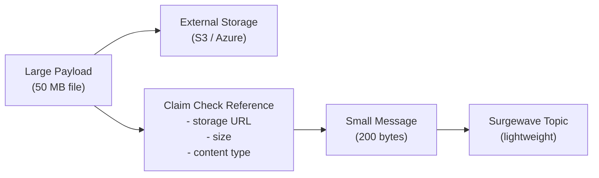
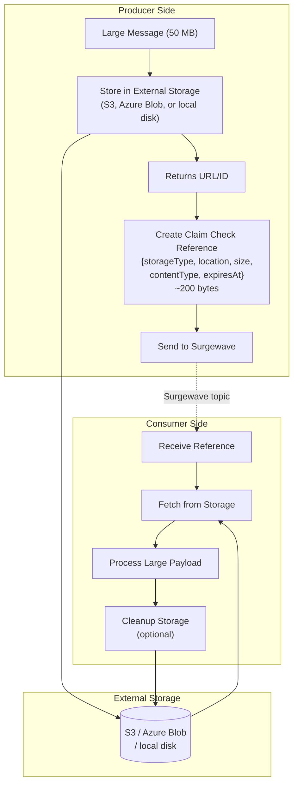

# Lesson 17.4: Claim-Check Pattern

> **Difficulty:** Advanced | **Duration:** 35 min | **Prerequisites:** Lesson 17.3

Learn the claim-check pattern for handling large messages by storing payloads externally and passing references through Surgewave.

## Learning Objectives

After completing this lesson, you will be able to:

- [ ] Understand the claim-check pattern and when to use it
- [ ] Store large payloads in external storage (simulated)
- [ ] Send lightweight reference messages through Surgewave
- [ ] Retrieve payloads using claim-check references
- [ ] Handle cleanup of external storage

## Prerequisites

- .NET 10 SDK installed
- Completed Lesson 17.3: Chunking
- Understanding of external storage concepts (S3, Azure Blob)

## Duration

~35 minutes

## What You'll Build

A claim-check system that:
1. Stores large payloads in external storage
2. Sends small reference messages through Surgewave
3. Retrieves payloads on the consumer side
4. Cleans up storage after processing

## Key Concepts

### Claim-Check Pattern Overview

The claim-check pattern is like a coat check at a restaurant:

1. You give your coat (large payload) to the attendant
2. You receive a ticket (claim check reference)
3. You carry the light ticket, not the heavy coat
4. Later, you present the ticket to retrieve your coat



### Architecture



### When to Use Claim-Check

| Decision | Conditions |
|----------|-----------|
| **Use** Claim-Check | Messages are very large (> 10 MB); payloads don't need to be retained in Surgewave long-term; external storage is available and reliable; consumers can tolerate additional fetch latency; you need to process files (images, videos, documents) |
| **Avoid** Claim-Check | Messages are small (< 1 MB); you need Surgewave's retention guarantees; external storage is unreliable; ultra-low latency is required; you want atomic message delivery |

### Claim-Check Reference Structure

```json
{
  "claimCheck": {
    "id": "550e8400-e29b-41d4-a716-446655440000",
    "storageType": "s3",
    "location": "s3://my-bucket/payloads/550e8400.bin",
    "size": 52428800,
    "contentType": "application/octet-stream",
    "checksum": "sha256:abc123...",
    "createdAt": "2024-01-15T10:00:00Z",
    "expiresAt": "2024-01-16T10:00:00Z"
  },
  "metadata": {
    "originalFilename": "large-dataset.json",
    "producer": "data-pipeline-1",
    "correlationId": "req-12345"
  }
}
```

## Exercise

### Step 1: Navigate to the Start Folder

```bash
cd bootcamp/unit-17/lesson-4/start
```

### Step 2: Open the Project

Open `Program.cs` in your editor. You'll see placeholder code with `// TODO` comments.

### Step 3: Follow the Instructions

Open [INSTRUCTIONS.md](INSTRUCTIONS.md) for detailed step-by-step guidance.

### Step 4: Run Your Solution

```bash
dotnet run
```

### Expected Output

```
Claim-Check Pattern Demo
========================

Broker started on port 54321
External storage initialized at: C:\temp\claim-check-demo

Creating large payload (10 MB)...

Storing payload in external storage...
  Stored at: file://C:\temp\claim-check-demo\550e8400-e29b-41d4-a716-446655440000.bin
  Claim check reference size: 312 bytes
  Size reduction: 99.997%

Sending claim check reference to Surgewave...
  Sent reference for payload 550e8400

Consuming claim check reference...
  Received claim check for 550e8400
  Storage type: LocalFile
  Location: file://C:\temp\claim-check-demo\550e8400.bin
  Size: 10,485,760 bytes

Fetching payload from external storage...
  Retrieved 10,485,760 bytes
  Content matches original: True

Cleaning up external storage...
  Deleted: 550e8400.bin

Demo completed!
```

## Checkpoints

Verify your solution:

- [ ] Large payload is stored externally
- [ ] Claim check reference is small (< 500 bytes)
- [ ] Reference contains all needed metadata
- [ ] Consumer can retrieve original payload
- [ ] Cleanup removes external storage

## Troubleshooting

### "Storage location not found"

Ensure the storage directory exists:

```csharp
Directory.CreateDirectory(storageBasePath);
```

### "Payload doesn't match after retrieval"

Verify checksum is computed and validated:

```csharp
var computedChecksum = ComputeChecksum(retrievedData);
if (computedChecksum != reference.Checksum)
{
    throw new InvalidDataException("Checksum mismatch");
}
```

### "Reference too large"

Don't store payload data in the reference - only metadata:

```csharp
// Wrong - reference contains payload
var reference = new { Payload = largeData };

// Right - reference contains location only
var reference = new ClaimCheck { Location = "s3://bucket/key" };
```

## Summary

In this lesson, you learned:

- The claim-check pattern for large message handling
- How to store payloads in external storage
- How to create and send lightweight references
- How to retrieve payloads using claim checks
- Storage cleanup strategies

## Next Steps

Continue to [Lesson 17.5: Streaming Large Data](../lesson-5/README.md) to learn about streaming uploads and downloads.

---

**Stuck?** Check the [completed/](completed/README.md) solution for reference.
