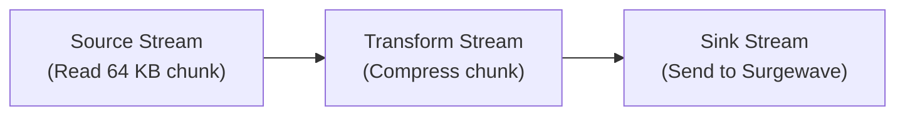

# Lesson 17.5: Streaming Large Data

> **Difficulty:** Advanced | **Duration:** 35 min | **Prerequisites:** Lesson 17.4

Learn how to stream large data efficiently with backpressure handling and memory-efficient processing.

## Learning Objectives

After completing this lesson, you will be able to:

- [ ] Implement streaming uploads for large data
- [ ] Handle backpressure in data pipelines
- [ ] Process data in a memory-efficient manner
- [ ] Use async streams for large data transfer

## Prerequisites

- .NET 10 SDK installed
- Completed Lesson 17.4: Claim-Check Pattern
- Understanding of async/await and IAsyncEnumerable

## Duration

~35 minutes

## What You'll Build

A streaming system that:
1. Streams large data in manageable chunks
2. Applies backpressure when consumer is slow
3. Processes data without loading entirely in memory
4. Tracks progress and throughput

## Key Concepts

### Streaming vs Buffering

| Approach | Memory Usage | Behavior |
|----------|-------------|---------|
| **Buffering (Traditional)** | 100 MB RAM — entire file loaded at once | Source → 100 MB Buffer → Write to Surgewave; problem: entire file must fit in memory |
| **Streaming (Efficient)** | ~64 KB at any time | Source → 64 KB chunk → Write to Surgewave (repeated); benefit: only small buffer in memory at any time |

### Backpressure Handling

| Mode | Producer | Queue | Consumer | Result |
|------|----------|-------|----------|--------|
| **Without Backpressure** | 1000 msg/s | Unbounded — grows until OUT OF MEMORY | 10 msg/s | Memory exhaustion |
| **With Backpressure** | Slowed to 10 msg/s (waits when queue full) | Bounded (max 3) | 10 msg/s | Stable, memory safe |

### Async Streaming in C#

```csharp
// Producer: Yields chunks as they're generated
async IAsyncEnumerable<byte[]> StreamDataAsync(Stream source)
{
    var buffer = new byte[64 * 1024]; // 64 KB chunks
    int bytesRead;

    while ((bytesRead = await source.ReadAsync(buffer)) > 0)
    {
        var chunk = new byte[bytesRead];
        Array.Copy(buffer, chunk, bytesRead);
        yield return chunk;  // Yield one chunk at a time
    }
}

// Consumer: Processes chunks as they arrive
await foreach (var chunk in StreamDataAsync(fileStream))
{
    await ProcessChunkAsync(chunk);
    // Memory is freed after each iteration!
}
```

### Memory-Efficient Pipeline



Memory at any point: ~64 KB (not the entire file).

### Progress Tracking

> **Progress Reporter** — Streaming 100 MB file...
>
> `[====================                    ] 50%`
> Transferred: 50 MB / 100 MB | Speed: 25 MB/s | ETA: 2 seconds

## Exercise

### Step 1: Navigate to the Start Folder

```bash
cd bootcamp/unit-17/lesson-5/start
```

### Step 2: Open the Project

Open `Program.cs` in your editor. You'll see placeholder code with `// TODO` comments.

### Step 3: Follow the Instructions

Open [INSTRUCTIONS.md](INSTRUCTIONS.md) for detailed step-by-step guidance.

### Step 4: Run Your Solution

```bash
dotnet run
```

### Expected Output

```
Streaming Large Data Demo
=========================

Broker started on port 54321

Creating test data source (50 MB)...

Starting streaming upload...
  Chunk size: 65,536 bytes (64 KB)
  Backpressure threshold: 10 pending chunks

Progress:
  [====                                    ] 10% (5 MB / 50 MB) - 45 MB/s
  [========                                ] 20% (10 MB / 50 MB) - 48 MB/s
  [============                            ] 30% (15 MB / 50 MB) - 47 MB/s
  [================                        ] 40% (20 MB / 50 MB) - 46 MB/s
  [====================                    ] 50% (25 MB / 50 MB) - 47 MB/s
  [========================                ] 60% (30 MB / 50 MB) - 46 MB/s
  [============================            ] 70% (35 MB / 50 MB) - 47 MB/s
  [================================        ] 80% (40 MB / 50 MB) - 48 MB/s
  [====================================    ] 90% (45 MB / 50 MB) - 47 MB/s
  [========================================] 100% (50 MB / 50 MB) - 47 MB/s

Upload complete!
  Total chunks: 800
  Total bytes: 52,428,800
  Duration: 1.12 seconds
  Throughput: 47.2 MB/s

Starting streaming download...

Download complete!
  Received chunks: 800
  Received bytes: 52,428,800
  Data integrity: VERIFIED

Demo completed!
```

## Checkpoints

Verify your solution:

- [ ] Data streams in chunks without loading entirely
- [ ] Backpressure slows producer when needed
- [ ] Progress shows during streaming
- [ ] Memory usage stays low throughout
- [ ] Data integrity is verified

## Troubleshooting

### "Out of memory during streaming"

Ensure you're not buffering all chunks:

```csharp
// Wrong - buffers all chunks in memory
var allChunks = await streamSource.ToListAsync();

// Right - process one at a time
await foreach (var chunk in streamSource)
{
    await ProcessAsync(chunk);
}
```

### "Backpressure not working"

Use a bounded channel for backpressure:

```csharp
var channel = Channel.CreateBounded<byte[]>(new BoundedChannelOptions(10)
{
    FullMode = BoundedChannelFullMode.Wait
});
```

### "Progress not updating"

Report progress periodically, not for every chunk:

```csharp
if (chunksProcessed % 100 == 0 || isLastChunk)
{
    ReportProgress(processed, total);
}
```

## Summary

In this lesson, you learned:

- How to stream large data without loading entirely in memory
- How to implement backpressure to prevent memory overflow
- How to use async streams (IAsyncEnumerable) in C#
- How to track progress and throughput
- How to verify data integrity in streaming scenarios

## Congratulations!

You have completed Unit 17: Large Message Handling! You now understand:

- Message size limits and configuration
- Compression to reduce message size
- Chunking for oversized messages
- Claim-check pattern for external storage
- Streaming for memory-efficient data transfer

---

**Stuck?** Check the [completed/](completed/README.md) solution for reference.
