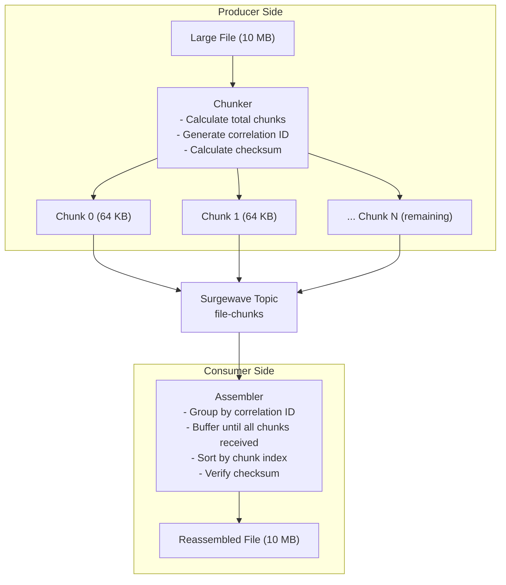

# Unit 17 Project: File Processor - Large File Chunking

Build a file processing system that chunks large files for transmission and reassembles them on the consumer side.

## Scenario

You're building a file transfer system using Surgewave. Large files must be:
1. Split into manageable chunks (max 64KB per message)
2. Transmitted with ordering guarantees
3. Reassembled on the consumer side
4. Verified for integrity using checksums
5. Support concurrent file transfers

## Requirements

### Functional Requirements

- [ ] Split files larger than chunk size into multiple messages
- [ ] Include chunk metadata (index, total, checksum)
- [ ] Reassemble chunks in correct order on consumer
- [ ] Verify file integrity using checksums
- [ ] Handle out-of-order chunk arrival

### Technical Requirements

- [ ] Use correlation ID to group chunks of the same file
- [ ] Implement chunking with configurable chunk size
- [ ] Calculate and verify MD5/SHA256 checksums
- [ ] Handle concurrent file transfers (multiple files in flight)
- [ ] Track transfer progress and statistics

## Architecture



## Expected Output

```
=== File Processor - Chunking System ===

[Config] Chunk size: 64 KB
[Config] Topic: file-chunks

[File 1] Processing: report.pdf (2.5 MB)
[Chunker] Splitting into 40 chunks...
[Producer] Chunk 0/40 -> file-chunks (correlation: abc123)
[Producer] Chunk 1/40 -> file-chunks (correlation: abc123)
...
[Producer] Chunk 39/40 -> file-chunks (correlation: abc123)
[Producer] File report.pdf: 40 chunks sent (checksum: a1b2c3d4)

[File 2] Processing: image.png (512 KB)
[Chunker] Splitting into 8 chunks...
[Producer] Chunk 0/8 -> file-chunks (correlation: def456)
...
[Producer] Chunk 7/8 -> file-chunks (correlation: def456)
[Producer] File image.png: 8 chunks sent (checksum: e5f6g7h8)

[Consumer] Starting chunk assembly...
[Assembler] Received chunk 0/40 (correlation: abc123)
[Assembler] Received chunk 2/40 (correlation: abc123) [out of order]
[Assembler] Received chunk 1/40 (correlation: abc123)
...
[Assembler] File abc123: 40/40 chunks received
[Assembler] Verifying checksum...
[Assembler] File report.pdf reassembled successfully (checksum: VALID)

[Assembler] File def456: 8/8 chunks received
[Assembler] File image.png reassembled successfully (checksum: VALID)

[Stats] Transfer Summary:
  - Files processed: 2
  - Total chunks: 48
  - Total bytes: 3,012,608
  - Out-of-order chunks: 3
  - Checksum failures: 0

=== File Processor Complete ===
```

## Chunk Message Format

```csharp
public record ChunkHeader(
    string CorrelationId,      // Groups chunks of the same file
    string FileName,           // Original file name
    int ChunkIndex,            // 0-based index of this chunk
    int TotalChunks,           // Total number of chunks
    long TotalSize,            // Original file size in bytes
    string Checksum            // SHA256 of complete file
);

public record ChunkMessage(
    ChunkHeader Header,
    byte[] Data                // Chunk payload
);
```

## Getting Started

```bash
cd bootcamp/unit-17/project/start
dotnet run
```

## Hints

1. Use `Guid.NewGuid().ToString("N")` for correlation IDs
2. Calculate chunk count: `(int)Math.Ceiling(fileSize / (double)chunkSize)`
3. Use `MemoryStream` and `BinaryReader/Writer` for efficient chunking
4. Store pending chunks in `Dictionary<string, List<ChunkMessage>>`
5. Use SHA256 for checksums: `System.Security.Cryptography.SHA256`

## Evaluation Criteria

| Criteria | Points |
|----------|--------|
| Files split into correct chunks | 20 |
| Chunks include proper metadata | 20 |
| Reassembly handles out-of-order | 25 |
| Checksum verification works | 20 |
| Multiple concurrent files supported | 15 |

## Solution

Compare your implementation with [completed/](completed/README.md) when done.
