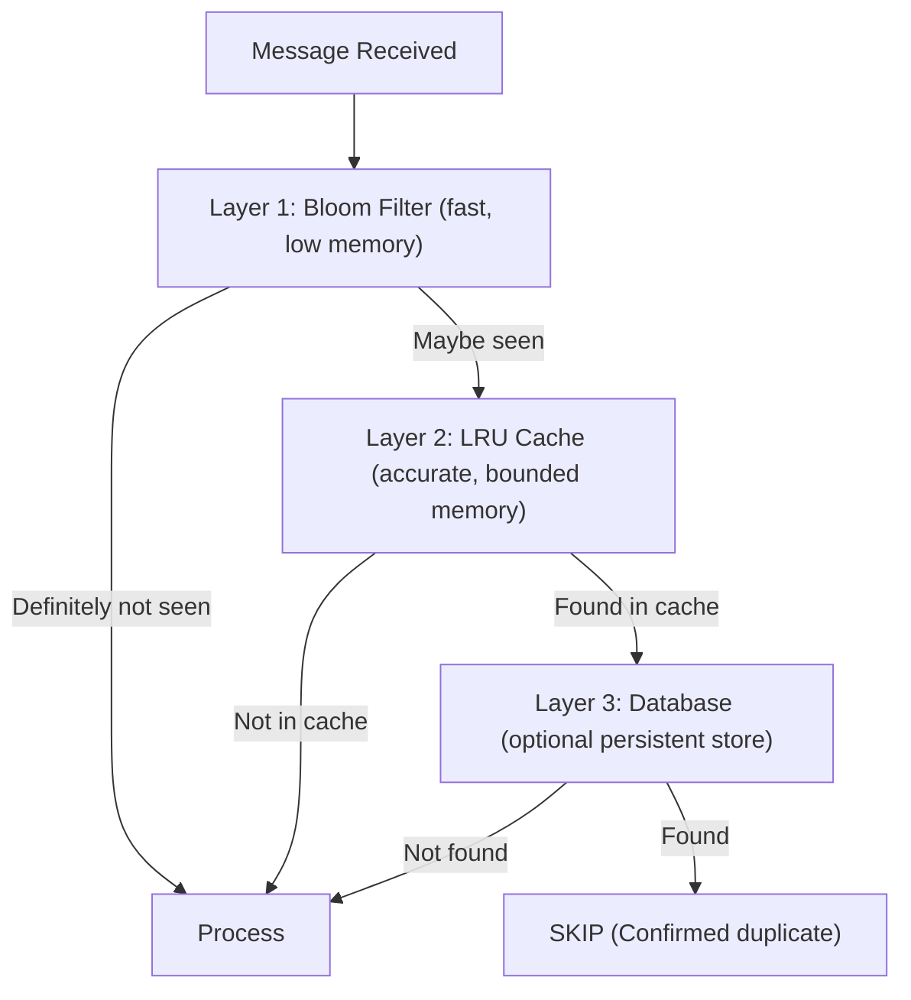

# Unit 31: Message Deduplication

Master idempotent consumer patterns and deduplication strategies in Surgewave to build robust message processing applications that handle duplicate messages gracefully and achieve exactly-once processing semantics.

## Learning Objectives

By the end of this unit, you will be able to:

- Understand why message duplicates occur in distributed systems
- Implement in-memory deduplication with LRU caches and Bloom filters
- Build persistent deduplication stores with checkpointing
- Design idempotent operations that are safe to repeat
- Achieve end-to-end exactly-once semantics with outbox and saga patterns

## Lessons

| Lesson | Topic | Description |
|--------|-------|-------------|
| [21.1](lesson-1/README.md) | Deduplication Concepts | Why duplicates occur, idempotency keys, delivery semantics |
| [21.2](lesson-2/README.md) | In-Memory Deduplication | LRU cache, Bloom filters, time-based expiry |
| [21.3](lesson-3/README.md) | Persistent Deduplication | Database-backed stores, compacted topics, checkpointing |
| [21.4](lesson-4/README.md) | Idempotent Operations | Database upserts, atomic operations, idempotency tokens |
| [21.5](lesson-5/README.md) | End-to-End Exactly-Once | Transactional patterns, outbox pattern, saga coordination |

## Prerequisites

- Completed Unit 1: Surgewave Fundamentals
- Completed Unit 2: Producer & Consumer Basics
- Understanding of consumer groups and offsets

## Why Deduplication Matters

| Semantic | Offset Commit | Duplicates | Data Loss | Best For |
|----------|--------------|------------|-----------|----------|
| At-Most-Once | BEFORE processing | Zero | Possible | Metrics, logs where loss is acceptable |
| At-Least-Once (Default) | AFTER processing | Possible | None | Most use cases (with idempotent handlers) |
| Exactly-Once | Transactional/atomic | None | None | Financial transactions, critical data |

## Deduplication Architecture Overview



## Why Duplicates Occur

| Scenario | Cause | Result |
|----------|-------|--------|
| Producer retry | Network timeout after send | Message sent twice |
| Consumer crash | Crash after process, before commit | Message redelivered |
| Rebalance | Consumer group rebalance mid-batch | Messages reprocessed |
| Network partition | Split-brain during failover | Duplicate writes |
| Exactly-once failure | Transaction abort and retry | Duplicate attempts |

## Key Patterns

### Idempotency Key Design

```csharp
// Natural key from business identifier
var naturalKey = $"order:{orderId}:{action}";

// Composite key with timestamp window
var compositeKey = $"{service}:{entity}:{action}:{timestamp:yyyy-MM-dd-HH}";

// Hash-based key from content
using var sha = SHA256.Create();
var hash = sha.ComputeHash(Encoding.UTF8.GetBytes(messageContent));
var hashKey = Convert.ToHexString(hash)[..32];
```

### Simple Deduplication

```csharp
var processedKeys = new HashSet<string>();

bool IsDuplicate(string key) => processedKeys.Contains(key);
bool TryMarkProcessed(string key) => processedKeys.Add(key);

// During message processing
if (IsDuplicate(message.IdempotencyKey))
{
    Console.WriteLine("Duplicate detected, skipping");
    return;
}

ProcessMessage(message);
TryMarkProcessed(message.IdempotencyKey);
```

### Idempotent Operations

```csharp
// Non-idempotent (dangerous to repeat)
balance += 100;  // Increments each time!

// Idempotent (safe to repeat)
balance = expectedBalance;  // Same result every time

// Database upsert (idempotent)
// INSERT ... ON CONFLICT (id) DO UPDATE
```

## Deduplication Strategies Comparison

| Strategy | Memory | Durability | Speed | Use Case |
|----------|--------|------------|-------|----------|
| HashSet | High | None | O(1) | Development/testing |
| LRU Cache | Bounded | None | O(1) | Recent duplicates |
| Bloom Filter | Very Low | None | O(k) | Pre-filtering |
| Time-Based | Medium | None | O(1) | Short dedup windows |
| File-Based | Low | High | O(1) | Single node persistence |
| Database | Low | High | O(log n) | Production systems |
| Compacted Topic | Low | High | O(1) | Distributed state |

## Best Practices

| Practice | Description |
|----------|-------------|
| Include idempotency key in message | Don't rely on offset alone |
| Check for duplicate BEFORE processing | Fail fast on duplicates |
| Use atomic operations | Combine check-and-process |
| Set TTL on dedup stores | Prevent unbounded growth |
| Log duplicate detections | Monitor for excessive retries |
| Test with duplicates | Verify idempotent behavior |

---

**Ready?** [Start Lesson 21.1: Deduplication Concepts](lesson-1/README.md)
