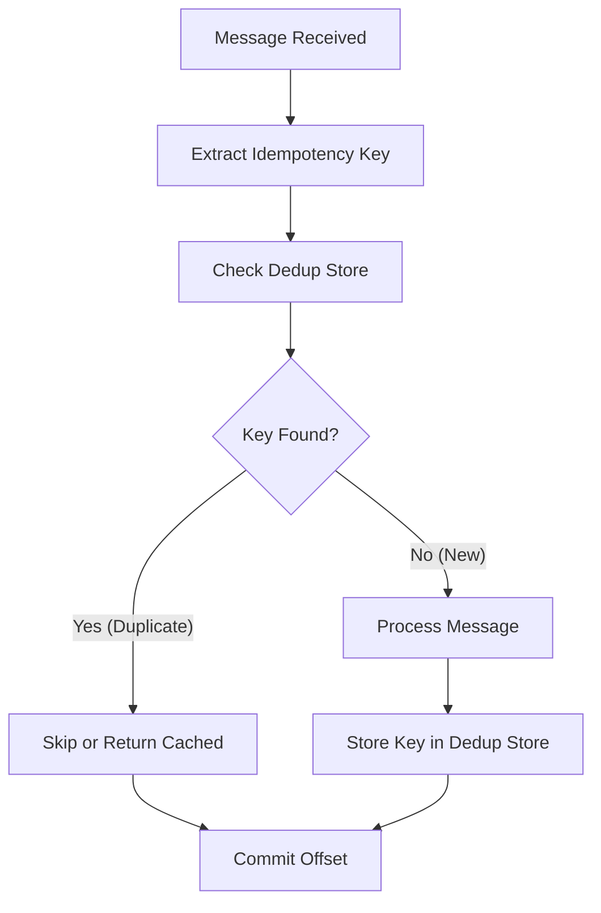

# Lesson 21.1: Deduplication Concepts

> **Difficulty:** Advanced | **Duration:** 30 min | **Prerequisites:** Unit 20 completion

## Overview

Learn the fundamental concepts of message deduplication in distributed systems, why duplicates occur, and how to design idempotent consumers that can safely process the same message multiple times.

## Learning Objectives

- Understand why message duplicates occur in distributed systems
- Learn about idempotency keys and their design
- Explore exactly-once, at-least-once, and at-most-once delivery semantics
- Implement basic deduplication detection
- Design idempotent message handlers

## Why Duplicates Occur

Message duplicates are a natural consequence of distributed systems guarantees:

| Scenario | Cause | Result |
|----------|-------|--------|
| Producer retry | Network timeout after send | Message sent twice |
| Consumer crash | Crash after process, before commit | Message redelivered |
| Rebalance | Consumer group rebalance mid-batch | Messages reprocessed |
| Network partition | Split-brain during failover | Duplicate writes |
| Exactly-once failure | Transaction abort and retry | Duplicate attempts |

## Delivery Semantics

| Semantic | Offset Commit | Duplicates | Data Loss | Best For |
|----------|--------------|------------|-----------|----------|
| **At-Most-Once** | Before processing | Zero | Possible | Metrics, logs where loss is acceptable |
| **At-Least-Once** (Default) | After processing | Possible | None | Most use cases (with idempotent handlers) |
| **Exactly-Once** | Atomic/transactional | None | None | Financial transactions, critical data |

## Idempotency Key Design

| Strategy | Format / Example | Pros | Cons |
|----------|-----------------|------|------|
| **Natural Keys** (preferred) | `ORD-2024-001234`, `PAY-abc123-xyz789`, `evt_1234567890` | Business meaning, easy to debug | Must ensure uniqueness in source system |
| **Composite Keys** | `{source}:{entity}:{action}:{timestamp}` e.g. `payment-svc:order-123:charge:2024-01-15T10:30:00Z` | Unique across services and time | Longer storage, complex parsing |
| **UUID-Based Keys** | `Guid.NewGuid()` or UUIDv7 e.g. `550e8400-e29b-41d4-a716-446655440000` | Guaranteed unique, no coordination | No business meaning, harder to debug |
| **Hash-Based Keys** | `SHA256(message content)` e.g. `a3f2b8c9d4e5f6a7b8c9d0e1f2a3b4c5` | Content-addressable, detects duplicate content | Hash collisions (rare), expensive to compute |

## Deduplication Flow

## Idempotent Operations

| Type | Examples |
|------|---------|
| **Idempotent** (safe to repeat) | `SET balance = 100` (same result every time); `DELETE FROM orders WHERE id = 123`; `UPSERT (INSERT … ON CONFLICT UPDATE)`; `PUT /api/orders/123` (replace entire resource) |
| **Non-Idempotent** (dangerous to repeat) | `SET balance = balance + 100` (increments each time!); `INSERT INTO orders (…)` (creates duplicates!); `POST /api/orders` (creates multiple resources!); `SendEmail(…)` (sends multiple emails!) |
| **Conversion** (non-idempotent → idempotent) | `balance += 100` → `SET balance = 100 WHERE version = 5`; `INSERT` → `INSERT … ON CONFLICT DO NOTHING`; `SendEmail` → check `sent_emails` table first |

## Best Practices

| Practice | Description |
|----------|-------------|
| Include idempotency key in message | Don't rely on offset alone |
| Store key BEFORE processing | Prevent race conditions |
| Use atomic operations | Combine check-and-process |
| Set TTL on dedup store | Prevent unbounded growth |
| Log duplicates | Track for monitoring/debugging |

## Exercise

In this exercise, you will:

1. Create messages with idempotency keys
2. Implement a basic deduplication checker
3. Detect and handle duplicate messages
4. Track deduplication statistics
5. Simulate scenarios that cause duplicates

---

**Instructions:** [INSTRUCTIONS.md](INSTRUCTIONS.md)
