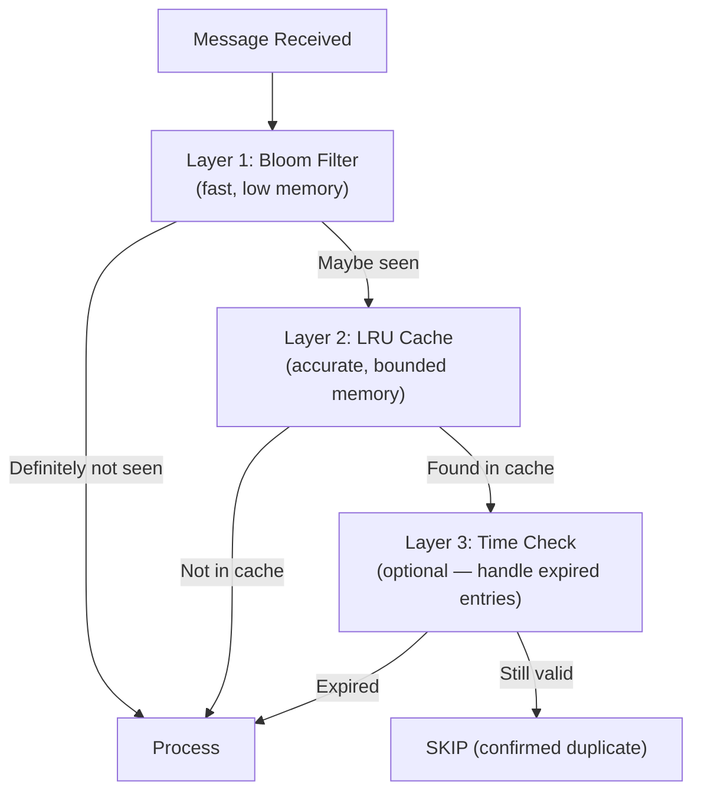

# Lesson 21.2: In-Memory Deduplication

> **Difficulty:** Advanced | **Duration:** 35 min | **Prerequisites:** Lesson 21.1

## Overview

Learn how to implement efficient in-memory deduplication using LRU caches, Bloom filters, and time-based expiry strategies. These techniques provide fast duplicate detection while managing memory constraints.

## Learning Objectives

- Implement LRU (Least Recently Used) cache for bounded deduplication
- Use Bloom filters for probabilistic duplicate detection
- Apply time-based expiry to prevent unbounded memory growth
- Combine multiple strategies for optimal performance
- Monitor memory usage and cache effectiveness

## LRU Cache Architecture

LRU Cache (capacity: 10,000 keys): `[key-9999 (MRU)] … [key-0001 (LRU → evicted when full)]`

New access moves a key to the front (MRU). When full, the tail entry is evicted.

| Operation | Complexity | Implementation |
|-----------|-----------|----------------|
| Check | O(1) | Dictionary lookup |
| Add | O(1) | LinkedList prepend |
| Evict | O(1) | LinkedList tail removal |

## Bloom Filter for Fast Pre-Check

Bit array with m = 1,000,000 bits and k = 3 hash functions:

- **Insert** `"order:123"`: compute `hash1`, `hash2`, `hash3` → set bits at positions 5, 12, 27 to 1
- **Check** `"order:123"`: if ALL bits at 5, 12, 27 are 1 → **MAYBE duplicate**; if ANY bit is 0 → **DEFINITELY not duplicate**

| Property | Value |
|----------|-------|
| False Positive Rate | ~1% (tunable via m and k) |
| False Negatives | Never (guaranteed) |

## Time-Based Expiry Strategy

Time window: 1 hour. At `Now = 11:30`, the dedup store contains:

| Key | Stored At | Status |
|-----|-----------|--------|
| order:001 | 10:35 | EXPIRED — will be removed |
| order:002 | 10:50 | Still valid |
| order:003 | 11:10 | Still valid |
| order:004 | 11:25 | Still valid |

**Cleanup strategy options:**
1. Lazy: check expiry on access
2. Background: timer-based cleanup every N minutes
3. Sliding: use `SortedSet` ordered by timestamp

## Combined Strategy

## Memory Considerations

| Strategy | Memory per Key | 1M Keys | Lookup Time |
|----------|---------------|---------|-------------|
| HashSet | ~50 bytes | ~50 MB | O(1) |
| LRU Cache | ~70 bytes | ~70 MB | O(1) |
| Bloom Filter | ~1.2 bits | ~150 KB | O(k) |
| Time-Expiry Map | ~60 bytes | ~60 MB | O(1) |

## Best Practices

| Practice | Description |
|----------|-------------|
| Set capacity limits | Prevent OOM with bounded caches |
| Use Bloom filter pre-check | Reduce expensive lookups |
| Choose appropriate window | Match message retention period |
| Monitor hit rates | Track cache effectiveness |
| Handle restarts gracefully | Accept brief duplicate window |

## Exercise

In this exercise, you will:

1. Implement an LRU cache with configurable capacity
2. Add time-based expiry to cached entries
3. Create a Bloom filter for fast pre-checking
4. Build a multi-layer deduplication pipeline
5. Compare memory usage and performance

---

**Instructions:** [INSTRUCTIONS.md](INSTRUCTIONS.md)
